# 精简版验证操作手册 · 照着走一遍就能验完

**项目**：基于对话内容的行为异常检测和心理变化分析技术（中关村新域新质创新挑战赛，需求编号 7008111111）
**产品**：「言心」MindDialogue 精简版 —— 仅分析工作台的离线音视频分析闭环
**版本**：P0 脚本回放原型 · 手册编制日 2026-10-22 · 上游：`01_精简版调研报告.md`（招标原文逐字）、`02_精简版产品形态与功能划分.md`（28.01—28.08 覆盖矩阵、Q1—Q15）

> **这份手册解决什么**：给你一条可复现的操作路径，13 个用例、每个用例几步、每步点哪里、看到什么算对、对应招标哪一条。
> **手册里的"实测值"从哪来**：全部是 2026-10-22 用 `prototype-lite/scripts/testkit-shots.mjs` 在 dev server 上跑真实链路时服务端当场返回的数字，截图与逐条记录见 `验证手册截图/`（汇总 `验证手册截图/取证记录.md`，分用例记录见 `验证手册截图/取证记录/<用例>.md`）。你手动走同一条链路会看到同样的结构，但**会话号、时间戳、进度百分比会变**（进度取决于你拍的那一瞬间），这些不是判据。
> **判据是什么**：看"有没有、对不对、口径一致不一致"，不看数值大小。每个用例的"通过判据"就是打勾项。

---

## 一、前置条件

### 1.1 环境

| 项 | 要求 | 备注 |
|---|---|---|
| Node.js | ≥ 18（本机 v24.18.0 实测通过） | `node -v` |
| 浏览器 | Chrome / Edge（桌面版，需支持 `DataTransfer` 拖拽与 `video.duration` 本地读取） | Safari 未验 |
| 磁盘 | 原型 <100 MB，测试素材包 26 MB | — |
| 网络 | **不需要**：素材在本机浏览器内读元数据，不上传、不解码内容 | 这是产品口径的一部分 |
| ffmpeg | 可选，仅在你要自己复核素材规格时用（`ffprobe`） | 素材已随包提供 |

**Apple Silicon 已知坑**：`npm install` 后首次 `npm run dev` 可能报 `Cannot find module @rollup/rollup-darwin-arm64`。补装即可，不影响代码：

```bash
npm install --no-save @rollup/rollup-darwin-arm64@4.64.10
```

### 1.2 启动与自检

```bash
cd /Users/admin/Downloads/标书/精简版/prototype-lite
npm install
npm run dev        # http://127.0.0.1:5185 （固定端口，避开完整版 5175）
```

另开一个终端跑一次基线断言，确认引擎本身是好的再开始走用例：

```bash
cd /Users/admin/Downloads/标书/精简版/prototype-lite
npm run verify     # 49 条需求覆盖断言，含 21 条多信号源（F / F2 组）
```

- ☐ `npm run verify` 输出 49/49 通过
- ☐ 浏览器打开 http://127.0.0.1:5185 能看到席位登录页

> ⚠️ `npm run verify` 与本手册用例**共用同一个内存引擎，不要并发跑**，两套断言会互相污染出假失败。
> ⚠️ `verify` 收尾会把引擎恢复出厂状态。**跑完 verify 之后，任务台列表里只剩种子会话**，这是正常的，不是数据丢了。

### 1.3 席位与口令

| 席位 | 工号 | 角色 | 能做什么 | 用于哪些用例 |
|---|---|---|---|---|
| 研判席 | `W-02` | analyst | 建会话、登记素材、起批分析、看结果、起草报告、提交复核 | 全部 |
| 复核席 | `R-01` | reviewer | 审批（通过/驳回）、发布、导出发布件 | C1 第 12—15 步 |

口令统一 `1234`。**角色互斥在服务端校验**：分析师自己提交的报告，分析师席位点「通过」会被 403 拦下——这不是 bug，是职责分离（对应 28.04 结论可信度的制度设计）。

> **重要操作细节**：审批必须由**复核席登录后**在同一个浏览器会话里点，才生效。原因：服务端把"当前操作人"记在自己的 `state.viewer.person` 上，只有走登录页才会改它；在 URL 或 localStorage 里塞 `actor` 只影响界面显示，服务端仍认为你是分析师 → 403。手动验证时正常退出占席、改用 `R-01` 登录即可，不会遇到这个坑。

### 1.4 测试素材（13 份，全部随包）

目录：`prototype-lite/public/testkit/`，规格与用途见该目录下 `README.md`。下载后**拖进弹窗对应的登记框**即可，文件名不匹配会被服务端按类型归类。

| 编号 | 文件 | 类型 | 关键规格 | 用在 |
|---|---|---|---|---|
| V1 | `V1_谈话室正面_音视频_156s.mp4` | 主信号·视频 | h264 960×720 + aac，156.0s，3.1 MB | C1 / C3 / C4 / N3 / N4 / N9 |
| V2 | `V2_谈话室侧面_音视频_192s.mp4` | 主信号·视频 | h264 854×480，192.0s，3.3 MB | C4 / N3 |
| A1 | `A1_单对象询问_录音_156s.m4a` | 主信号·音频 | aac 96k，156.0s，1.9 MB | C2 / C4 / N3 / N5 |
| A2 | `A2_双人谈话_录音_192s.mp3` | 主信号·音频 | mp3 112k 44.1kHz，192.0s，2.7 MB | C4 / N3 |
| E1 | `E1_近红外_hbo_156s_1Hz.csv` | 扩展·近红外 | 逗号，1 Hz，157 行 | C3 / N9 |
| E2 | `E2_毫米波_resp_156s_1Hz.csv` | 扩展·毫米波 | 逗号，1 Hz，157 行 | C3 / N9 |
| E3 | `E3_近红外_hbo_156s_10Hz.csv` | 扩展·近红外 | 逗号，10 Hz，1561 行，首列带小数 | C5 |
| E4 | `E4_毫米波_resp_156s_25Hz.csv` | 扩展·毫米波 | 逗号，25 Hz，3901 行 | C5 |
| E5 | `E5_近红外_hbo_156s_2Hz.tsv` | 扩展·近红外 | **制表符**分隔，2 Hz | 附录（可替换 E1） |
| X1 | `X1_短素材边界件_音视频_40s.mp4` | 主信号·视频 | 40s < 脚本时间轴 152s | 附录 |
| X2 | `X2_边界_首列为物理量_无时间轴.csv` | 边界 | 首列是 HbO 浓度 | N5 |
| X3 | `X3_边界_超4MB采样序列.csv` | 边界 | 6.0 MB > 解析上限 4 MB | N5 |
| X4 | `X4_边界_JSON采样序列.json` | 边界 | JSON 结构 | N7 |

- ☐ 13 个文件齐全，`ls prototype-lite/public/testkit/` 数量对得上
- ☐ 音视频能在本机播放器正常打开（素材内容不影响判定，但打不开说明包损坏）

### 1.5 怎么拖素材（三种都行）

1. **拖拽**：从访达/资源管理器把文件拖到弹窗里对应的虚线框（主信号·视频 / 主信号·音频 / 扩展信号·近红外 / 扩展信号·毫米波）。
2. **点击选择**：点虚线框 → 系统文件选择器 → 选中文件。
3. **一次多选**：近红外与毫米波两个框都支持一次选多个文件（C3 就是一次选 E1+E2）。

拖进来后，弹窗下方会列出一行行的登记结果：`类型标签 + 文件名 + 大小 + 时长/行数`，以及一行**计数说明**：「主信号 N 份 / 扩展信号 M 份。」加一句封顶口径提示。**这一行就是本用例最主要的证据**，务必核对份数与口径文案。

---

## 二、用例总览

| 用例 | 验什么 | 素材 | 对应招标条目 | 对应指标 |
|---|---|---|---|---|
| **C1** | 音视频单路主链路：登记→起批→逐段进度→结果→三级归因→报告→审批→发布→导出 | V1 | 28.01 / 28.03 / 28.04 / 28.07 | Q8 Q9 Q10 Q11 Q12 |
| **C2** | 纯音频单模态：不可用模态显性标注为"不可用"而非 0 值 | A1 | 28.05 / 28.06 | Q8 Q11 |
| **C3** | 音视频 + 双扩展信号：三份全进分析、逐份切片、会话层融合成一份报告 | V1 + E1 + E2 | 28.01 / 28.05 / 28.06 | Q13 Q14 Q15 |
| **C4** | 四份主素材多文件：逐份切片互不覆盖、融合不重复计数 | V1 + V2 + A1 + A2 | 28.06 | Q13 Q14 |
| **C5** | 仅扩展信号：判定链整体裁撤并逐条给原因，不伪装成"检测正常" | E3 + E4 | 28.06 / 28.07 | Q11 Q15 |
| **N1** | 缺授权文书号 → 服务端 403 `CONSENT_REQUIRED`（R1 卡口） | V1 | 合规前置（docx §28 注记） | Q12 |
| **N2** | 未登记素材的会话不可起批 → 422 | 无 | 链路完整性 | — |
| **N3** | 分析进行中重复起批 → 409 `ANALYZING`，不产生第二份结果 | V1+V2+A1+A2 | 链路完整性 | Q13 |
| **N4** | 同一文件重复登记自动去重 | V1 ×2 | 登记准确性 | Q13 |
| **N5** | 时基读不出的采样序列：显示"时基未读出"，不猜 | X2 + X3 | 如实披露 | — |
| **N7** | JSON 采样序列本版不支持：同样显示"时基未读出" | X4 | 如实披露 | — |
| **N8** | 已归档会话只读，起批按钮禁用 + 服务端 409 | 种子会话 | 审计与留痕 | Q12 |
| **N9** | 扩展信号封顶口径在结果页 / CSV / 报告 / 导出件四处一致 | V1 + E1 + E2 | 28.01 开放面 / 28.07 | **Q15** |

> 用例编号 N6 本轮未设用例（预留位），编号不连续属正常。
> 表里各用例的**对象编号 / 场景 / 授权文书号**用的是实拍脚本 `testkit-shots.mjs` 里的值，与截图画面一一对应；你手动走时填什么都行，只要格式合法（这些字段不参与判定）。
> **素材才是判据**：请严格按表里"素材"列拖同一批文件，否则份数、段数、切片数对不上。

---

## 三、主用例（C1—C5）

### C1 · 音视频单路主链路（12 分钟，其余用例的基础）

**验什么**：一份 156s 谈话录像进来，能不能走完「登记 → 离线批分析 → 六类异常 → 三级归因 → 报告起草 → 复核审批 → 发布导出」这条闭环，并且每一环都有可核对的证据。这是 28.01 / 28.03 / 28.04 / 28.07 的正面实例。

| 步 | 操作 | 预期看到 | 实测值（2026-10-22） |
|---|---|---|---|
| 1 | 首页用 `W-02` / `1234` 登录 | 顶栏出现「分析师 W-02（分析师）· 研判席 2」，左侧只剩「任务台·素材分析」和「分析报告与审批」两个入口 | — |
| 2 | 任务台点「新建会话」，填对象编号 `M-T101`、场景 `验证 C1 · 音视频单路离线复盘 · 谈话室 03`、授权文书编号 `SQ-2026-T101`，把 **V1** 拖进「主信号·视频」 | 弹窗下方出现 V1 登记行（3.1 MB · 156s），计数行「主信号 1 份 / 扩展信号 0 份。未登记扩展信号：本次仅音视频主信号链。」 | 份数 1 · 时基未读出 0 |
| 3 | 点「创建」 | 任务台列表顶部新增一行，带「离线导入 · 1 份」标签，状态待开始 | 会话号 SES-20261022-N07 |
| 4 | 该行点「离线分析」 | 行内出现按素材逐段推进的进度条，状态转「离线分析中」，顶部统计卡「离线分析中」计数 +1 | 抓拍时 53%，当前段〔V1…〕语义通道：话题切分与四维影响值，**总段数 7**（视频 6 步 + 会话级融合 1 步） |
| 5 | 等进度走完，点「查看结果」 | 结果页标题「离线批分析结果 · <会话号>」，汇总行给出素材/切片/上报/裁撤/模态/报告号 | 素材 1 份 / 切片 1 片 / 上报 7 条（扩展 0）/ 裁撤 0 条 / 可用模态 6/6 / 报告 RP-2026-05 |
| 6 | 滚到「素材切片」 | 一张切片卡对应一份文件，列出该文件跑的解析链（视频 6 段）与六路模态勾选（语音·语义·表情·姿态·手部·生理全 ✓） | 切片数 == 登记数 == 1 |
| 7 | 滚到「异常事件」，点任意一行 | 抽屉展开三级：L1 观察层（可核对的时间窗与实测现象）→ L2 候选规则（规则号 + 文献字段）→ L3 结论层（含反事实与免责） | 展开事件 EV-007 |
| 8 | 滚到「话题切分与语义影响值」 | 表格有话题行、边界秒、标签、影响值、四维分解、边界判定依据 | 19 轮对话驱动的 4 个话题段 |
| 9 | 滚到「转写原文与分角色置信度」 | 逐轮转写 + 说话人色块 + 分角色置信度 | 共 19 轮 |
| 10 | 左侧切到「分析报告与审批」 | 列表首行是刚自动起草的报告，状态「起草中」，右侧步骤条停在 1 起草；正文六章齐全，含「精度受限」提示块 | RP-2026-05 |
| 11 | 点「导出 HTML 件」并打开 | 文件顶部有水印「草稿 · 未经复核审批」，含附表 A 素材切片一览 | 审计 seq=398 · encrypted=false |
| 12 | 退出占席，改用 `R-01` / `1234` 登录，回到报告页点「提交复核」 | 步骤条走到 3 审批，状态「待复核」，复核人列显示 复核人 R-01 | status=pending_review |
| 13 | 点「通过」，再点「发布」 | 状态「已发布」，发布列出现时间；四个流转按钮全部变灰（终态不可重放） | 发布时间 2026-10-22 11:24 |
| 14 | 再点「导出 HTML 件」 | 水印消失；含附表 A；正文含「离线导入 · 非实时」 | 水印=无 · 附表A=true · 非实时标注=true |
| 15 | 结果页点「导出 CSV（含裁撤条目）」 | 下载到的 CSV 行数与页面口径一致，表头含 `asset` 列 | **11 行** · `trend_only` 0 行 · 含 asset 列 |

**证据截图**

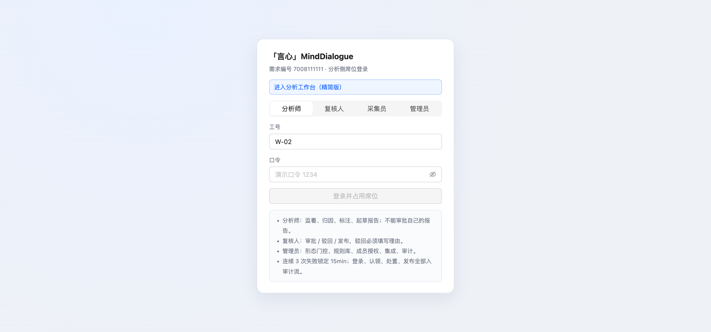

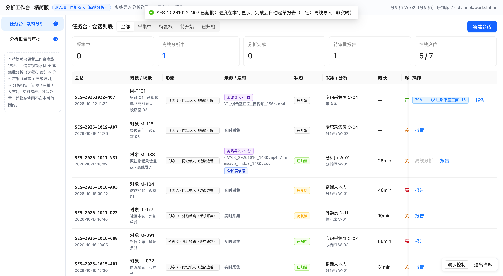
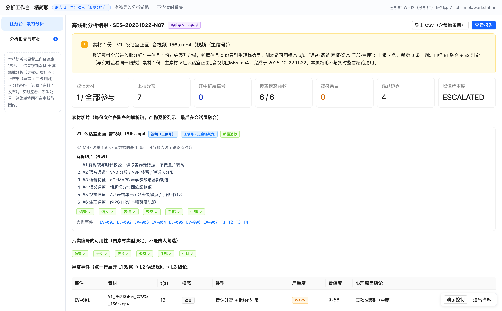
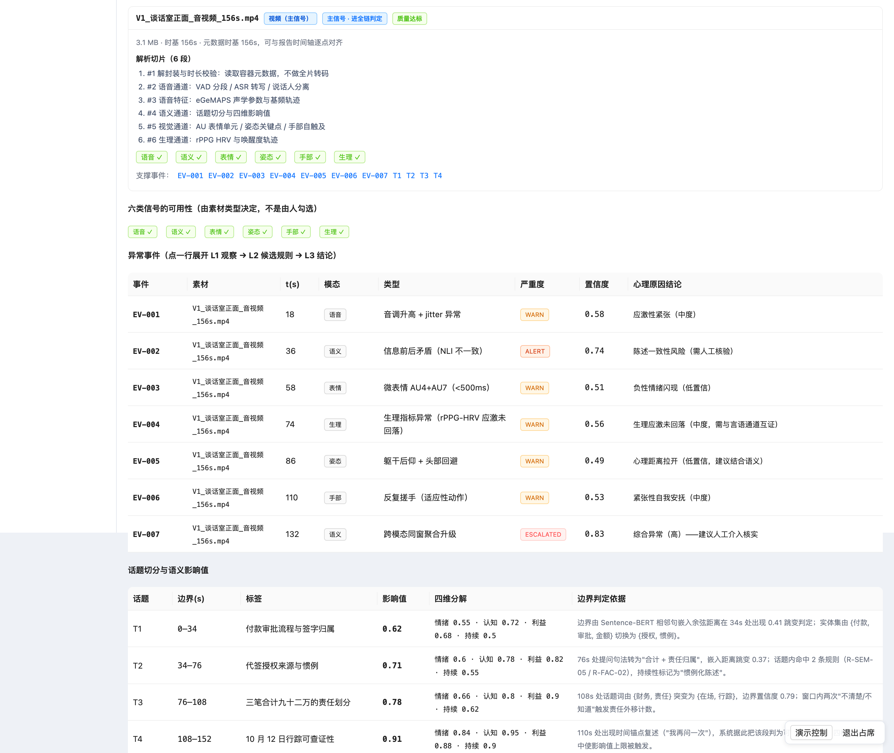
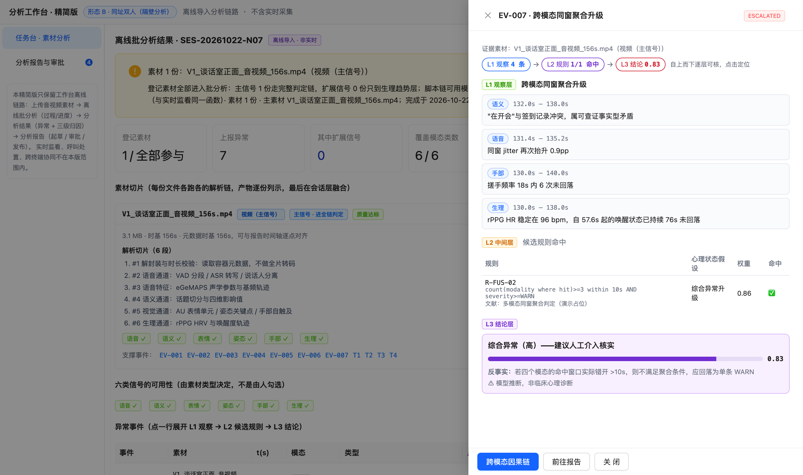
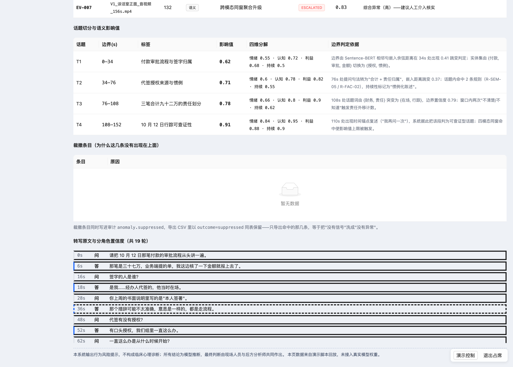
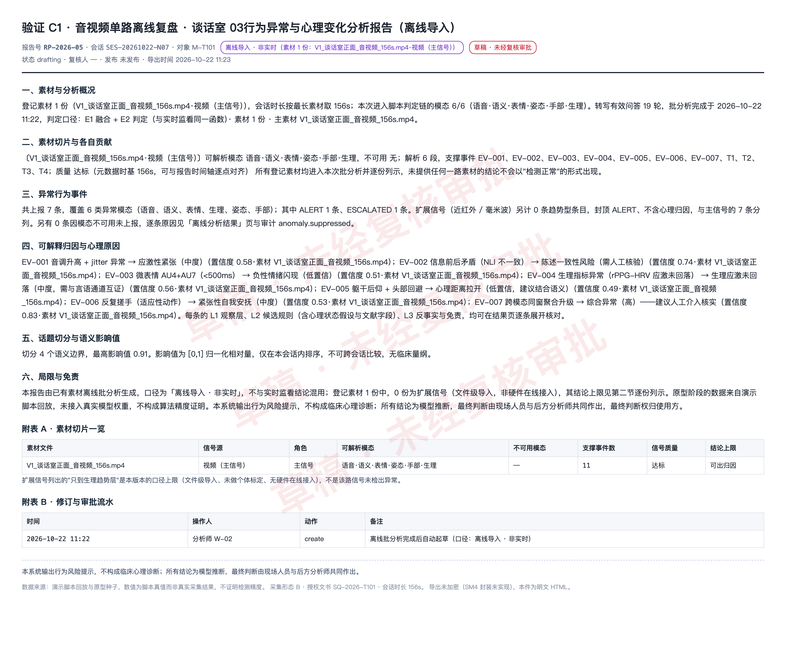
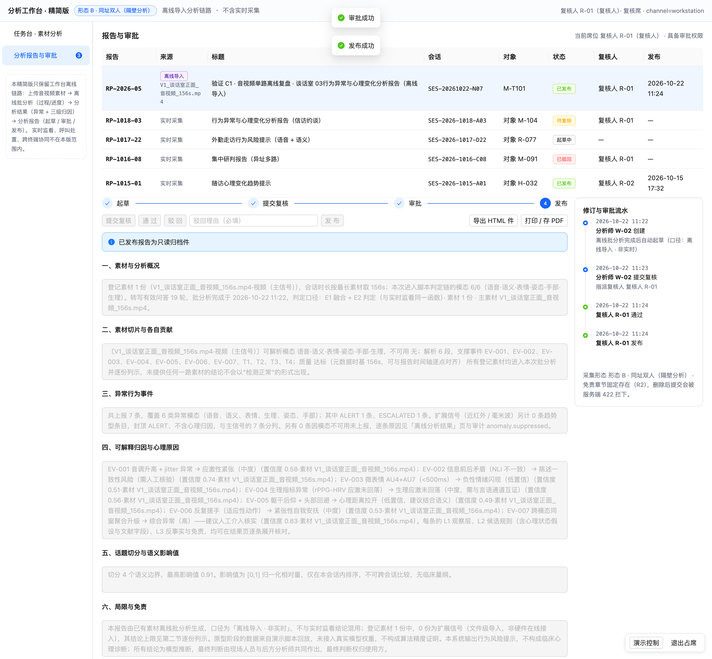
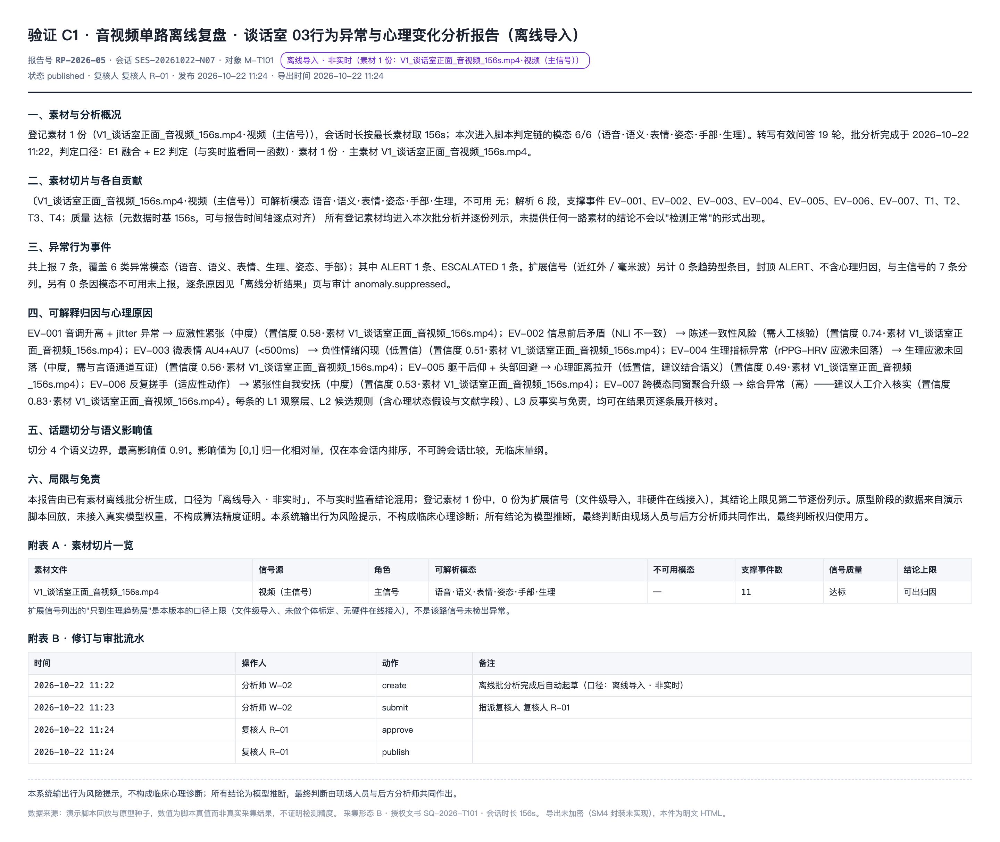

导出件本体（可直接用浏览器打开对照）：`验证手册截图/C1_导出_草稿未发布.html`、`验证手册截图/C1_导出_已发布.html`

**通过判据**

- ☐ 登记份数、切片份数、报告附表 A 的文件名三处一致（1 份 V1）
- ☐ 六类异常模态全部命中（语音/语义/表情/生理/姿态/手部），且至少 1 条 ESCALATED
- ☐ 任一异常展开后有 L1 观察层证据 + L2 文献字段 + L3 反事实与免责（缺一即不通过）
- ☐ 草稿件有水印、发布件无水印，两份都含附表 A
- ☐ 审批由复核席完成，且分析师席位下「通过」按钮点不动或返回 403
- ☐ 页面底部常驻免责行：「不构成临床心理诊断；所有结论为模型推断」

**对应招标**：28.01（对话为驱动、捕捉行为/生理异常并分析心理原因）、28.03（语音输入→语音与言语异常→心理原因）、28.04（六类异常全覆盖 + 归因）、28.07（异常类型清单）。
**对应指标**：Q8 六类覆盖、Q9 单素材分析时长、Q10 报告生成时长、Q11 可追溯率、Q12 审计完整率。

---

### C2 · 纯音频单模态（4 分钟）

**验什么**：只给录音，表情/姿态/手部/生理四路必须显示**不可用**，而不是给出 0 值或"正常"。这是 28.06「可单模态」最容易造假的地方。

| 步 | 操作 | 预期看到 | 实测值 |
|---|---|---|---|
| 1 | 新建会话 `M-T102` / 场景 `验证 C2 · 纯音频离线分析 · 谈话室 01` / 文书号 `SQ-2026-T102`，**只**把 A1 拖进「主信号·音频」 | 计数行「主信号 1 份 / 扩展信号 0 份」；音频框下方灰字说明「无画面帧，表情/姿态/手部/生理四路按不可用处理」 | 份数 1 |
| 2 | 创建 → 起批 | 总段数 **6**（音频 5 步 + 融合 1 步），比视频少一段视觉通道 | 抓拍 61%，当前段〔A1…〕语义通道 |
| 3 | 查看结果 → 汇总 | 可用模态 **2/6**；上报 2 条、**裁撤 5 条** | 素材 1 / 切片 1 / 上报 2 / 裁撤 5 |
| 4 | 「六类信号的可用性」 | 语音 ✓、语义 ✓，表情/姿态/手部/生理为 ✗ 且写明原因，**没有任何 0 值指标** | 2/6 |
| 5 | 「素材切片」 | 切片卡解析链 5 段，末段写明「#5 视觉与生理通道：素材无画面帧，四路按不可用处理（不产出 0 值）」 | 5 段 |
| 6 | 「裁撤条目」 | 5 条被裁撤项逐条给原因，不并入"检测正常" | 5 条 |

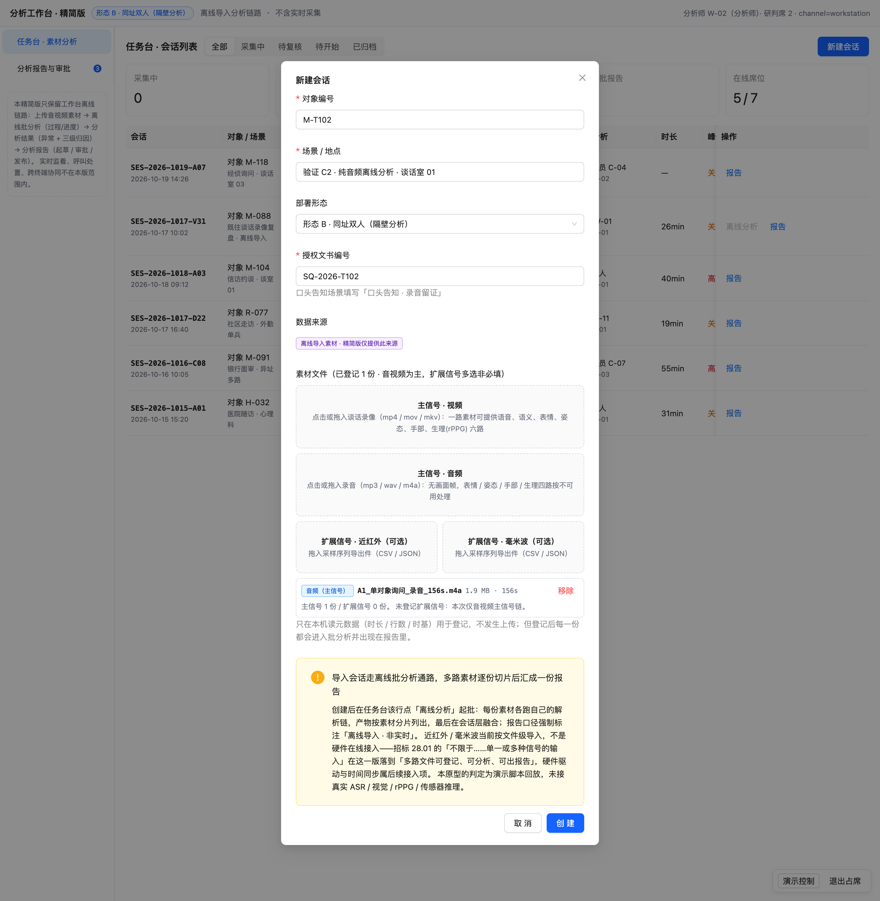
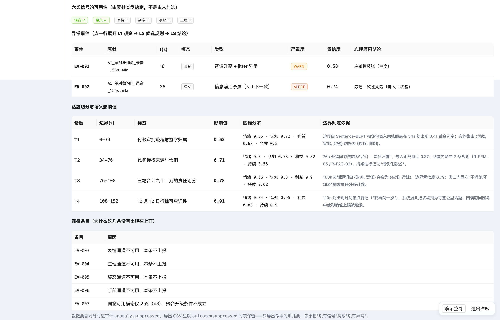
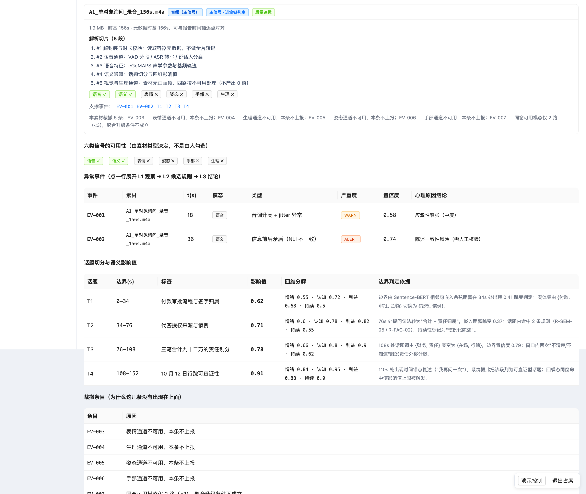

**通过判据**

- ☐ 可用模态显示 2/6，且四路不可用是"不可用"而不是 0 或"正常"
- ☐ 裁撤条目 5 条且每条有原因文字
- ☐ 报告「精度受限」块自动列出被降级模态

**对应招标**：28.05（语音模态输入）、28.06（单模态方法）。

---

### C3 · 音视频 + 双扩展信号（5 分钟）

**验什么**：28.01「不限于语音、视频、近红外、毫米波等单一或多种信号的输入」的多路实例——三份文件全部进入分析、各出一份切片，最后在会话层融合成**一份**报告。

| 步 | 操作 | 预期看到 | 实测值 |
|---|---|---|---|
| 1 | 新建会话 `M-T103`（场景 `验证 C3 · 多信号源融合 · 谈话室 03`、文书号 `SQ-2026-T103`），V1 拖进「主信号·视频」，E1 拖进「近红外」、E2 拖进「毫米波」 | 计数行「主信号 1 份 / 扩展信号 2 份」，并紧跟封顶口径：「本次含扩展信号：它们全部参与分析，但结论只到生理趋势层，不进升级、不出心理归因。」 | 份数 3 · 时基未读出 0 |
| 2 | 创建 → 起批 | 总段数 **15** = 视频 6 + 近红外 4 + 毫米波 4 + 融合 1 | 抓拍 25%，总段数 15 |
| 3 | 查看结果 → 汇总 | 素材 3 份 / 切片 **3** 片 / 上报 9 条（其中扩展 2 条）/ 裁撤 0 / 模态 6/6 | 与左列一致 |
| 4 | 「素材切片」 | 三张切片卡，扩展信号卡只有 4 段解析链、模态仅生理，且卡上带「结论上限」说明 | 3/3 份产出切片 |
| 5 | 「异常事件」 | 扩展信号事件行：严重度最高 ALERT（无 ESCALATED）、候选规则层为空、结论列显示「只到趋势层 · 不出归因」 | 2 条 |
| 6 | 「报告与审批」→ 打开草稿 | 第二章「素材切片与各自贡献」逐份列出三个文件名与其可解析/不可用模态；「精度受限」块列出扩展信号份数与封顶口径 | RP-2026-05 |

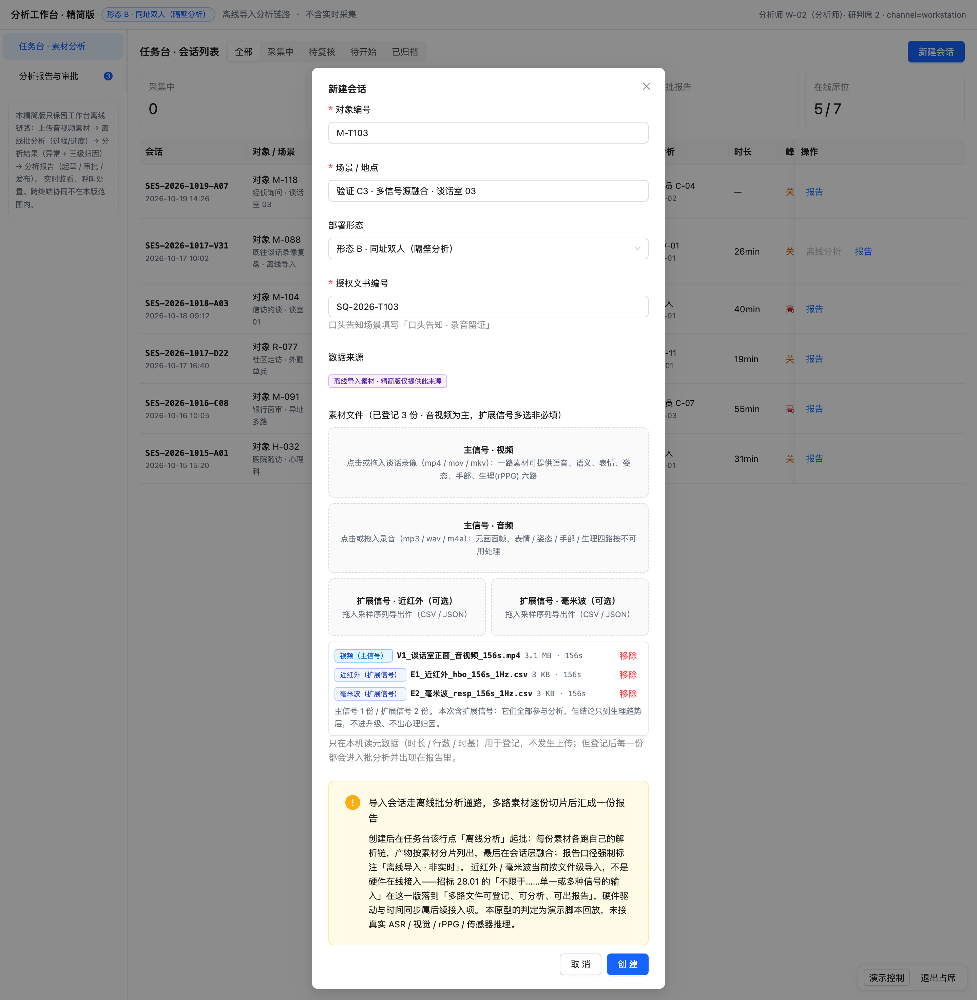
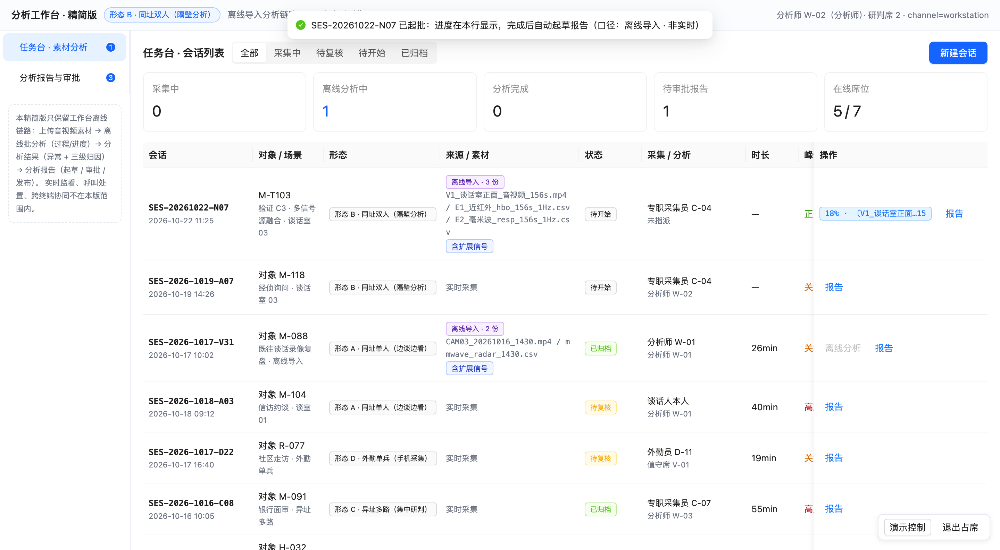
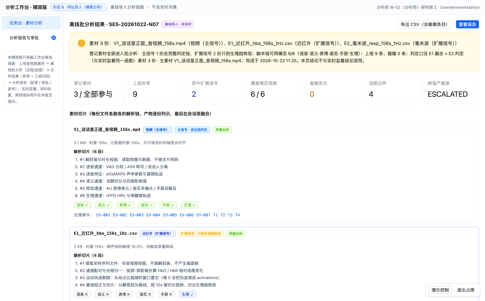
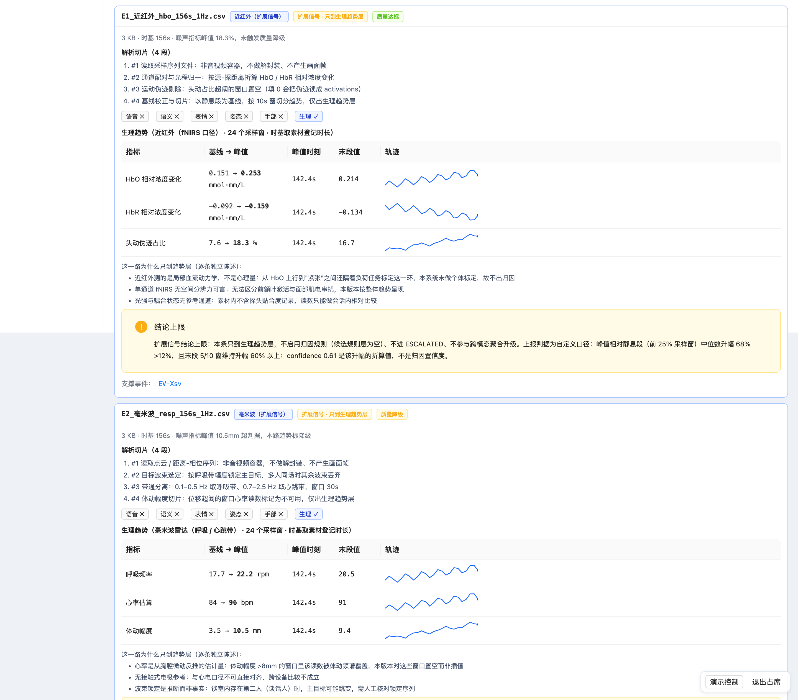
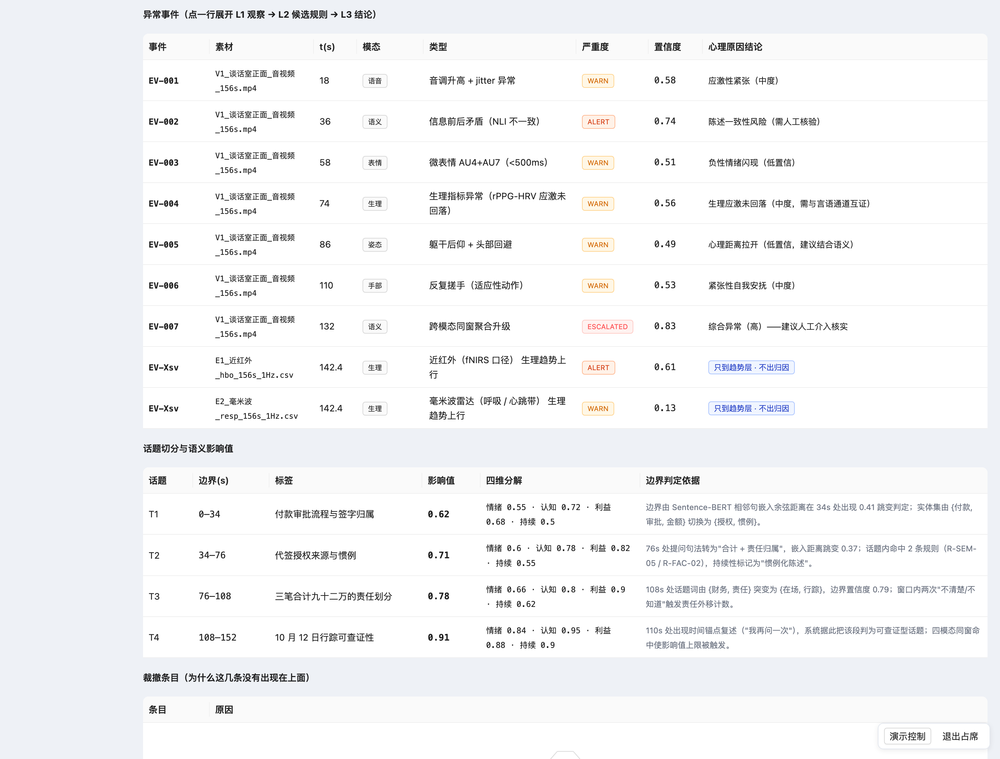

**通过判据**

- ☐ 登记 3 份 → 切片 3 片（**没有文件被静默跳过**，这是 Q13）
- ☐ 扩展信号事件 2 条，全部封顶在 ALERT、候选规则层为空
- ☐ 报告第二章逐份列出三个文件名，且「精度受限」块自动出现
- ☐ 上报 9 条 == 主信号 7 条 + 扩展 2 条，扩展条目单列不混入主链

**对应招标**：28.01（多信号输入）、28.05/28.06（多模态）。**对应指标**：Q13 素材级参与率、Q14 素材级可追溯率、Q15 封顶一致率。

---

### C4 · 四份主素材多文件（5 分钟）

**验什么**：同一类信号给多份文件（两路视频 + 两路音频，不同分辨率/容器/采样率），逐份切片互不覆盖，融合层不重复计数。

| 步 | 操作 | 预期看到 | 实测值 |
|---|---|---|---|
| 1 | 新建会话 `M-T104`（场景 `验证 C4 · 多路文件逐份切片 · 谈话室 03`、文书号 `SQ-2026-T104`），V1+V2 拖进「主信号·视频」，A1+A2 拖进「主信号·音频」 | 计数行「主信号 4 份 / 扩展信号 0 份」；四行登记各自读出时长（156s / 192s / 156s / 192s） | 份数 4 · 时基未读出 0 |
| 2 | 创建 → 起批 | 总段数 **23** = 6+6+5+5 + 融合 1 | 抓拍 16%，总段数 23 |
| 3 | 查看结果 → 汇总 | 素材 4 份 / 切片 **4** 片 / 上报 7 条（扩展 0）/ 裁撤 0 / 模态 6/6 | 与左列一致 |
| 4 | 「素材切片」 | 四张卡：V1、V2 各 6 段全模态 ✓；A1、A2 各 5 段且表情/姿态/手部/生理 ✗；每卡「支撑事件」列可点 | 4 张卡 |
| 5 | 对照上报条数 | 4 份素材都出切片，但会话层融合后**仍只上报 7 条**（同窗聚合，不重复计），这是融合语义正确的关键 | 7 条 |


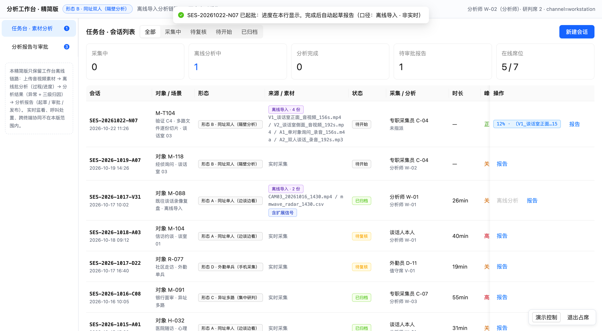
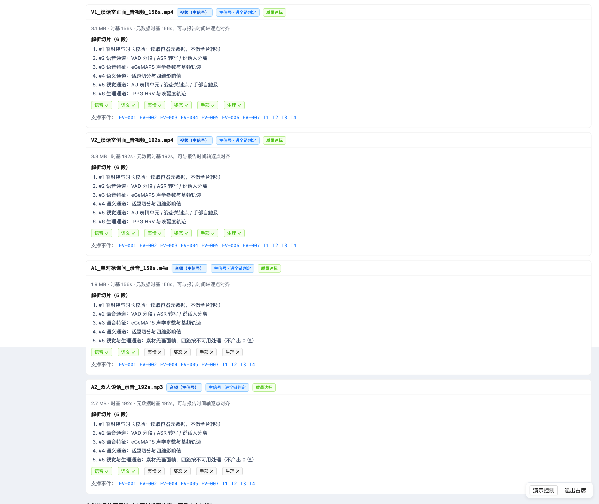

**通过判据**

- ☐ 4 份 → 4 张切片卡，文件名与登记顺序一致
- ☐ 音频卡的视觉/生理四路为 ✗，视频卡为 ✓
- ☐ 上报条数不因素材变多而翻倍（7 条，与 C1 同口径）
- ☐ 导出 CSV 每条告警的 `asset` 列能指回具体文件（Q14）

**对应招标**：28.06（多模态方法、逐素材切片 + 会话层融合）。**对应指标**：Q13、Q14。

---

### C5 · 仅扩展信号（4 分钟）

**验什么**：最容易出假象的一种输入——只给近红外和毫米波、没有音视频。正确做法是**整条脚本判定链裁撤并逐条说明原因**，而不是显示"未检出异常"。

| 步 | 操作 | 预期看到 | 实测值 |
|---|---|---|---|
| 1 | 新建会话 `M-T105`（场景 `验证 C5 · 无音视频仅扩展信号 · 谈话室 03`、文书号 `SQ-2026-T105`），E3 拖进「近红外」、E4 拖进「毫米波」，音视频两框留空 | 计数行「主信号 0 份 / 扩展信号 2 份」+ 封顶口径 | 份数 2 · 时基未读出 0 |
| 2 | 创建 → 起批 | 总段数 9 = 4+4+1，当前段文案是「基线校正与切片：以静息段为基线，按 10s 窗切分趋势，仅出生理趋势层」 | 抓拍 41% |
| 3 | 查看结果 → 汇总 | 素材 2 / 切片 2 / 上报 2 条（全部扩展）/ **裁撤 11 条** / 可用模态 **0/6** | 与左列一致 |
| 4 | 「话题切分与语义影响值」 | 空表 + 「暂无数据」，**不编造话题** | 空 |
| 5 | 「转写原文」 | 标题为「转写原文与分角色置信度（共 0 轮）」 | 0 轮 |
| 6 | 「裁撤条目」 | 11 条：T1—T4 原因「本会话只登记了扩展信号素材，没有音视频输入，语义通道不成链」；EV-001—EV-007 原因「本会话只登记了扩展信号素材，脚本判定链（音视频口径）没有输入」。下方一行说明裁撤条目同时写进审计 `anomaly.suppressed`，CSV 以 `outcome=suppressed` 同表保留 | 4 + 7 = 11 条 |

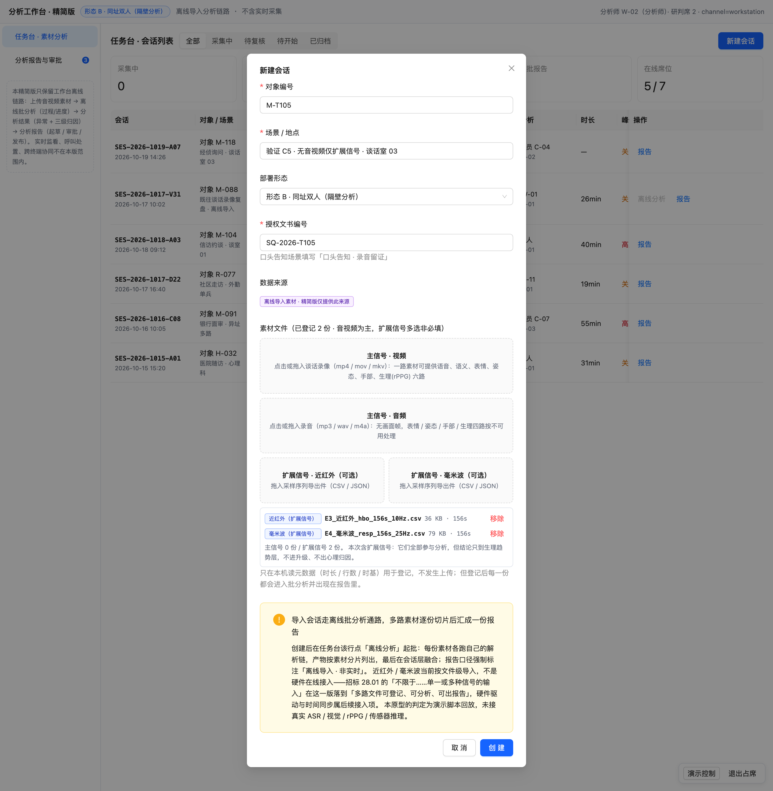
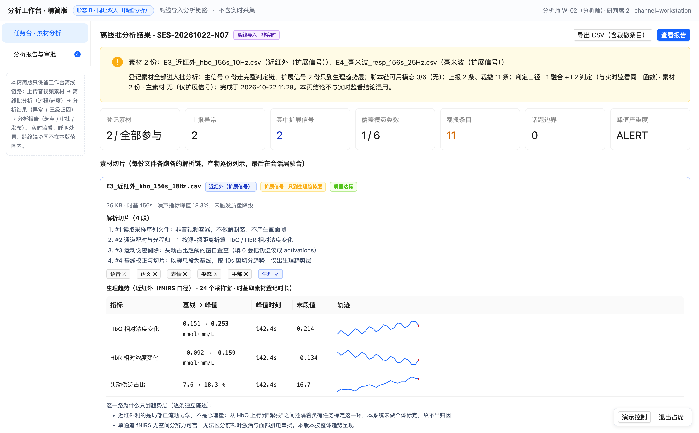
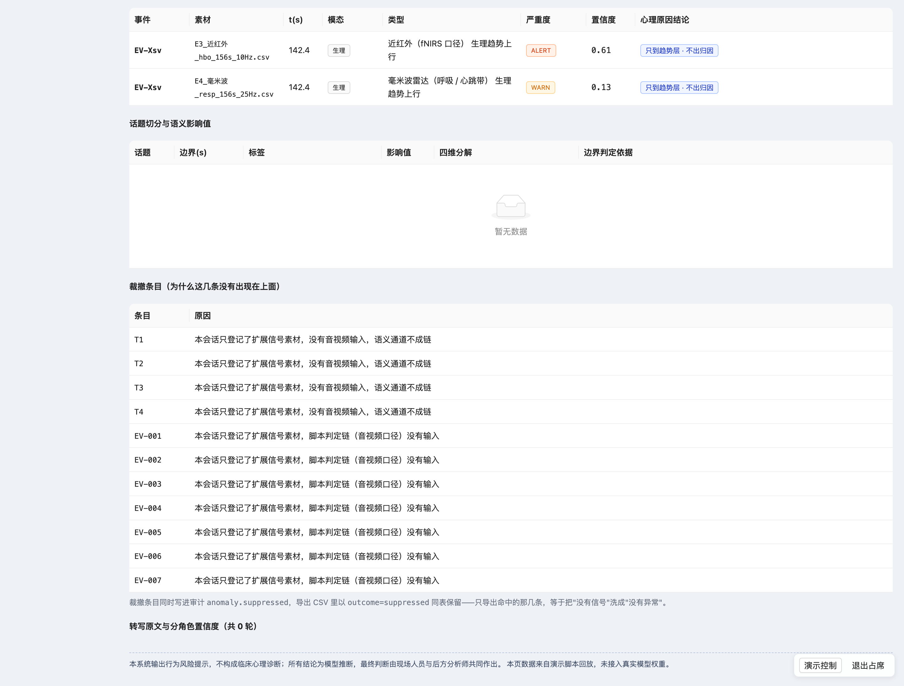

**通过判据**

- ☐ 可用模态 0/6，且页面上**没有**出现"检测正常/无异常"这类表述
- ☐ 裁撤 11 条与上报 2 条之和 == 脚本判定链条目总数（13），一条不丢
- ☐ 话题表与转写为空，不是 0 分或占位假数据
- ☐ 两条扩展事件仍是封顶 ALERT/WARN，不出归因

**对应招标**：28.06（方法裁剪）、28.07（异常类型口径诚实）。**对应指标**：Q11、Q15。

---

## 四、负向与边界用例（N1—N9）

这一组验的是"不该发生的事会不会被拦住"和"读不出来的东西会不会被猜出来"。招标原文没有量化门槛，评审时对这类卡口的追问通常最尖锐。

### N1 · 缺授权文书号 → 服务端 403（R1 卡口）

**操作**：新建会话 `M-N1`，场景 `验证 N1 · 不填授权文书号 · 谈话室 03`，**授权文书编号留空**，V1 拖进视频框，点「创建」。

**预期**：
1. 弹窗内该字段红字必填提示，前端不放行；
2. 即使绕过前端直接调 `POST /v1/sessions`（不带 `consent`），服务端返回 **HTTP 403**，`error=CONSENT_REQUIRED`，消息「缺少知情告知文书号，会话不可创建（R1）」；
3. 对照组：同一份素材补上文书号后创建 **HTTP 200**，返回会话号。

**实测**：403 `CONSENT_REQUIRED`；对照组 200 · SES-20261022-N08。

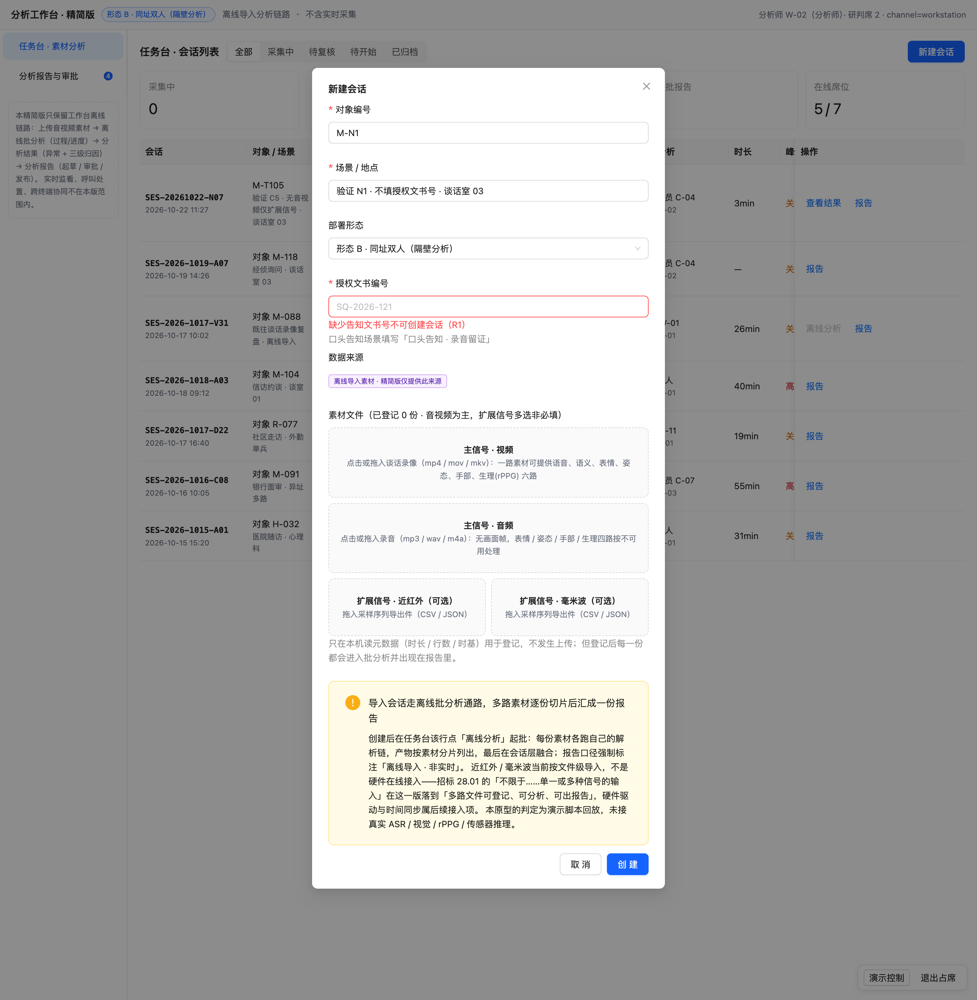

**怎么绕过前端复验第 2 点**（可选，用 curl）：

```bash
curl -s -o /dev/null -w '%{http_code}\n' -X POST http://127.0.0.1:5185/v1/sessions \
  -H 'content-type: application/json' \
  -d '{"subject":"M-N1","scene":"绕过前端","source":"offline_import"}'
# 期望输出 403
```

- ☐ 前端红字必填；☐ 直连接口 403；☐ 补上文书号后 200

### N2 · 未登记素材的会话不可起批 → 422

**操作**：新建会话时**一个素材都不拖**（对象编号 `M-N2`、场景 `验证 N2 · 表单填全但不拖文件 · 谈话室 03`、文书号 `SQ-2026-N2` 全部填齐），创建成功后点行内「离线分析」。

**预期**：创建时弹窗给出「未登记素材」的 warning 提示；起批返回 **HTTP 422**，消息「本会话未登记素材文件，离线分析没有输入」。

**实测**：空素材会话 SES-20261022-N09 → 起批 422。

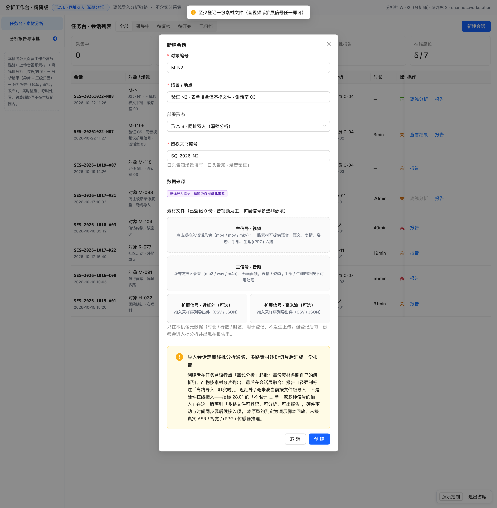

- ☐ 422 而不是"跑出一个空结果"

### N3 · 分析进行中重复起批 → 409，且不产生第二份结果

**操作**：用 V1+V2+A1+A2 建会话 `M-N3` 并起批，**趁进度没走完**再点一次「离线分析」（或连发两次 `analyze-offline`）。

**预期**：第一次 200；第二次 **409 `ANALYZING`**，消息「本会话离线分析进行中，请等待完成」；等完成后切片仍为 4 片、段数不翻倍。

**实测**：200 / 409 ANALYZING；完成后切片 4 片 · 段数已收敛（重复起批没有产生第二份结果）。

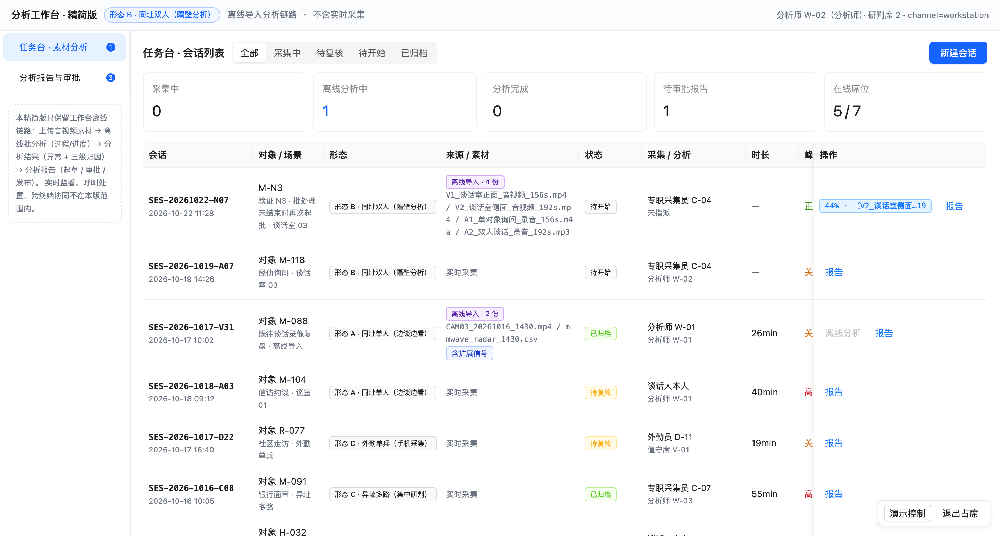

- ☐ 第二次 409；☐ 完成后结果仍是一份（切片 4 / 段数 23）

### N4 · 同一文件重复登记自动去重

**操作**：新建会话 `M-N4`，把 **V1 拖两次**进同一个视频框。

**预期**：登记列表仍只有 1 行 V1，计数行「主信号 1 份」，弹窗标题处显示「已登记 1 份」。

**实测**：份数 1 · 时基未读出 0。

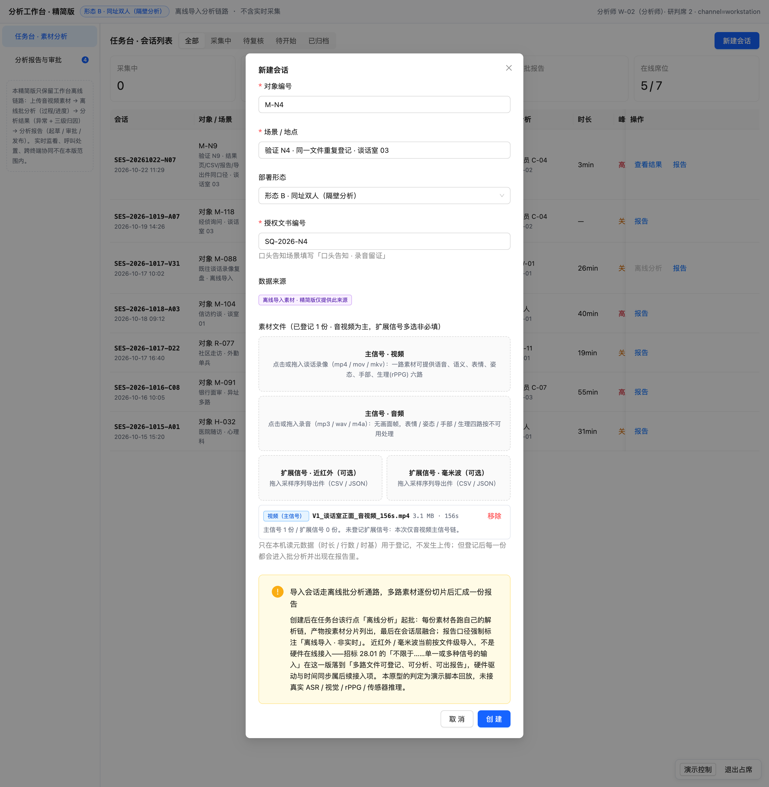

- ☐ 份数 1，不出现两条相同素材

### N5 · 时基读不出的采样序列 → 如实显示"时基未读出"

**操作**：新建会话 `M-N5`（场景 `验证 N5 · 首列非时间轴 + 超 4MB · 谈话室 03`），**A1** 拖进「主信号·音频」；把 **X2**（首列是 HbO 物理量、无时间轴）和 **X3**（6.0 MB 超解析上限）分别拖进近红外与毫米波框。

**预期**：两行登记显示「时基未读出」，计数行给出「时基未读出 2」；系统**不猜**采样率、不显示编造的行数/时长。

**实测**：份数 3 · **时基未读出 2**。

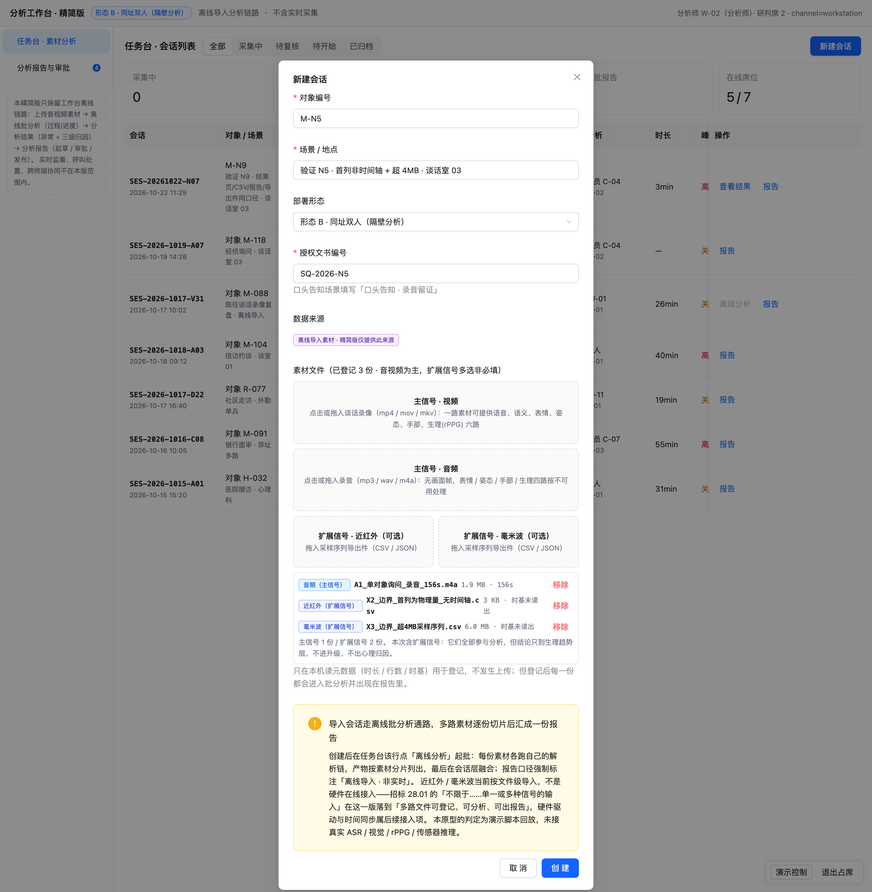

- ☐ 两个文件都标"时基未读出"，且份数统计里能看到 2

> 判据依据：`probeSeries` 只读首列推时基，落在 10—7200s 之外或整体超过 4 MB 上限即放弃解析（上限见 `SessionsPage.tsx` 的 `probeSeries`）。

### N7 · JSON 采样序列本版不支持

**操作**：新建会话 `M-N7`，把 **X4**（JSON）拖进近红外框。

**预期**：显示「时基未读出」——本版按分隔符文本解析首列，JSON 结构读不出。**这是如实限制，不是崩溃**：不报错、不上传、不影响其他素材登记。

**实测**：份数 1 · 时基未读出 1。

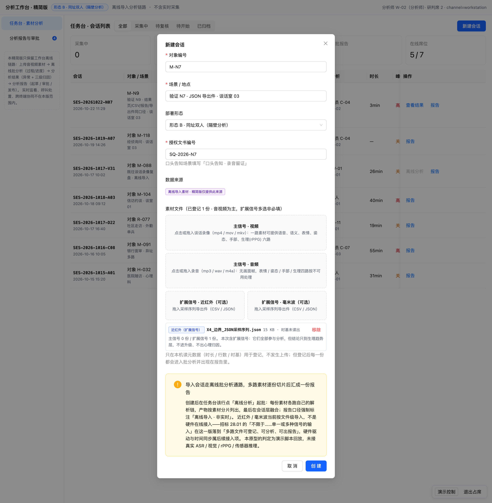

- ☐ 界面稳定，标注为"时基未读出"，并在报告/手册里作为已知限制申报（见本手册第七章）

### N8 · 已归档会话只读

**操作**：任务台切「已归档」筛选，找到种子会话 `SES-2026-1017-V31`（离线导入 · 2 份 · 含扩展信号）。

**预期**：行内「离线分析」按钮为**禁用灰态**；若绕过界面直接调起批接口，服务端返回 **409**（归档只读）。

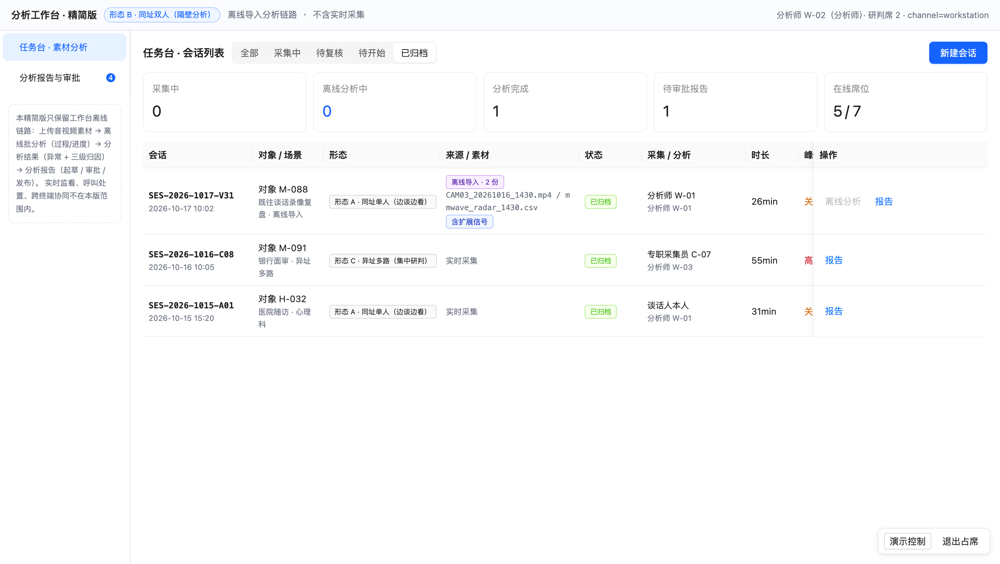

- ☐ 按钮禁用；☐ 直连返回 409

> **顺带纠正一处文档表述**：`prototype-lite/README.md` 原先写"也可用种子会话 SES-2026-1017-V31 点离线分析"，该会话状态是 closed，点不动。已按 N8 的实测结论改正。

### N9 · 扩展信号封顶口径四处一致（**Q15 的核心用例**）

**操作**：跑完 C3 同构会话（V1 + E1 + E2），然后依次核对四处。

| 处 | 核对点 | 实测 |
|---|---|---|
| ① 结果页 | 两份扩展素材切片卡都带「结论上限」说明；封顶事件 2 条，候选规则层为空、最高 ALERT（无 ESCALATED） | 全部 true |
| ② CSV | 表头含 `asset` 列；`outcome=trend_only` 的行数 == 扩展事件数 | 13 行，其中 trend_only 2 行 |
| ③ 报告 | 提到扩展信号封顶口径的章节 | slices（第二章）· anomaly（第三章）· attribution（第四章）三处都有 |
| ④ 导出件 | 含「趋势型条目」措辞；含「不出心理归因 / 不含心理归因」；未发布时带水印 | true / true / 「草稿 · 未经复核审批」 |

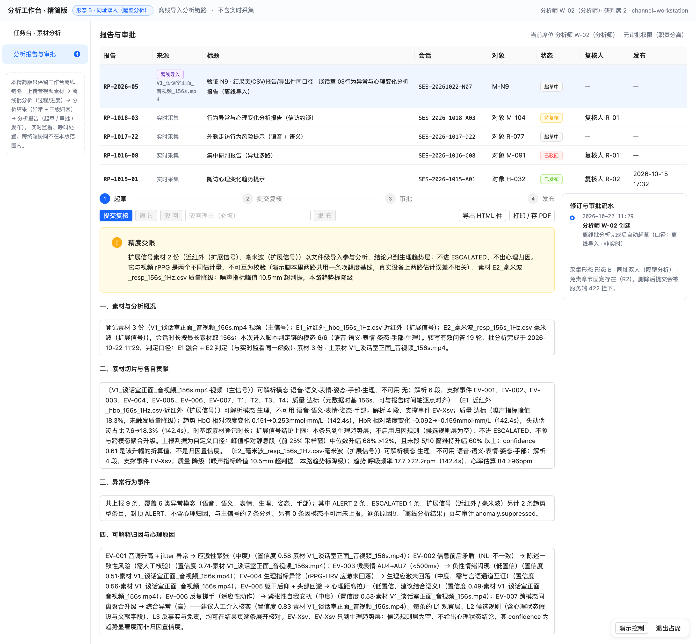

- ☐ ①②③ 四处全部一致，**任何一处口径不同即判不通过**（这是最容易在正式实现时被改崩的地方）

---

## 五、招标条目覆盖核对表

拿这张表逐条打勾，就是"符合原招标文件需求"的正面回答。

| 条目 | 招标原文要点（逐字摘录见 `01_精简版调研报告.md` §一） | 用哪个用例验 | 证据 | 结论 |
|---|---|---|---|---|
| 28.01 | 「不限于语音、视频、近红外、毫米波等单一或多种信号的输入」+ 捕捉言语/姿态/手部/表情/生理异常 + 分析心理原因 | C1（音视频）+ C3（音视频+近红外+毫米波）+ C5（仅扩展） | `C3_01_register.png`、`C3_04_result_top.png`、`C1_08_attribution.png` | ✅ 四类信号文件级全通路 |
| 28.02 | 分角色识别 + 话题提取 + 语义影响值 | C1 第 8—9 步 | `C1_09_impacts.png`、`C1_10_transcript.png` | ✅ 置信度/边界依据/四维影响值三项齐 |
| 28.03 | 语音输入 → 语音特征、言语表达异常 → 心理原因 | C1 + C2 | `C2_06_slices.png`、`C1_07_anomalies.png` | ✅ |
| 28.04 | 不限信号输入，六类异常 + 背后心理原因 | C1（6/6 命中）+ C4（多文件） | `C1_05_result_top.png`、`C4_05_slices.png` | ✅ 归因含反事实与免责常驻 |
| 28.05 | 输入：语音 / 语音+视频 / 多模态 | C2（纯音频 2/6）、C1（音视频 6/6）、C3（+扩展趋势层） | 三个用例的汇总屏 | ✅ 三种组合各有实例 |
| 28.06 | 方法：可单模态或多模态 | C2 单模态裁剪 + C4 多文件融合 + C5 仅扩展裁撤 | `C2_05_modality.png`、`C4_03_progress.png`、`C5_06_suppressed.png` | ✅ 缺失显性标注、不静默跳过 |
| 28.07 | 异常类型包括但不限于六类，提供心理原因分析 | C1 异常表 + N9 封顶口径 | `C1_07_anomalies.png`、`N9_02_n9_matrix.png` | ✅ 六类可命中；扩展信号按封顶口径单列 |
| 28.08 | 「主要考察参赛方提供的行为异常检测能力」 | **本手册第七章现场演练**（形态由"边采集边看"改为"现场上传、离线出报告"） | 演练动线 + C1—C5 全链截图 | 🟡 能力覆盖，**形态变更需主动申报口径** |

> 28.08 的诚实说法：招标只要求考察"行为异常检测能力"，没规定必须实时。精简版把实测改成现场上传素材离线出全套结论，检测能力项不减，但演示冲击力从"边谈边看"变成"分钟级出全套报告"——**这一条要在比选材料里主动写清楚，不要等评委问**。

---

## 六、量化指标核对表（Q1—Q15）

招标原文**没有任何量化门槛**（无准确率、无时延、无部署形态要求）。指标全部是我们主动定义的口径，每项只允许【文献参考水平】或【实测现场标定】两类标签，**未经复算的单值不写入标书**。本表说明哪些能靠这份手册当场验、哪些不能。

| # | 指标 | 本轮（P0 原型）能否现场验 | 怎么验 / 为什么不能 |
|---|---|---|---|
| Q1 | 语音识别质量 WER | ❌ | 原型无真实 ASR，转写来自演示脚本。P1 接 openSMILE + Whisper/FunASR 后用招标素材现场标定 |
| Q2 | 分角色识别 DER | ❌ | 同上，P1 接 pyannote 后可复算 |
| Q3 | 话题边界 P/R/F1 | ❌ | 需人工标注集；界面侧可验"边界判定依据是否逐条给出"（C1 第 8 步） |
| Q4 | 异常检出率 | ❌ | 需 ≥50 段标注集（P2） |
| Q5 | 误报率 | ❌ | 依赖复核闭环数据；精简版由报告审批流的"驳回+理由"承接（C1 第 12—13 步可验机制在） |
| Q6 | 标注一致率 Kappa | ❌ | 需双人标注（P2） |
| Q7 | 归因可采纳率 | 🟡 机制可验 | 审批环节"认可/驳回"天然产生该数据，C1 可验流程通 |
| Q8 | 六类异常覆盖 | ✅ | C1 汇总屏 6/6 + 异常表逐类核对 |
| Q9 | 单素材分析时长 | ✅ 口径可验 | 156s 素材批分析在原型内 <3min 走完（C1 第 4—5 步计时）；正式实现按 1× 视频时长 CPU 预算另标 |
| Q10 | 报告生成时长 | ✅ | 分析完成即自动起草（C1 第 10 步） |
| Q11 | 可追溯率 | ✅ | 每条告警都有 L1 观察层证据 + 文献字段；未登记规则显性标出（C1 第 7 步逐条点开） |
| Q12 | 审计完整率 | ✅ | 导出件与 CSV 的 `seq` / `prev_hash` 链，`npm run verify` E 组断言复算缺失=0；N1/N2/N3/N8 的 403/422/409 也留痕 |
| Q13 | 素材级参与率 | ✅ | C3（3/3）、C4（4/4）、C5（2/2）——登记数 == 切片数 |
| Q14 | 素材级可追溯率 | ✅ | CSV `asset` 列 + 报告附表 A 逐份列文件名（C1 第 15 步、C4 判据） |
| Q15 | 扩展信号封顶一致率 | ✅ | **N9 四处一致**（结果页 / CSV / 报告 / 导出件） |

- ☐ 已向需求方说明：Q1—Q6 属 P1/P2 现场标定项，P0 不承诺数值，只承诺口径与可复算路径

---

## 七、28.08 现场实测演练动线（约 3 分钟）

现场用招标方提供的素材，按这条动线走。前提：素材已拷到本机、dev server 已起、用分析师席位登录。

| 时 | 动作 | 说什么 |
|---|---|---|
| 0:00 | 席位登录（W-02 / 1234） | "工作台只保留离线分析闭环，实时监看与跨终端协同不在精简版范围。" |
| 0:15 | 新建会话，把招标方的录像拖进「主信号·视频」、录音拖进「主信号·音频」、两份生理导出表分别拖进近红外/毫米波 | "四类信号分框登记，音视频为主，扩展信号非必填；但**登记进来的每一份都会参与分析**，只在浏览器本机读元数据，不上传内容。" |
| 0:45 | 念计数行 | 指着「主信号 N 份 / 扩展信号 M 份」和封顶口径那句，**主动说出**"扩展信号结论只到生理趋势层，不进升级、不出心理归因" |
| 1:00 | 点「离线分析」 | "逐素材各跑各的解析链：视频 6 步、音频 5 步、近红外/毫米波各 4 步，最后一步会话级融合。" |
| 1:40 | 结果页汇总 → 模态可用性 | "六路由素材类型决定，缺的显性标'不可用'，不填 0 值。" |
| 2:00 | 点开一条 ESCALATED 异常 | "三级归因：观察层是可核对的时间窗与现象；规则层给规则号和文献；结论层是**模型推断**，带反事实与免责声明，不是临床诊断。" |
| 2:20 | 点开一张扩展信号切片 | "这两路只出趋势，候选规则层为空，最高 ALERT——这是刻意的封顶，不做跨模态互为校验。" |
| 2:40 | 报告页 → 提交 → 换复核席审批 → 发布 → 导出 | "分析师不能自批，服务端校验；发布件去掉草稿水印，附表 A 逐份列出素材文件名，可直接打印存 PDF 归档。" |

**现场风险预案**

| 风险 | 处置 |
|---|---|
| 招标方素材时长读不出来（容器异常） | 改拖 `public/testkit/` 自带素材，并当场说明"读不出就显示时基未读出，不猜"（N5 就是这个口径） |
| 素材是 JSON 导出件 | 直说不支持并展示 N7，把它作为后续项（列名/单位映射配置在 P1） |
| 采样序列 > 4 MB | 说明上限与原因（只读首列，不整体解析），当场用 X3 演示"时基未读出" |
| 评委要求看实时 | 回答口径：实时监看属完整版六终端路线，两版同源、数据契约一致，可另约演示；精简版按离线实测交付 |
| 断网 | 全流程不依赖网络（素材本机读取、mock 引擎在本进程内），提前确认 5185 端口可访问即可 |

---

## 八、如实披露（验证时请一并说明，不要藏）

1. **原型无真实推理**：所有判定来自演示脚本回放（D 级演示占位）。截图里的置信度、影响值、事件号是脚本产出的**结构示例**，不是模型精度。**D 级演示占位数值任何场合不得作为依据。**
2. **规则库为占位**：8 条脚本候选规则 + R-PSY-22 文献字段是占位，投标截止（2026-10-31）前替换为 `01_精简版调研报告.md` §3.1 的真实文献或标"待审"。
3. **扩展信号是文件级导入**：无硬件在线接入、无采样级时钟同步、无个体基线标定；结论封顶在生理趋势层。显著性判据（升幅 >12% 且末段 6/10 窗维持 60%）与 `confidence` 重定义属**自定义口径**（出处目录 C 级，不引文献）。接口契约与后续硬件候选见 `06_多信号源上传与硬件接入说明.md`。
4. **JSON 采样序列不支持**（N7）：本版按分隔符文本解析首列；JSON、Parquet 等结构化导出件在 P1 的列名/单位映射里补。
5. **采样序列解析上限 4 MB**（N5）：超限整体不解析，显示"时基未读出"。
6. **会话时长取"最长素材"，事件时间戳按脚本 0—152s 下发**（附录 X1 用例）：两个口径不同，看时长时须注意。
7. **影响值 [0,1] 是相对量，不可跨会话比较**。
8. **精简版不含实时监看与跨终端协同**：28.08 实测形态改为现场上传离线出报告，**属主动申报的形态变更**。
9. **会话号与报告号会重复**：`SES-<日期>-N<序号>` 按当前会话列表长度生成，报告号同理按报告列表长度生成。`npm run verify` 与各用例之间引擎会恢复出厂状态，序号因此回到同一个值——本手册 C1—C5 都出现 `SES-20261022-N07` 与 `RP-2026-05`，**不是同一个会话/同一份报告**。手动逐个跑时，序号会随列表增长而递增。

---

## 九、附录

### 9.1 补充用例（可选）

| 用例 | 素材 | 验什么 | 预期 |
|---|---|---|---|
| 附录 A | X1（40s 短素材） | 素材时长 < 脚本时间轴 | 会话时长取最长素材，事件时间戳仍按 0—152s 下发；两口径不同须看清（第 8 章第 6 条） |
| 附录 B | E5（.tsv 制表符分隔） | 厂商导出件形态 | 与 E1 同样读得出时基与行数（2 Hz / 79 行），可直接替换 C3 里的近红外位 |

### 9.2 截图与取证重跑

截图不是贴图，是脚本跑真实链路时逐屏拍的；数字是服务端当场返回后打印的。要重跑：

```bash
cd /Users/admin/Downloads/标书/精简版/prototype-lite
npm run dev &                       # 先起 dev server（5185）
node scripts/testkit-shots.mjs      # 全量 13 个用例，约 8 分钟
node scripts/testkit-shots.mjs --only=C1     # 只跑单个用例（逗号分隔可多个）
```

产物写回 `../验证手册截图/`：PNG + `取证记录.md`（汇总）+ `取证记录/<用例>.md`（分用例）+ `_shotlog/`（每次注入的原始片段与告警）。

回归断言（与本手册互补，覆盖面更广但无画面）：

```bash
cd /Users/admin/Downloads/标书/精简版/prototype-lite
npm run verify      # 49 条需求覆盖断言
npm run demo-multi  # 用 public/demo 四份真实文件跑一遍完整批分析，打印会话号与结果页地址
```

### 9.3 本手册的 HTML 版

```bash
cd /Users/admin/Downloads/标书/精简版
node tools/md2html.mjs 07_精简版验证操作手册.md   # 生成同名 HTML，截图按相对路径引用
```

> 改 md 后必须重跑这一句，否则两份不一致。截图目录 `验证手册截图/` 与本文件同级，整体拷走即可离线看。
