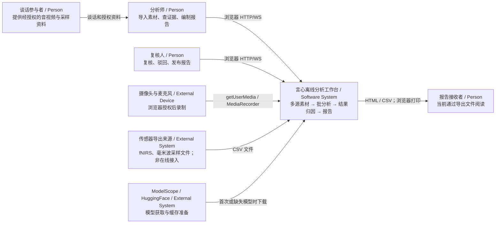
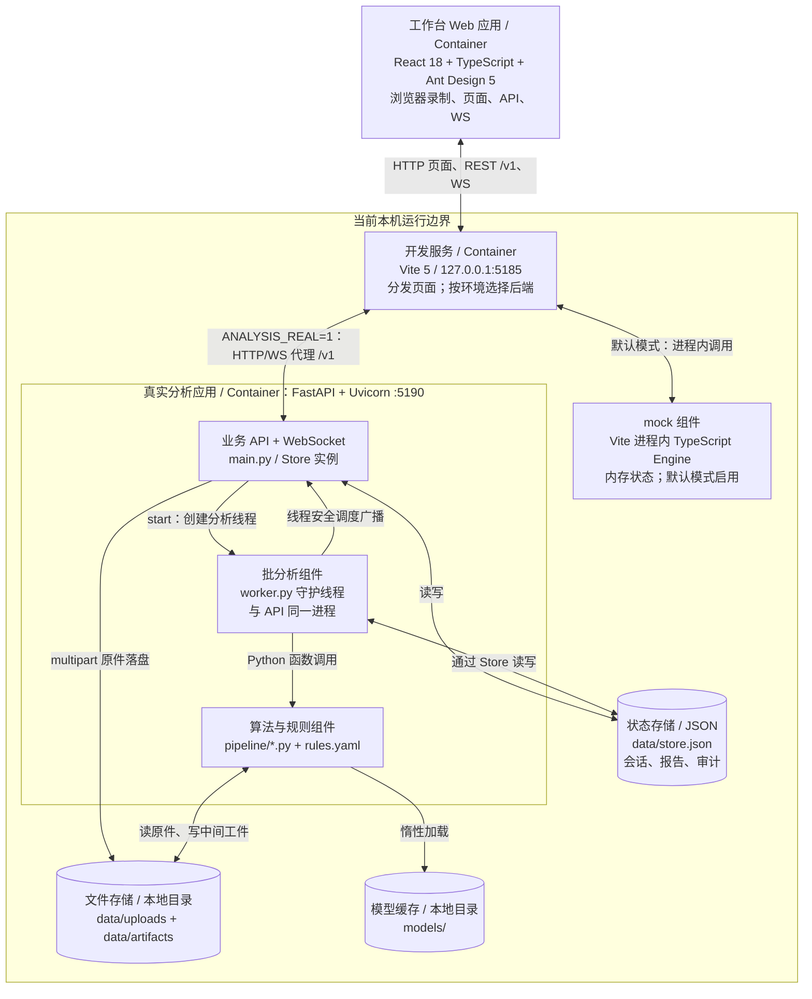
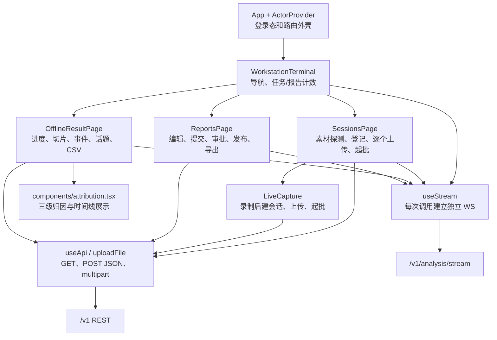
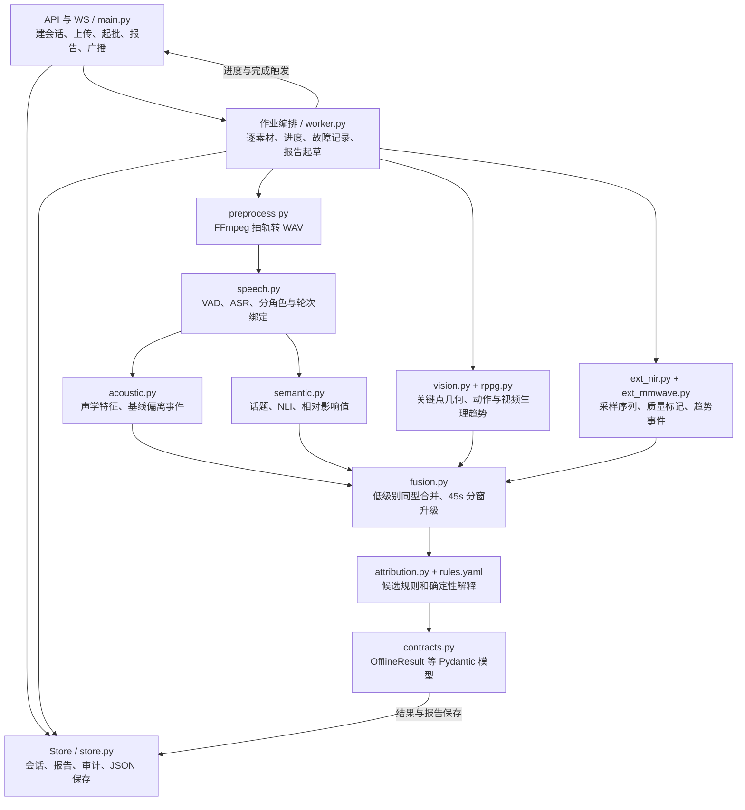
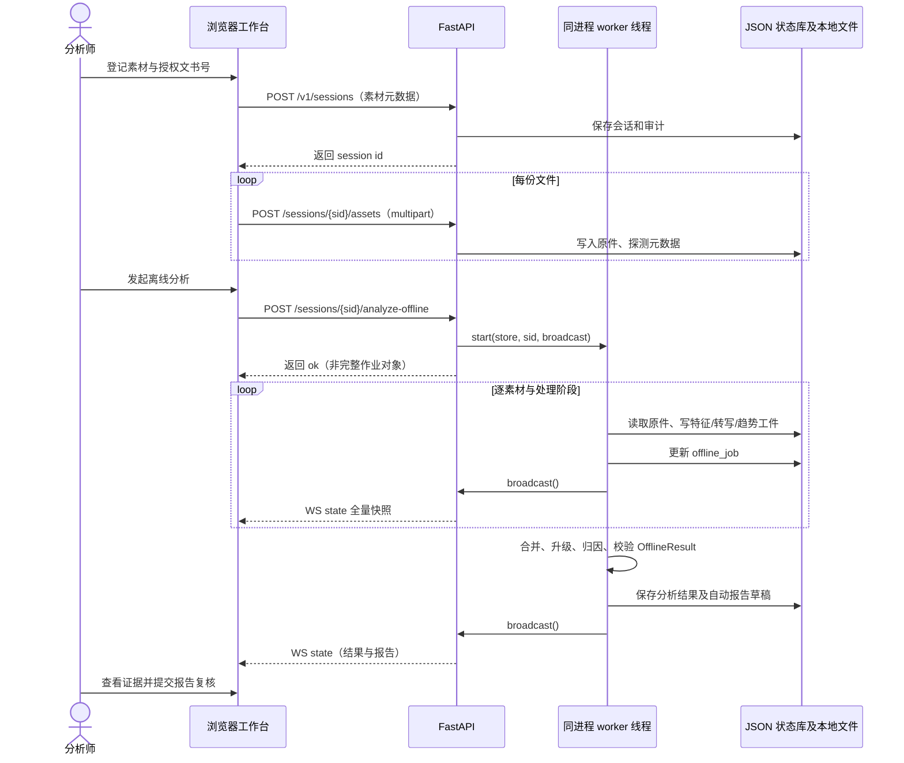

# Know Me：对话驱动的行为变化证据分析平台

> 梳理日期：2026-10-26。目的：为下一轮项目优化、重构和范围冻结提供可追溯的架构基线。
> 需求编号：7008111111；原题《基于对话内容的行为异常检测和心理变化分析技术》。
> 本文依据本目录中的源码、配置、需求 PDF、开发矩阵、设计规范、历史测试记录和已落盘分析结果整理。**“代码存在”“历史运行结果存在”“本次重新实测通过”是三种不同状态；本次未重跑模型和业务链路。**

后续设计与决定入口：[优化完善需求方案设计](优化完善需求方案设计.md)、[需求方案评审记录](需求方案评审记录.md)。本文件保留现状基线；新需求及分期是否已确认，以配套方案和评审决定为准。

## 0. 先读这几条

1. **这是“需求与设计资料 + 可运行精简版 + 历史交付证据”的工作目录。** 实际应用代码在 `精简版/`，该子目录有独立 Git 仓库；当前根目录没有 `.git`，本文件也不自动纳入该子仓库。
2. **当前业务闭环是离线分析工作台。** 文件导入或浏览器录制结束 → 上传 → 批分析 → 多模态结果与归因 → 报告复核、发布、HTML/CSV 导出。浏览器录制不等于实时心理分析。
3. **存在两种后端模式。** 默认 `npm run dev` 使用 Vite 内嵌的 TypeScript mock；只有 `ANALYSIS_REAL=1` 才将 `/v1` 的 HTTP/WS 转发到 Python 服务。默认启动不会运行真实模型。
4. **`gpt/` 是另一套完整产品的设计交付包。** 18 个核心页面、24 个弹层和治理流程主要是设计目标，并没有接入 `精简版/analysis-service/`；不能把这套页面算作已开发功能。
5. **后续优先补齐契约、身份、作业恢复和证据血缘，再扩页面。** 当前代码适合作为单机验证起点；完整 PRD 中的逐人授权、版本化分析、独立复核、受控导出和研究评测需要进一步实现。

### 阅读导航

| 要解决的问题 | 入口 |
|---|---|
| 谁使用系统、外部依赖是什么 | §3 C1 系统上下文 |
| 当前究竟运行了哪些进程和存储 | §4 C2 容器 |
| 前后端如何拆分、修改从哪里进入 | §5 C3 组件、§6 C4 代码索引 |
| 数据怎么走、接口和状态是什么 | §7 数据与动态流程 |
| 设计与代码有哪些差异 | §8 目标差距、§10 重构清单 |
| 如何启动和验证 | §9 运行与验证 |
| 哪些资料可信、哪些需要确认 | §1 来源、§11 待确认问题 |

## 1. 资料来源与版本关系

### 1.1 来源索引

下表编号是本文引用编号；`Rxx/DRxx/UI.Pxx/ALGxx/DSxx/ATxx` 等保留原资料的编号体系，不另行改名。

| 编号 | 来源 | 本文用途与边界 |
|---|---|---|
| S01 | [原始需求汇编](精简版/中关村新域新质创新挑战赛需求汇编.pdf)，正文印刷页 80—81；需求起始页为 PDF 第 85 页 | 原始需求与实测要求。原文未规定准确率、实时性和并发阈值；文件中截止日期为 2026-10-31，本文不核验外部公告是否更新 |
| S02 | [需求清单](精简版/独立软件开发需求清单-人员分配版本.docx)，§28 | `28.01—28.08` 拆分来源，不代表 8 个独立算法模块 |
| S03 | [产品 PRD v1.0](其他资料/行为变化证据分析平台_PRD_v1.0.pdf)，103 页 | 完整产品的评审候选基线；含 R01—R17、DR01—DR12、18 页设计、11 算法模块、30 组验收。P0 是规划优先级，不是完成状态 |
| S04 | [开发执行矩阵](其他资料/开发执行矩阵.xlsx) | 10 张表：阅读与进度、原始需求、设计补充、UI操作、数据资源、算法模块、开源集成、场景流程、验收用例、来源索引。含负责人/状态栏；抽查仍有“待分配/未开始”，不能据此否定后续精简版代码已存在 |
| S05 | [UI 包说明](gpt/DialogueEvidence_UI_v1.2/README.md)、[UI 规范](gpt/DialogueEvidence_UI_v1.2/docs/UI设计规范_v1.2.md)、[页面操作明细](gpt/DialogueEvidence_UI_v1.2/docs/页面操作与字段明细_v1.2.md) | 2026-10-25 的 UI v1.2；明确引用 **PRD v1.1**，但本目录仅找到 PRD v1.0，不能默认两版一致 |
| S06 | [精简版功能划分](精简版/02_精简版产品形态与功能划分.md)、[硬件与多源说明](精简版/06_多信号源上传与硬件接入说明.md)、[技术出处目录](精简版/04_技术出处目录.md) | M1—M4、Q1—Q15、扩展信号封顶及历史原型口径；其中部分技术选型和完成状态已落后于源码 |
| S07 | [真实实现方案](精简版/docs/优化需求方案设计-7008111111.md) | 2026-10-24 的真实算法替换设计；是设计依据，不能直接等同当前实现 |
| S08 | [自测报告](精简版/docs/自测报告.md)、[人工验收手册](精简版/docs/人工验收手册.md) | 真实服务的历史实测、已知限制及 V0—V14 验收步骤；本轮没有重新执行 |
| S09 | [前端配置](精简版/prototype-lite/vite.config.ts)、[前端类型](精简版/prototype-lite/src/shared/types.ts)、[后端入口](精简版/analysis-service/app/main.py)、[作业编排](精简版/analysis-service/app/worker.py) | 当前实现的主要证据。本文说明“现状”时以实际代码为依据 |
| S10 | [设计交付检查报告](gpt/DialogueEvidence_UI_v1.2/qa/交付检查报告.md)、`qa/*.json` | UI 原型的历史渲染/交互检查；不能代替真实服务、安全和算法验收 |
| S11 | `精简版/analysis-service/data/store.json`、`data/artifacts/` | 当前本地持久化快照与中间工件，仅证明历史数据存在，不证明本轮算法效果 |
| S12 | [论文线索](其他资料/ref.txt) | ACL 2022 论文链接及一句备注。本次未访问外网，也不据此推断代码已经实现论文方法 |

### 1.2 如何处理资料冲突

- **查原始要求**：从 S01/S02 出发，区分原始要求与产品化设计补充。
- **查当前行为**：查看 S09 配置、调用链与代码，再参考 S11。测试报告只能说明其记录时点。
- **查未来产品目标**：用 S03/S05，但先补齐缺失的 PRD v1.1，再冻结范围。
- **查算法是否达标**：看明确协议、数据来源、版本和实测证据；设计示例、脚本断言和历史单样例计数不能替代盲测。
- `gpt`、`精简版` 的两套资料不可按文件名新旧自动覆盖。前者偏完整产品设计，后者偏离线验证实现。

## 2. 目录地图

```text
1022/
├── knowme.md                         本架构与重构入口
├── gpt/                              UI v1.2 设计交付、打包和分发副本
│   └── DialogueEvidence_UI_v1.2/
│       ├── prototype/                原生 HTML/CSS/JS 可编辑设计原型
│       ├── design/                   tokens、页面/弹层 JSON、追踪 CSV、角色终端表
│       ├── docs/                     设计规范、页面字段、弹层规范及 Word/PDF
│       ├── screens/                  设计截图
│       ├── qa/                       原型历史检查记录
│       └── tools/verify_ui.py        原型交互检查工具
├── 精简版/                            独立 Git 仓库，实际应用与演示证据
│   ├── prototype-lite/               React 工作台 + Vite mock
│   │   ├── src/                      页面、接口 Hook、共享类型、登录壳
│   │   ├── mock/                     TypeScript 回放引擎、插件、种子和脚本
│   │   ├── public/demo/              四路示例素材
│   │   ├── public/testkit/           主链路与负向边界素材
│   │   ├── scripts/                  mock 需求断言、演示、截图和素材工具
│   │   └── dist/、node_modules/      本地构建产物和依赖
│   ├── analysis-service/             Python 真实分析服务
│   │   ├── app/                      API、状态库、编排、契约、算法、规则
│   │   ├── tests/                    语音链自测、产物契约校验和模型下载工具
│   │   ├── models/                   本地模型缓存，不能视为业务源码
│   │   ├── data/uploads/             上传原件及转码缓存
│   │   ├── data/artifacts/           会话/素材级算法中间工件
│   │   └── data/store.json           会话、报告和审计状态
│   ├── docs/                         真实实现方案、自测、验收、汇报 PPT/PDF
│   ├── tools/                        文档转换、截图、WebRTC 自检、PPT 生成
│   ├── 可视稿/、验证手册截图/         历史展示和取证输出
│   └── 00—08 文档及 HTML            评审、调研、功能、出处、说明和手册
├── 其他资料/                          原始产品 PRD、开发矩阵、论文线索
├── scripts/                          当前为空，尚无根级统一启动/检查脚本
└── logs/                             当前为空，尚无根级日志汇聚
```

补充约定：

- `gpt/` 根下的自包含原型 HTML、Word/PDF、ZIP 是分发载体；已抽查根下 HTML/Word 与包内同名副本字节一致。维护时建议以包内 `prototype/`、`design/`、`docs/` 为编辑入口，再重新生成分发件；本次未删除副本，也未逐文件校验整个 ZIP。
- `精简版/README.md` 规定 02、05、06、07、08 的 HTML 由 `tools/md2html.mjs` 同步，01、03、04 是手写富样式版，不能批量覆盖。00 的生成命令也在其打包说明中，修改前核对具体文件。
- 模型、上传原件、特征工件、截图、报告、构建产物分属不同生命周期。整理目录之前先保留引用关系，尤其不要将 `data/` 当作可随意清空的缓存。
- 当前未发现根级或子目录 `AGENTS.md`、统一 CI 配置及生产部署编排；旧文档提到的 `标书/prototype/` 等完整版路径不在本工作目录中。

## 3. C1：系统上下文（System Context）

### DES-001 系统职责和参与者

**系统职责**：围绕对话和素材时间轴，提供可回看、可追溯的行为变化观察、候选解释与人工复核报告。当前实现的系统名为“言心 MindDialogue 精简版”，完整设计使用“对话证据工作台/行为变化证据分析平台”。



**当前角色与目标角色的区别**：

| 角色 | 当前精简版 | 完整设计目标 |
|---|---|---|
| 分析师 | 席位 W-02，导入、分析、查结果、编报告 | 按项目及分派资源工作，修订转写/角色/话题，不能自审自发 |
| 复核人 | 席位 R-01，前端允许审批/驳回/发布 | 独立自然人身份；行为与解释分别决定；发布需额外许可 |
| 采集员、管理员 | 登录壳保留角色；不代表存在完整采集端/后台 | 独立任务、终端和资源能力 |
| 报告阅读者 | 接收导出 HTML，未见独立受控阅读应用 | P18，指定已发布版本；媒体、打印、下载分别授权 |
| 项目负责人、标注/仲裁、算法/评测、治理/审计/运维 | 主要在设计包中 | 角色定义见 `design/role-terminal-map.json`，尚未接入真实服务 |

系统边界：不把推断当诊断、不把 NLI 不一致当事实认定；近红外/毫米波当前为文件趋势输入。此处是已有资料的产品约束，不是对算法科学效度或法规适用性的确认。

## 4. C2：容器（Container）

这里的“容器”指可运行应用或数据存储，**不表示项目使用了 Docker**。以下是源码确认的本地开发拓扑。

### DES-002 当前双模式运行结构



说明：mock 和真实服务是两种替代数据路径；图中不表示请求同时经过两者。当前没有独立队列服务、独立模型推理服务、PostgreSQL 或对象存储服务。

| 单元 | 代码/技术 | 职责 | 当前约束 |
|---|---|---|---|
| Web 应用 | `prototype-lite/src/` | 登录壳、任务、录制、结果、报告 | 浏览器 `localStorage` 保存展示用席位；无有效服务端登录凭证传递 |
| 开发服务 | `vite.config.ts` | 页面、HMR、mock 挂载或 `/v1` 代理 | 当前生产构建/preview 不会自然获得开发 middleware 和代理的全部能力 |
| mock 引擎 | `mock/plugin.ts`、`engine.ts` | 脚本回放、模拟接口、状态机、通道裁剪 | 进程内内存；仍保留已删页面的管理/实时端点 |
| Python 应用 | `app/main.py`、`worker.py` | 真上传、批分析、报告、审计、广播 | API 和重计算同进程；每个会话独立线程，无全局并发上限和持久队列 |
| 状态存储 | `app/store.py` | JSON 快照、增量业务更新、审计哈希链 | `RLock` 仅在本进程有效；每次保存重写整份 JSON；不支持直接扩为多进程共享库 |
| 文件/模型 | `app/config.py`、`model_dl.py` | 原件、工件和权重 | 开发路径与二进制路径存在环境绑定；首次运行可能需要外网 |

部署含义：现状应按单机验证系统理解。生产静态页面托管、HTTP/WS 反向代理、模型离线包、持久作业恢复和访问控制仍需专门设计与验证。

## 5. C3：组件（Component）

### DES-003 前端组件



| 路由/入口 | 责任文件 | 关键依赖 |
|---|---|---|
| `/` → `/t/workstation` | `src/App.tsx`、`src/shells/session.tsx` | 席位登录、Ant Design、React Router |
| `/t/workstation` | `SessionsPage.tsx` | `probeDuration`、`probeSeries`、`AssetRef`、真实文件上传 |
| 任务台“活体采集”弹窗 | `LiveCapture.tsx` | `getUserMedia`、`MediaRecorder`、录制结束后 Blob 上传；没有独立实时推理路由 |
| `/t/workstation/offline/:id` | `OfflineResultPage.tsx` | 从 WS 快照定位会话，读取 `offline_job/offline` |
| `/t/workstation/reports?session=<id>` | `ReportsPage.tsx` | 按会话锁定报告，未完成时显示分析进度；避免选中其他会话报告 |
| 样式与主题 | `src/index.css`、`App.tsx` | 当前主题在应用代码中定义；未与 `gpt/design` token 自动对接 |

### DES-004 后端组件



图表示编排依赖，算法组件由 `worker.py` 调用；它们不是独立部署服务。

| 模块 | 当前真实实现 | 主要工件/边界 |
|---|---|---|
| `preprocess.py` | FFmpeg 转为 16 kHz 单声道 WAV，同目录缓存 `.16k.wav` | 不是方案图中完整的统一抽帧服务；视觉模块自行读视频 |
| `speech.py` | FunASR SenseVoiceSmall、VAD、标点、CAM++ 嵌入/聚类、时间重叠绑定 | `speech/turns.json`、`segments.json`；`diar_confidence` 为时间重叠比例，不能直接当校准后的说话人正确概率 |
| `acoustic.py` | parselmouth/librosa 等特征、前段基线、偏离度与静音规则 | `acoustic/features.csv`、`events.json`；属于自定义检测规则，不等于心理诊断模型 |
| `semantic.py` | bge-m3 相邻句相似度切分，Erlangshen NLI 初筛及会话内影响值 | `semantic/topics.json`、`contradictions.json`；当前不是 BERTopic 聚类实现 |
| `vision.py` | MediaPipe legacy FaceMesh/Pose/Hands、OpenCV 几何量、检出率质量门 | `vision/au_series.csv`、`pose_series.csv`、`hand_events.csv`；AU 为几何代理，不是已验证的标准 AU 真值 |
| `rppg.py` | 面部 RGB 的 POS 方法、窗口心率/变异趋势与质量门 | `rppg/waveform.csv`、`hr_series.csv`；独立读取视频，不能与临床量测等同 |
| `ext_mmwave.py` | 读取 `t_s/resp_bpm/hr_bpm/motion_mm` 等遥测列、前 20% 基线和趋势；未知列退为包络 | `mmwave_telemetry.csv`；没有实现方案中从原始雷达信号估 HR/RR 的完整算法 |
| `ext_nir.py` | 读取 HbO/HbR、漂移处理与 z 分数，头动标记 | `nir_telemetry.csv`；假定 MBLL 已由厂商完成，不是本服务从原始光强转换 |
| `fusion.py` | INFO/WARN 同型合并，再以 45 s 连续分窗检查多模态升级；保留合并后的基础事件并新增综合事件 | 代码 `start=end`，不是重叠滑窗；有 `cap_note` 的事件排除升级 |
| `attribution.py` | 事件类型关键词映射规则，输出 L1 观察、L2 候选、L3 解释/反事实/免责 | 当前 `worker` 调用 `fill_attribution`，未调用 `llm_narrative`；不能声称 LLM 已进入主链 |
| `rules/rules.yaml` | 9 条规则，含心理候选、权重、文献和反事实 | 权重和规则阈值需要独立标定；规则字符串有引用不等于引用已逐条核实 |

真实分析链目前按素材顺序执行。首个成功的音视频素材生成会话级 `turns/impacts`；后续主素材仍运行 speech/acoustic，但不会再次运行 semantic，也不会把其 turns 合入会话结果。这是重构多素材语义与统一时间轴时的重要边界。

## 6. C4：代码级落点（Code）

本项目大量使用函数和字典；代码层以实际类型/函数依赖表达，不虚构类层次或服务。

### DES-005 关键调用索引

| 改动目标 | 应从哪里读 | 必须联动检查 |
|---|---|---|
| 切换 mock/real、修改地址 | `prototype-lite/vite.config.ts` | dev 与 preview/生产部署差异、WS 代理、环境文案 |
| 身份和职责分离 | `src/shells/session.tsx`、`main.py:login/approve/publish` | `useApi/uploadFile` 凭证、WS 鉴权、`ReportsPage` 按钮与审计 actor |
| 素材契约与上传 | `SessionsPage.tsx:create`、`LiveCapture.tsx`、`main.py:CreateSession/upload_asset/_probe` | `AssetRef`、文件名映射、上传完整性、媒体探测、失败提示 |
| 作业与恢复 | `main.py:analyze/_startup`、`worker.py:start/_run/_commit_progress` | `offline_job`、真实失败状态、重启、并发、前端阶段显示 |
| 新增/替换检测器 | `pipeline/events.py:RawEvent`、对应模块 `run`、`worker.py:_run` | `OfflineSlice`、模态可用性、来源素材、裁撤原因、工件落盘 |
| 融合与来源追踪 | `fusion.py:_consolidate/fuse/to_contract_event` | `source_assets`、聚合成员、事件 ID 范围、跨素材同型合并 |
| 封顶与归因 | `config.py:CAP_NOTE`、`attribution.py:fill_attribution`、`rules.yaml` | UI、报告、CSV、融合资格与候选规则层一致性 |
| 报告状态和导出 | `worker.py:_draft_report`、`main.py` 报告接口、`ReportsPage.tsx` | 内容冻结、复核后编辑、独立发布身份、免责、水印、资源授权 |
| 状态迁移 | `store.py:Store`、`contracts.py`、`src/shared/types.ts` | seed、JSON 历史数据兼容、HTTP 与 WS 快照、事务/审计一致性 |
| 文档和取证再生成 | `精简版/tools/`、`prototype-lite/scripts/` | mock/real 工具差异、素材路径、截图中的会话号、MD/HTML 同步 |

### DES-006 核心类型关系

```text
SessionSummary（前端） / Store.sessions 中的会话字典（后端）
  ├─ assets[]: AssetRef                登记素材，asset 保留首素材兼容字段
  ├─ offline_job                      可空：进度、阶段、步骤；不是独立 Job 实体
  └─ offline: OfflineResult           可空：当前仅一份分析产物
       ├─ slices[]: OfflineSlice      素材可用性、质量、趋势、关联事件、裁撤
       ├─ turns[]: DialogueTurn       interviewer/subject 二元角色
       ├─ impacts[]: ImpactEvent      话题、相对影响值、计算依据
       ├─ anomalies[]: AnomalyEvent
       │    ├─ source_assets[]        素材引用
       │    ├─ cap_note               扩展趋势封顶标识
       │    └─ attribution            观察 → 候选规则 → 结论
       ├─ suppressed[]                未报告条目及原因
       └─ report_id → Report          sections、status、revisions、published_at

检测器 run(...) → RawEvent[] → fusion.fuse(...)
  → to_contract_event(...) → fill_attribution(...)
  → OfflineResult(...).model_dump() → Store
```

契约不是自动生成的同一份定义：前端 TypeScript 与后端 Pydantic 手工镜像；Python 的 Session/Report 仍主要是字典，`Attribution.conclusion`/`ImpactEvent.dims` 也是宽松字典。未来契约治理应先覆盖当前字段，再逐步引入完整领域对象。

## 7. 数据、接口和动态流程

### DES-007 文件导入到报告的时序



录制入口的差别仅在前段：浏览器先在内存累积录制块，结束后组为 WebM 文件，再走建会话、上传和起批。当前不是边录边传的断点续传采集端，`LiveCapture` 创建的会话也仍标为 `source=imported`。

### DES-008 当前 HTTP/WS 契约

以下为真实服务代码中的端点，均以 `/v1` 为前缀；`{sid}` 为会话，`{rid}` 为报告。

| 方法/路径 | 当前行为与卡口 |
|---|---|
| `POST /auth/login`、`/auth/logout` | 静态成员、演示 PIN；login 返回 `demo-<id>` token，但前端未用于后续认证 |
| `GET /sessions` | 所有会话列表；当前未按项目/用户分页过滤 |
| `POST /sessions` | 至少一份素材、非空 `consent_doc`；返回 `{id}`，不同时上传内容 |
| `POST /sessions/{sid}/assets` | multipart：`file/kind/asset_id/client_duration`；原件落盘；归档 409 |
| `POST /sessions/{sid}/analyze-offline` | 检查归档、已有产物、重复运行；起线程，返回 `{ok:true}` |
| `POST /sessions/{sid}/analyze-offline/csv` | 导出 reported/suppressed 条目，返回 CSV 文本和审计号 |
| `POST /reports/{rid}/section` | 修改 section；`published/pending_review` 禁止编辑，当前仍允许修改 approved |
| `POST /reports/{rid}/submit` | drafting/rejected 可提交；`limit` 章节存在且非空，否则 422 |
| `POST /reports/{rid}/approve` | pending_review → approved；当前没有可信服务端复核身份校验 |
| `POST /reports/{rid}/reject` | pending_review → rejected；理由必填 |
| `POST /reports/{rid}/publish` | approved → published；无版本快照和独立发布许可 |
| `POST /reports/{rid}/export` | 任意报告状态均可导出；未发布带水印，返回 HTML、截短内容 hash、`encrypted:false` |
| `GET /audit/verify` | 校验当前 JSON 中的哈希链；不是独立防篡改存储证明 |
| `WS /analysis/stream?channel=workstation` | 接受连接后推送全量 `state`；真实服务接收 channel 参数但未按通道裁剪 |

兼容注意：mock 的错误体使用 `message/error`，FastAPI 默认 `HTTPException` 使用 `detail`，但 `useApi/uploadFile` 只读取 `message`，会丢失真实错误原因。mock 起批响应的 `assets/slices/stages` 也不在真实服务 `{ok:true}` 中；“接口路径相同”不等于完整契约一致。

### DES-009 状态与时间单位

| 对象 | 当前状态/行为 | 重构须保留或澄清 |
|---|---|---|
| Session | 类型声明 `draft/live/review/closed`；新建为 draft；真实分析完成主要写 offline，未见完整 session 状态迁移接口 | 不要把业务生命周期、作业执行状态、访问限制塞进一个状态字段 |
| 批分析 | `offline_job` 非空表示进行中；完成写 `offline` 后清空；失败也清空；启动时清除残留标志 | 缺少 persisted queued/running/failed/cancelled 记录、失败原因资源和续跑位置 |
| Report | `drafting → pending_review → approved → published`；`pending_review → rejected → pending_review` | approved 后继续编辑不会自动撤销批准；应冻结批准内容或使批准失效 |
| 模态/质量 | `ok/degraded/off`、切片 `quality` 与 available/unavailable、`suppressed` | “未采集/未通过质量门/未发现事件”应分别表达，不能用 0 分代替缺失 |
| 时间 | 当前事件 `ts/window/boundary` 多为秒，素材 `duration_seconds` 为整数秒；审计 `ts` 为 epoch 秒 | PRD 目标时间为整数 ms，不能原地替换单位；需显式版本和适配 |
| 影响值 | 当前 `semantic.py` 使用时长占比 × 情感翻转项 × 矛盾项，按会话话题最大值归一 | 旧精简版文档的四维加权式不同；不可跨会话直接比较或当心理强度真值 |

### DES-010 存储与证据血缘

- `data/store.json` 顶层：`sessions/reports/audit/seq/exports`。`Store` 使用线程锁、临时文件替换；这是当前单进程持久化实现，不是事务型数据库。
- `data/uploads/<session_id>/<原文件名>`：原件和同名 `.16k.wav` 缓存。登记、上传与后续读取依赖文件名，尚无内容哈希作为稳定对象键。
- `data/artifacts/<session_id>/<asset_id 替换冒号>/`：转写、语义、特征、视觉和趋势工件。测试脚本另有 `selftest`、`selftest-vision-rppg` 子目录，不能假设全部目录都是业务会话。
- `EV-001` 等事件 ID 仅在单次会话结果内编号；引用时必须同时带会话，未来再加 analysis_run/version。
- 审计链内容为 `seq|ts|actor|action|resource|prev_hash` 的 SHA-256，落在同一 JSON。能发现未同步重算的改动，但没有独立信任锚，也未将所有业务变更与审计绑定为同一事务。
- 当前快照包含 10 个会话、4 份报告、132 条审计。样例 `SES-20261024-001` 留存 4 素材/4 切片、28 轮、11 话题、37 事件，与历史自测报告一致；其中 4 个事件 `source_assets` 为空。**这是本次读取旧快照的结果，不是重新分析所得，也不是准确率指标。**

## 8. 完整产品目标与当前实现的差距

### DES-011 目标域划分：用于规划，尚未整体实现

依据 S03/S05，可把下一阶段模块划成以下边界。建议先在模块化单体内建立职责和契约，重计算资源确需隔离时再拆 worker 进程；没有依据要求立即微服务化。

| 目标业务域 | 设计页面/对象 | 可复用基础 | 主要缺口 |
|---|---|---|---|
| 项目、身份、任务与用途授权 | P01/P02/P16；Project、Participant、ConsentGrant | 登录壳、会话登记、文书号卡口 | 项目隔离、逐人逐用途授权、资源分派、可信身份、撤回限制 |
| 素材与受控采集 | P03/P04；MediaAsset/Stream、质量区间、基线 | 文件上传、浏览器录制、原件存储 | 分片校验与续传、不可变 manifest、多声道与采集缺口、设备绑定 |
| 对话证据与分析运行 | P05/P06/P07/P13；AnalysisRun、Utterance、TopicSpan、Observation、Baseline | pipeline、RawEvent、切片与进度 | 参与者绑定与未知/重叠、修订版本、run 重算、统一时轴、独立质量与基线对象 |
| 独立复核、报告与受控阅读 | P08/P09/P18；ReviewDecision、Hypothesis、ReportVersion、ExportJob | 三级归因、草稿审批、HTML/CSV | 行为与解释分开复核、不可变发布版本、独立批准/发布、受控下载/打印和失效 |
| 数据、标注、评测与模型包 | P11—P15；DatasetVersion、Annotation、Evaluation、ModelBundle | 少量自测与规则配置、模型缓存 | 准入/许可快照、双人盲标仲裁、冻结测试划分、模型与数据血缘、离线包审批 |
| 治理与恢复 | P16；WithdrawalCase、AuditEvent | 同库审计链、重启清残留 | 限制优先、衍生物清理、备份恢复、审计独立核验、可观测运行信息 |
| 跨次与科研传感器 | P10（P1）、P17（P2） | 文件趋势解析与说明文档 | 独立关联授权、可比性协议、硬件时钟、参考仪器验证；不默认进入本轮 |

目标部署在 PRD 中建议 React/TypeScript、业务 API、PostgreSQL、持久任务表/worker 租约和客户批准的 S3 兼容/NAS；这些均是待选/待实施方案。当前未发现对应已建数据库、独立采集组件和队列。

应补齐的目标追溯主链为：

```text
Project → Session/Participant/ConsentGrant
  → MediaAsset + input_manifest
  → AnalysisRun（模型包、配置、基线、转写/话题版本）
  → Observation/EvidenceRef → AnomalyEvent → Hypothesis/ReviewDecision
  → ReportVersion → ExportJob
```

授权/许可变更和上游修订应作用于整条链；这与当前 `Session.offline` 内嵌单份结果和可编辑报告的模型不同，迁移须保留旧数据适配。

## 9. 运行、验证与环境边界

### 9.1 真实模式启动（源码确认的开发方式）

在项目根目录打开两个终端：

```bash
# 终端一：先确保 Python 3.11 venv、依赖、模型和 FFmpeg 已就绪
cd 精简版/analysis-service
.venv/bin/uvicorn app.main:app --host 127.0.0.1 --port 5190
```

```bash
# 终端二：前端代理真实服务
cd 精简版/prototype-lite
ANALYSIS_REAL=1 npm run dev
```

访问 `http://127.0.0.1:5185`。演示账号为 W-02（分析师）/R-01（复核人），PIN `1234`；这是源码中的演示机制，不能作为生产身份方案。

环境约束：

- 后端已有文档和依赖约束针对 Python 3.11 / Intel Mac CPU；`speech.py` 当前显式使用 `device="cpu"`。GPU 机器上的性能与调度不能据旧方案直接承诺。
- `requirements.txt` 固定了部分 transformers/sentence-transformers/huggingface-hub、numba/llvmlite/numpy 组合，其余多为未锁版本；视觉依赖 MediaPipe legacy API，升级前需做兼容验证。
- FFmpeg 和 ffprobe 路径分别硬编码在 `preprocess.py` 与 `main.py` 为 `/usr/local/bin/...`，更换系统或 Apple Silicon 路径可能失败。
- `model_dl.py` 及 speech 加载可能获取 ModelScope/HF 模型。当前不是“断网冷启动已经验证”的交付包。
- `DISABLE_LLM=1` 控制可选叙述函数，但当前 worker 未调用该函数；设置变量本身不能证明 LLM 集成状态。

### 9.2 mock 模式与设计原型

```bash
# 默认 mock；不要把这个启动方式当真实推理
cd 精简版/prototype-lite
npm run dev
```

`gpt/DialogueEvidence_UI_v1.2/对话证据_UI交互原型_v1.2.html` 是独立自包含设计原型；也可从包目录运行本地静态 HTTP 服务。它的浏览器内示例状态不与 Python 状态库共享。

### 9.3 已有验证资源及使用条件

| 入口 | 验证什么 | 使用条件/限制 |
|---|---|---|
| `prototype-lite` 的 `npm run build` | TypeScript 与 Vite 构建 | 不证明后端、算法和生产代理正常 |
| `npm run verify` | 历史 49 条 mock 需求断言 | 调用 `/demo/*`，会重置演示引擎；仅用于隔离 mock 实例，不适用于 real |
| `npm run demo-multi` | mock 四素材登记和起批演示 | 读取本地文件大小但不上传字节；缺真实链路所需的文件上传和素材 ID，且依赖 mock 响应字段，不可直接作为 real 冒烟脚本 |
| `scripts/testkit-shots.mjs` | 历史界面、负向场景和截图取证 | 会改变/重置演示数据，需隔离环境；与 verify/demo 共用状态时不可并发 |
| `tests/test_speech_chain.py` | preprocess/speech/acoustic/semantic 样例链 | 需要模型与真实依赖，写 `data/artifacts/selftest/`；主要打印结果，不是完整断言测试套件 |
| `tests/check_contracts.py` | 部分转写/话题/事件产物形状 | 依赖前一步现成工件；不等于所有 API 契约已覆盖 |
| `selftest_vision_rppg.py` | 视觉与视频生理样例链 | 真实读视频并写工件，涉及耗时和模型环境 |
| `tools/webrtc-selftest.mjs` | 浏览器采集→上传→起批管路 | 依赖本机 Chrome CDP 1234；fake 媒体只证明管路 |
| `docs/人工验收手册.md` | real 模式 V0—V14 | 历史记录中真人 V12 仍待验；需按当前代码补回归 |
| `gpt/.../tools/verify_ui.py` | 设计 HTML 的交互与布局 | 历史 27 项通过属于设计原型，不验证真实 API/模型 |

本轮仅做静态与已有工件核对，没有启动业务进程、下载模型、执行上述会改变状态的脚本，也没有重建截图、PPT/PDF 或构建产物。

## 10. 下一轮优化重构清单

以下为基于源码的准备清单，不表示本次已修改或已做运行复现。优先级 `P0/P1/P2` 在本节仅表示重构顺序，区别于 PRD 的产品阶段。

| 编号/优先级 | 发现与影响 | 最小落地建议 | 验证标准 |
|---|---|---|---|
| TASK-001 / P0 | 文档同时存在“无真实推理”“真实实现”“完整产品设计”；UI 引用缺失 PRD v1.1 | 冻结当前开发基线，明确 mock/real/design 标签，补版本差异表和可执行范围 | 每个需求有来源、实现入口、验证方式和状态；设计不计入已交付 |
| TASK-002 / P0 | `main.py` 无可信 token/session 校验，actor 可由参数/default 指定；WS 忽略通道裁剪；前端角色不能提供后端保护 | 建立一条服务端身份与资源校验链，覆盖读、上传、分析、审批、导出、WS；审计 actor 从身份取 | 未登录/错误角色/跨资源/非法通道直接请求被拒；作者不可自审自发 |
| TASK-003 / P0 | `fill_attribution` 未对 `cap_note` 短路，扩展事件仍进入同模态候选规则构造，与“候选层为空”约定冲突 | 在共享归因入口实施趋势封顶，并覆盖序列质量门；UI、CSV、报告保持同一政策 | 人工构造会触发趋势事件的输入，验证候选为空、无心理解释、不参与升级 |
| TASK-004 / P0 | `fuse` 新建聚合 RawEvent 未带成员素材集合；已有样例 4 个聚合事件 `source_assets` 为空；低级别合并键不含素材 ID | 用稳定成员引用维护多素材来源，避免跨素材合并后丢来源 | 每个综合事件可回溯全部基础事件/素材/区间；相同事件类型跨素材不误归属 |
| TASK-005 / P0 | 两处上传失败均被 catch 为“仅登记元数据”并允许继续；服务端起批未验证完整上传集合；文件名作为路径且整文件读入内存 | 明确后端模式/能力，real 上传失败阻止起批；校验素材 ID/类型/大小/完整性，改稳定存储键与流式写入 | 缺件、重名、无效 ID、超限、伪格式、部分失败均有明确结果，原件不被意外覆盖 |
| TASK-006 / P0 | approved 报告可以编辑，之后仍可直接 publish；当前只校验免责非空 | 已批准内容冻结，修改生成新修订并使批准失效；批准/发布绑定版本及复核人 | 复核后修改必须重新审批；不可发布未获批准的具体内容版本 |
| TASK-007 / P1 | 每会话起 daemon thread，无全局资源上限；失败/重启只清 `offline_job`；模型全局单例被不同线程共享 | 先增加持久 Job 状态与全局并发限制，再按需要隔离 worker，支持失败原因和幂等重试 | 双会话并发受控；重启后能区分失败/排队/恢复；重复提交不重复生成报告 |
| TASK-008 / P1 | JSON 全量重写、业务/审计分开保存，线程锁不支持多进程 | 先固定 Repository 调用边界与数据迁移工具；选定事务存储后迁移，不直接启动多 Uvicorn worker 共写 JSON | 旧快照可导入；并发修改不丢失；报告、结果、审计提交一致；恢复后可核对 |
| TASK-009 / P1 | 前后端类型手写，错误封装不一；worker 步骤 progress 是单步百分比，前端仍按全程阈值推导；文档还写视频 6 步，当前数组实际 5 步 | 固定公共 schema、错误体和步骤状态语义，分别做 mock/real 契约检查 | 真实错误文案可见；阶段不误判；两模式共享字段、返回差异显式记录 |
| TASK-010 / P1 | shell/页面分别建 WS，服务端频繁推送含历史结果的全量快照；useStream 无重连/断点恢复 | 先共享单个工作台订阅，按会话订阅与增量事件逐步演进 | 页面切换连接数受控；断开后能恢复并补拉快照；无跨资源正文广播 |
| TASK-011 / P1 | 多素材仅首个主素材有语义结果；无统一时间偏移和参与者映射；最长发言者被自动当 interviewer，其余折叠为 subject | 保留每素材 turns/topics、原始 speaker ID 与时轴映射，提供人工确认角色；不要先改 UI 扩到多人 | 调换素材顺序不使语义来源不可追踪；未知角色不伪造；主素材全部有独立语义产物 |
| TASK-012 / P1 | 代码/权重/数据许可未形成工件清单，部分依赖未锁；“全栈 Apache/MIT/BSD”与方案表内 GPLv3+ 标注内部不一致 | 核对实际工件、版本、hash、许可来源及分发方式，形成离线环境清单；不按旧声明直接批准 | 干净环境可按锁定清单重现；下载来源、模型权重和许可状态均可追溯 |
| TASK-013 / P2 | 完整产品设计的大量治理/研究功能无后端实体，贸然整体替换将扩大范围 | 在 §8 业务域中选择本轮闭环，再逐域引入 AnalysisRun/ReportVersion/ConsentGrant 等 | 每增加一域均具备数据迁移、权限、失败路径与验收，P1/P2 设计不被默认拉入 |

建议实施顺序：先 TASK-001 冻结口径，接着处理身份、封顶、来源、上传和报告内容一致性；然后建立契约与回归基线，再改作业/存储/订阅；最后实施选定的完整产品业务域。

重构期间应保持的业务不变量：

- 登记素材都必须有成功切片或明确失败说明，不得把缺失/失败展示成“正常”。
- 观察、候选解释、人工复核结论分层；反事实与免责保留，扩展信号封顶。
- 上报与裁撤都可追溯到来源和原因；聚合不得吞掉关键证据引用。
- 未发布件的水印与已发布版本内容一致性可核对；发布不能绕过独立复核。
- mock 演示数据不混入真实分析记录；旧会话、`asset` 兼容字段和导出件可迁移核验。

## 11. 待确认问题

以下留作下一轮决策，不阻塞本文形成现状基线。

| 编号 | 决策问题 | 建议决策角色 | 当前处理 |
|---|---|---|---|
| Q-001 | 本轮继续强化精简离线验证，还是进入完整 PRD P0？ | 产品负责人 | 以现有离线闭环为事实基线，完整域保持规划状态 |
| Q-002 | PRD v1.1 在哪里？其与 v1.0、UI v1.2 的业务变更是什么？ | 产品/设计 | 明确缺件，不把 UI 的权限/状态调整视为已批准后端协议 |
| Q-003 | 精简版文件趋势是否继续进入当前交付？完整产品将生理外设置于 P2 的口径如何对齐？ | 产品/算法 | 保留已实现文件趋势与封顶；不默认扩硬件或心理归因 |
| Q-004 | 目标运行平台、断网条件、CPU/GPU、并发和文件上限是什么？ | 技术/部署负责人 | 当前只确认源码中的本机开发配置；PRD 的 120 分钟/10GB 等是待验证设计目标 |
| Q-005 | 模型性能以什么真人数据、标注协议和质量覆盖/弃权指标验收？ | 算法/评测负责人 | 历史合成样例和 fake 摄像头只作管路与开发证据 |
| Q-006 | 身份来源、用途授权、保留策略、导出受众和独立审核岗位如何确定？ | 产品/客户治理负责人 | 当前演示身份和文书号只算基础占位，后端须实施正式规则 |
| Q-007 | 根级资料和 `knowme.md` 如何纳入版本管理？`精简版/` 独立仓库是否作为持续开发主仓？ | 项目维护者 | 本次仅在根目录新增文件，不改仓库布局、不移动原始资料 |

## 12. 本文维护规则

1. 代码变动后同步对应 C2/C3 边界、接口、数据与重构清单；不要只更新首页概述。
2. 引入新目标必须写明来源、阶段、责任域和验收证据；将“计划”“已实现”“已验证”分开登记。
3. 新增模型或规则时记录版本、输入输出、工件路径、阈值依据和已知失效条件，不能只改算法名称。
4. 接口、时间单位、分析运行和报告版本迁移必须同时说明旧数据兼容方式。
5. 完成 TASK 时填写实际验证和证据位置，不直接沿用历史报告里的通过结论。
