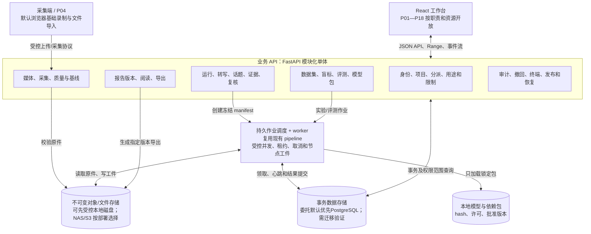

# 对话驱动的行为变化证据分析平台：优化完善需求方案设计

| 项目 | 内容 |
|---|---|
| 原始需求 | 7008111111《基于对话内容的行为异常检测和心理变化分析技术》 |
| 文档版本 | v0.11，2026-10-26，开发准备基线 |
| 总体范围 | **已确认：以 gpt 的 18 个核心页面为总体范围，分迭代实现全部业务域（DEC-001）** |
| 首期目标 | **已确认：优先可用业务闭环，同步建设必要身份、授权、作业与版本底座（DEC-002）** |
| 首期部署 | **已确认：单位局域网，内部服务器集中运行，多台电脑按角色协作（DEC-003）** |
| 首期离线要求 | **已确认：全新环境的安装、冷启动、登录、分析、导出均无公网依赖，模型及依赖离线导入（DEC-004）** |
| 当前实施环境 | **已确认沿用本机构建/验证（DEC-005）；实查 macOS 26.5.1 / Intel x86_64，项目 Python 3.11.11；不预设 Linux 迁移** |
| 首期会话人数 | **已确认：1 名访谈员 + 1 名受访者；完整产品的多人能力后续分期（DEC-006）** |
| 首期分析时机 | **已确认：录制结束后自动批分析，再进入证据校正、复核和报告流程（DEC-007）** |
| 首期解释能力 | **已确认接入本地大模型叙述，按证据/规则组装文字；离线包、引用校验、正常生成与失败降级均需验收（DEC-008）** |
| 首期报告格式 | **已确认 PDF + HTML + CSV，增加正式 PDF、保留现有格式，不新增 Word（DEC-009）** |
| 首期导出策略 | **发布时按指定版本分别授予阅读/下载/打印；有效授权内重复导出免再次人工审批，每次仍校验并留痕（DEC-010）** |
| 剩余问题处理 | **按用户委托采用推荐默认值（DEC-011、DF-001—016），不再逐项询问非阻塞问题；外部资源及实测前置另列§11** |
| 实现起点 | `精简版/prototype-lite/` + `精简版/analysis-service/`，当前 Git 基线 `4a01c05` |
| 架构基线 | [knowme.md](knowme.md) |
| 决策依据 | [需求方案评审记录.md](需求方案评审记录.md)；逐项答复与用户委托默认分别记录，不将未验证事实当结论 |
| 状态边界 | 本文为新增/完善设计；未开始业务代码改造，未复跑模型或业务链路；Q-005 后本机前端构建及后端语法检查通过，详见 §9.4 |

## 1. 概述与资料依据

### 1.1 目标

在现有真实分析链和工作台基础上，逐步建成覆盖“任务与授权—采集/导入—证据分析—独立复核—报告阅读—数据标注/评测—模型发布—治理—跨次/传感器”的完整产品。

本轮文档需给出可继续评审、可拆任务、可验收、可迁移的数据与接口方案。分期用于管理依赖和交付顺序，不将某个业务域无声删出总范围。

### 1.2 来源与冲突处理

| 来源 | 角色 | 使用方法 |
|---|---|---|
| [现状梳理](knowme.md)及精简版源码 | 当前实现基线 | 现状最终以代码和配置为准；历史实测不当作本轮通过 |
| [原始需求汇编](精简版/中关村新域新质创新挑战赛需求汇编.pdf)正文 80—81 页及[需求清单](精简版/独立软件开发需求清单-人员分配版本.docx)§28 | 原始要求 | 28.01—28.08；不把产品化补充和研究目标写成原始强制指标 |
| [PRD v1.0](其他资料/行为变化证据分析平台_PRD_v1.0.pdf) | 完整业务候选基线 | 原子要求 R01—R17、设计 DR01—DR12、流程 SC01—SC12、验收 AT01—AT30 |
| [开发执行矩阵](其他资料/开发执行矩阵.xlsx) | 追溯来源 | 保留原编号，新增本轮状态/任务/证据引用；不将其旧“未开始”直接当作当前代码完成度 |
| [UI v1.2 说明](gpt/DialogueEvidence_UI_v1.2/README.md)、[页面字段与操作](gpt/DialogueEvidence_UI_v1.2/docs/页面操作与字段明细_v1.2.md)、[弹层规范](gpt/DialogueEvidence_UI_v1.2/docs/弹层详细规范_v1.2.md) | 交互设计与操作契约 | 18 页、90 项核心操作和 24 弹层逐项对齐，不以截图替代业务协议 |
| [旧优化方案](精简版/docs/优化需求方案设计-7008111111.md)、[自测](精简版/docs/自测报告.md)、[验收手册](精简版/docs/人工验收手册.md) | 演进背景、历史取证 | 保留真实链能力，纠正文档中尚未真实接入/旧技术选型等过时口径 |

资料缺口：UI v1.2 引用 PRD v1.1，本目录只找到 v1.0；PRD 提及的 `api_contract.yaml/schemas` 等附件未找到。按DF-015，先以已取得的v1.0、UI v1.2、实际代码及本轮决定推进，差异登记后续对账，不等待缺件才开发，也不假定附件存在。

### 1.3 当前功能与必须修正的认识

| 能力 | 当前代码事实 | 本方案处理 |
|---|---|---|
| 上传、浏览器录制、批分析、报告链路 | 已存在；real 模式连接 FastAPI，默认 dev 为 mock | 保留主链并补完整性、模式标记、恢复与权限 |
| 语音/声学/语义/视觉/rPPG/序列趋势 | 真实代码与历史工件存在；效果未在本轮复测 | 先保留模型和规则，建立可复现评测后决定替换 |
| 证据校正 | 结果以展示为主，无完整角色/转写/话题编辑和重算 | 新增版本化人工校正与依赖失效 |
| 事件复核 | 三级归因展示存在；缺独立行为/解释复核对象 | 新增分层决定、理由与证据引用 |
| 身份与授权 | 演示 PIN、前端身份、文书号；服务端无完整资源权限 | 新增可信身份、用途与分派校验 |
| 作业与状态 | 同进程 daemon 线程、JSON 库、全量 WS 快照 | 形成持久运行记录、受控并发和恢复，再按部署需求隔离计算 |
| 完整产品其他页面 | gpt 为设计原型，尚未接入真实业务服务 | 全部纳入下表分期，不计作已完成 |

## 2. 范围、原则与交付边界

### 2.1 已确认范围

- DEC-001：P01—P18 全部业务域进入总体方案，基于精简版增量演进。
- DEC-002：首个里程碑完成采集/导入、证据校正、独立复核和版本报告，同步落实必要底座；其余业务域后续分期。
- DEC-003：首期内部服务器集中运行，多台电脑在单位局域网按角色协作；该决定本身不捆绑 OS、硬件、并发和公网依赖。
- DEC-004：首期全离线交付；在无互联网、单位局域网连通的全新目标环境完成安装、冷启动、登录、分析和导出；依赖和模型使用离线包导入。
- DEC-005：沿用当前本机 macOS 环境进行构建和验证，复用现有依赖，不预设迁移到 Linux 或另外搭建服务器；本机作为当前集中服务实现起点，不自动取消局域网多端和全离线目标。
- DEC-006：M1 优先双人访谈（1 名访谈员 + 1 名受访者）；角色校正、个人基线、事件/解释归属及样本验收按双人切片。完整产品 2—4 人仍后续交付，数据模型不固化为只能存两种角色。
- DEC-007：M1 现场采集录完后自动分析，现场以预览、录制状态和必要质量提示为主；持续流式推理与 AT29 延迟验证不纳入首期。全离线交付仍按 DEC-004 执行，两者分别约束网络依赖和分析时机。
- DEC-008：M1 接入本地大模型叙述，使用已有证据/规则生成可追溯文字；代码和规则负责数值/检测，人工复核负责最终决定。正常生成与失败降级分别验收，不能以始终降级替代接入交付。
- DEC-009：M1 正式报告增加 PDF，保留 HTML 报告及 CSV 数据；不新增 Word。各格式从明确的冻结版本与导出范围生成，离线生成与版式/内容一致性纳入验收。
- DEC-010：发布时按指定报告版本、接收人、用途、动作和有效期分别授予阅读/下载/打印；有效授权内重复导出免再次人工审批，生成和领取每次仍校验并审计。新版本、接收人、用途或动作不自动继承，变更需要重新授权。
- DEC-011（委托默认）：首期严格验证真实分析、本地叙述、证据/复核/报告闭环，同时用有权使用的真人样本形成人工核对的效果/耗时基线；不直接承诺旧PRD探索阈值。协议/真实样本和实测结果仍是能力验收前置。
- 用户要求：评审采用 `grill-me` 逐项确认，结论持续写入配套评审记录，作为迭代依据。
  - 当前更新：核心10项已逐项确认；用户随后要求剩余不影响开发的问题按推荐先记录。现采用§11默认值，不继续常规逐题提问；这不等于用户逐项确认了所有技术参数或算法效果。
- 当前主任务为文档与评审；用户在 Q-005 指示本地编译后，已执行现有前端构建和后端语法检查。需求实现、数据迁移与部署变更仍未执行。

### 2.2 设计原则与委托默认值

下列原则结合§11的DF-001—016作为开发默认；其中技术选型及阈值的验证状态独立记录，不因用户委托而伪写成已实施/已测通过。

- 保留 React/TypeScript/Ant Design 和 Python/FastAPI 的现有技术基础，采用模块化单体业务服务及可隔离计算 worker。
- 观察、行为候选、心理候选解释、专家决定四层分离；证据不足允许弃权。
- 原件、人工修订、分析运行和已发布报告各自版本化，不能用“覆盖最新结果”实现修正。
- 复用页面职责与设计 token，按真实工作流合并/拆分路由；完整覆盖 18 页的业务职责不等于强制原样复制 18 个壳。
- mock 保留为开发/演示工具，与真实业务数据隔离；UI 角色切换不作为权限实现。
- 首期人数按DEC-006为双人；日历工期、硬件容量和算法阈值未实测不承诺，原资料的研究目标保留“待验证”状态。

### 2.3 全范围与首期范围分开管理

总范围由 DEC-001 确认；DEC-002 确认首期业务闭环与底座，DEC-003 确认局域网协作，DEC-004 将全离线安装/运行纳入 M1，DEC-005 明确当前沿用本机 macOS 构建和验证。这些决定不等于后文细则或算法指标均获批准。本机现有环境可复用，但构建成功不能代替多端协作、全新环境离线安装及算法效果验收。研究平台、跨次对比、在线传感器和完整 P15 治理仍后续分期。

## 3. 18 个页面的能力整合矩阵

| 页面 | 当前可复用基础 | 优化/新增业务能力 | 需求编号 | 交付包映射（首期以 §10.1 为准） |
|---|---|---|---|---|
| P01 任务工作台 | SessionsPage，会话搜索、进度、结果入口 | 项目/分派待办、分层状态、版本与失败入口 | REQ-001/002/006 | A 底座、B 证据闭环 |
| P02 任务与参与者授权 | 新建会话、文书号 | 匿名参与者、逐人逐用途授权、草稿和撤回限制 | REQ-002/003 | A、B |
| P03 导入与质量预检 | 四类登记、文件上传、部分媒体探测 | 分片/完整性、质量区间、可用能力与失败修复 | REQ-004/005 | B |
| P04 采集与基线 | LiveCapture、录制后起批 | 设备自检、明确采集状态/缺口、现场控制、角色基线 | REQ-005/007 | B 基础，E 采集增强 |
| P05 说话人/转写校正 | 转写和二元角色展示 | 说话人匿名绑定、未知/重叠、范围校正与新 run | REQ-008/009 | B |
| P06 话题与关联变化指数 | 话题、相对影响值和依据展示 | 边界修订、基线/贡献/覆盖率、版本化研究指标 | REQ-010/011 | B 基础，C 研究验证 |
| P07 多模态证据分析 | OfflineResultPage、切片/事件/归因 | 统一游标、媒体回看、证据轨道、有效模态和来源引用 | REQ-012/013 | B |
| P08 事件与解释复核 | Attribution 展示 | 行为/假设分别确认、驳回/无法判断、支持和替代解释 | REQ-014 | B |
| P09 报告编制/发布 | 草稿、提交、审批、发布、导出 | 不可变版本、独立身份、引证冻结、批准内容校验 | REQ-015/016 | B |
| P10 跨次访谈对比 | 无业务实现 | 独立关联授权、可比性、统一重算与对比报告 | REQ-024 | E 跨次 |
| P11 标注与仲裁 | mock 中残留 annotations，不构成真实业务 | 盲标、独立双标、仲裁、标注修订与冻结 | REQ-018 | C 数据评测 |
| P12 数据集与授权登记 | 本地样例与模型目录 | 资源/许可准入、版本快照、按参与者/来源划分、训练资格 | REQ-019 | C |
| P13 流水线与运行 | worker、进度、工件 | 持久 Job/Run、节点错误、重试/取消、运行差异 | REQ-006/020 | A、C 增强 |
| P14 盲测与评测 | 样例自测和契约脚本 | 冻结协议、盲测/拒判/分组误差、证据包 | REQ-021 | C |
| P15 模型包/离线发布 | 下载和缓存函数 | 候选包、工件 hash/许可、隔离验证、批准/激活/回滚 | REQ-022 | D 治理交付 |
| P16 权限/审计/撤回 | 演示成员与审计哈希链 | 资源用途策略、终端、撤回清理、独立核验、恢复 | REQ-001/003/017/023 | A 基础、D 完善 |
| P17 传感器与生理扩展 | nir/mmwave 文件趋势及 rPPG | 适配器/单位/目标/时钟协议、设备量测验证、质量降级 | REQ-025 | B 保留文件，E 硬件 |
| P18 报告阅读/下载 | HTML 文件导出 | 指定版本阅读、独立媒体/下载/打印权、反馈和失效 | REQ-016 | B、D 增强 |

18 页的具体 90 项操作继续沿用 `UI.Pxx.xx`，进入页面开发前填写“复用/新增/调整/分期、REQ、接口、TEST、证据”。24 个弹层按 `design/modal-specs.json` 的 ID 追踪，不另造一套编号。

## 4. 功能需求分解

以下为完整产品候选要求，条目内容仍可逐项评审。交付包对应 §10，不等于已冻结的日历排期。每条的验收入口对应 §10.3。

### REQ-001 可信身份、角色与资源能力

- 来源：DR01/DR02/DR05、P01/P16/P18；现状 `session.tsx`、`main.py`。
- 目标：用户只能操作获授项目、任务、媒体、运行和报告；角色切换不能改变可信身份。
- 规则：认证由服务端维护；账号与自然人主体分开建模；权限同时判断角色、资源、用途、终端、状态和职责分离。管理项目不默认授予原始媒体读取权；WS、Range、导出与 REST 使用同一策略。
- 数据/接口：User、Person、RoleGrant、ResourceAssignment；当前成员可迁移为待激活本地账号，演示 PIN 不能成为正式默认凭证。
- 依赖/验收：DES-101/104/107，TEST-101；替换资源 ID、伪造 actor、直接调用审批或非法订阅均不能越权。DF-005默认采用内网本地账号，组织IAM对接后续按需适配，不依赖公网认证。

### REQ-002 项目、任务与分派工作台

- 来源：DR01、P01；复用 SessionsPage 的搜索、进度和报告入口。
- 规则：项目下有会话任务、匿名参与者和职责分派；展示生命周期、作业、审核、访问限制四类独立状态。进入任务时带明确 run/version；归档只读，不等于删除。
- 数据/接口：Project、Session、TaskAssignment；列表分页、筛选和错误均按权限过滤，不先全量拉取再前端隐藏。
- 依赖/验收：REQ-001、DES-103/104，TEST-102；无任务和无权访问可区分且不泄漏他人元数据；报告不误选其他会话。

### REQ-003 匿名参与者、用途授权与限制

- 来源：DR02/DR07、P02/P16；当前文书号仅作为凭证线索保留。
- 规则：逐参与者记录 capture/analyze/review/train/link/export 用途、凭证版本/hash、有效期和状态；训练及跨次默认关闭。草稿缺授权不触发 AI；撤回按用途生效，限制状态优先于已完成或已发布。
- 数据/接口：Participant、ConsentGrant、Restriction；敏感身份映射独立存储/授权；不将匿名编号等同取得授权。
- M1 边界（DEC-006）：登记一名访谈员和一名受访者，各有独立匿名 ID 与适用用途授权；3—4 人正式会话后续分期，第三人声音不默认为已授权受访者。
- 依赖/验收：REQ-001/002、DES-104/107，TEST-103；缺失、过期和撤回直接后端请求均阻断相应用途，拒绝训练不影响其他仍有效用途。

### REQ-004 素材登记、可靠上传与来源保全

- 来源：R05/R06/R07、DR03、P03；复用四类登记与上传入口。
- 规则：每素材使用稳定 ID 和存储键，文件名仅展示；文件内容、格式、大小、通道、时长、hash 由服务端验证。上传状态与登记状态分开，未 complete 的必需素材不能起批；同名不覆盖，中断可重试/续传，重复 complete 幂等。
- 数据/接口：MediaAsset、Upload、Chunk、MediaManifest；保留原始流，转码副本另有 hash/处理版本；上传限额由部署参数给出。
- 依赖/验收：REQ-001/003、DES-103/106，TEST-104；坏文件/断传/超限/未知素材 ID 有明确错误；不能捕获真实上传失败后当作成功继续分析。

### REQ-005 质量预检、模态能力与弃权

- 来源：R08、DR03/DR04、P03/P04/P07。
- 规则：按时间区间和目标角色标记未采集、低质量、同步不足、处理失败、有效未检出；质量事件不直接变成行为异常。能力由实际输入及质量决定；没有视频不产生视觉 0 分。
- 数据/接口：QualitySegment、ModalityAvailability、capability/quality API；前端可回看失败区间，用户能选择合法降级、补件或停止。
- 依赖/验收：REQ-004/007、DES-103/108，TEST-105；遮挡、噪声、短片、无有效模态及全失效输入均有清楚结果；无必需有效输入不能生成“正常分析报告”。

### REQ-006 持久作业、运行进度与恢复

- 来源：DR03/DR11、P01/P13；现状 `worker.py` 和 `offline_job`。
- 规则：作业明确 queued/running/needs_correction/succeeded/failed/cancelled；进度区分全程、节点状态和节点进度；不伪装线性计时。受控并发、心跳/租约、幂等重试、取消和错误码持久化；失败保留原件和已完成工件。
- 数据/接口：Job、JobNode、AnalysisRun；接口返回 job_id/run_id，断连后查询同一作业；重启不以清空标志代替恢复。
- 依赖/验收：DES-102/103/106，TEST-106；进程终止、重复消息、磁盘/内存不足可恢复或明确失败，不重复发布结果/报告。

### REQ-007 受控采集、真实时钟与基线段

- 来源：R06、DR03/DR04、P04；保留 LiveCapture 录制后离线分析入口。
- 规则：自检设备与授权，明确录制/暂停/异常/结束；暂停、掉线和设备丢失形成真实缺口，不能压缩成连续有效时间。采集控制权绑定任务/设备，网络恢复前先检查用途限制；按 DEC-007，首期录制结束后、原件完整上传/封存且授权与预检通过时自动起批，不在录制过程中持续输出模型分析结果。
- 数据/接口：Capture、CaptureLease、Stream、ClockMap、BaselineCandidate；首期默认复用浏览器录制和文件导入，在受管入口验证权限与稳定性，需操作系统专用组件的增强另按实际缺口演进。
- 依赖/验收：REQ-003/004/005，TEST-107；两人抢控制、暂停、设备拔出、权限失效和恢复不产生虚假连续证据；结束后自动起批只创建一次，上传/预检失败显示可修复状态，不误报开始分析。AT29 留后续近实时能力评审，不进 M1。

### REQ-008 说话人识别、匿名绑定与范围校正

- 来源：R02、P05；复用 ASR/diarization 算法，但取消“最长发言者必为访谈员”的最终身份推断。
- 规则：保留原始 speaker cluster、unknown/overlap 和置信度含义，支持单句/选区/整簇绑定匿名参与者，展示影响范围再提交；同人映射不依赖页面角色名称。按 DEC-006，M1 只把经确认的声段绑定到一名访谈员或一名受访者，不按发言时长自动确认身份。
- 数据/接口：SpeakerTrack、ParticipantBindingRevision；绑定结果形成修订，不能覆盖机器原始工件。
- 依赖/验收：REQ-003/006/009，TEST-108；M1 双人错角色修正可追溯，未知/重叠/第三人插话不强行归属，不纳入已确认个人基线或解释；多人正式识别/评测后续分期，重叠算法能力按独立协议实测。

### REQ-009 转写校正、修订和依赖重算

- 来源：R02/R09/R10、DR11、P05/SC04。
- 规则：机器原稿只读保留，编辑、切分、合并形成新 revision；使用 If-Match 防并发覆盖。提交前显示受影响话题/事件/报告；新运行绑定修订，旧结果标 stale，不复制旧批准。
- 数据/接口：UtteranceRevision、RevisionSet、run dependency；首次可按整个受影响管线重跑，之后再优化工件复用，避免先实现复杂 DAG 优化。
- 依赖/验收：REQ-006/008、DES-104/105，TEST-109；冲突不丢本地编辑；重算失败时旧结果仍可追溯且不能冒充新结果。

### REQ-010 话题边界与多素材语义

- 来源：R01/R03、P06；修正当前仅首个主素材产生会话语义的问题。
- 规则：每份主素材保存自己的 turns/topics；主对话时间轴需明确素材选择和 offset，独立素材不能默认同场/同步。话题标题引用发言，支持边界调整、切分、合并及修订；重复音轨不重复计为独立证据。
- 数据/接口：TopicSpanRevision、TimelineMap、PrimaryDialogueSelection；不同素材的事件在明确对齐后才可融合。
- 依赖/验收：REQ-004/008/009，TEST-110；换上传顺序不静默换掉语义来源；不同时间基准素材不能错误同窗升级。

### REQ-011 基线和关联变化指数的可解释计算

- 来源：R04、DR04、P06；复用当前影响值展示，保留其 legacy 算法标识。
- 规则：按参与者/模态/特征建立有效基线，展示窗口、覆盖率、单位、贡献和公式版本；不足时值为 null 并给原因。当前“话题内相对影响值”与目标“关联变化指数”分开命名/版本，不能静默替换公式或跨会话比较。
- 数据/接口：BaselineVersion、ChangeIndex、MetricDefinition；当前 dims 不自动解释为经过验证的心理维度。
- 依赖/验收：REQ-005/008/010、DES-108，TEST-111；固定公式的手算样本可复算，null/0、MAD=0、缺模态和窗口重叠均有明确规则；研究效度另验。

### REQ-012 统一游标、原始媒体与证据回看

- 来源：R01/R05/R06/R08、P07/UI.P07.01—05。
- 规则：媒体、转写、话题、质量和事件联动同一游标；点击事件定位真实片段；选择参与者/素材/区间可筛选；原始与处理音频明确标识，屏幕显示不等于允许下载。
- 数据/接口：EvidenceRef、ClockMap、鉴权 Range 媒体代理；按需分页/采样显示长时间轴，禁止快照携带全部媒体/工件正文。
- 依赖/验收：REQ-001/004/010/013、DES-107，TEST-112；定位到正确素材与区间，权限变更后停止访问；回看误差阈值随媒体协议确认。

### REQ-013 多模态检测、融合与来源完整性

- 来源：R08—R14、P07；复用当前 detector/fusion，补结构化事件血缘。
- 规则：保留观察值/单位/区间/质量、规则与模型版本；聚合显式保存成员事件引用和全部素材来源。同型合并键包含 run/角色/来源范围；不能将不同素材独立失败或观察合并成无来源综合结论。
- 数据/接口：Observation、BehaviorEvent、FusionMembership；类型名作为显示文案，规则匹配逐步迁到稳定事件代码。
- 依赖/验收：REQ-005/010/011，TEST-113；已有空 source_assets 的聚合问题回归；降级/封顶事件不越级；单/多模态均保留可复核输入。

### REQ-014 行为与候选解释的独立复核

- 来源：R15、DR05、P08；扩展现有三级归因。
- 规则：行为决定 confirmed/rejected/uncertain 与解释决定 supported/rejected/abstain 分开；允许行为成立但心理解释弃权。解释需支持/反证/替代解释和来源，驳回/不确定有理由；专家备注与量测结果分开显示。
- 数据/接口：Hypothesis、ReviewDecision；引证必须同项目、正确 run、正确参与者/上下文和区间；上游修改使受影响复核过期。
- M1 解释能力（DEC-008）：规则解释后增加本地模型叙述节点，记录模型/提示模板/输入引用/输出及校验状态；文本为待复核候选，不能替换原始观察/规则或直接写入专家结论。
- 依赖/验收：REQ-001/012/013，TEST-114；错角色、伪造 ID、过时引证不能保存有效复核；本地叙述有真实成功样本，越界/非法/超时显式回退规则，模型候选不自动成为专家结论。

### REQ-015 报告编制、独立批准与不可变发布

- 来源：R15、DR05、P09；复用 sections 和审批操作，修复 approved 仍可编辑的问题。
- 规则：草稿引用已复核证据；提交绑定源 run/证据/正文 hash；作者与批准者须不同自然人；发布单独校验能力和批准内容 hash。批准后修改生成新修订并撤销旧批准；已发布内容永不原位改写。
- 数据/接口：Report、ReportRevision、ReportApproval；固定免责章节不能仅靠非空绕过，来源、覆盖/弃权和局限纳入导出。
- 依赖/验收：REQ-001/014、DES-104/105，TEST-115；旧版保留，新版重新审核；stale/restricted/未批准具体内容不能发布。

### REQ-016 指定版本阅读、受控导出和打印

- 来源：DR06、P09/P18；DEC-009 已确认 M1 提供 PDF、HTML 和 CSV，不新增 Word。
- 规则：阅读、媒体回看、导出、打印分别授权；仅打开获授 report_revision，不静默切最新版。按DEC-010，发布流程授予明确版本/接收人/用途/动作/期限的权限；授权内请求生成→校验授权→生成→ready→领取，无需逐次人工批准。未完成/失效不能领取，文件带版本/hash/用途/受众信息和水印。
- 数据/接口：ReportAccessGrant、ExportJob、DownloadReceipt、ReaderFeedback；草稿预览与正式分发分开，读取与导出均入审计。
- 格式与内容：PDF/HTML 从批准发布的报告快照渲染，不在导出时重新调用模型改写；CSV 明确来自同一 run 的报告证据附件或全量分析导出，两者范围和权限独立。每种文件有 artifact_hash，并引用相同的源 report_revision/content_hash/run_id；不同格式不要求二进制 hash 相同。
- M1授权粒度（DEC-010）：ReportAccessGrant与ExportJob分开；版本授权资格不能被单次导出请求扩大。无权/过期/撤回时拒绝生成或领取，并提供申请新授权的入口；新授权须由有资源授权能力的人员作出，申请本身不自动放行。发布失败不使拟授予权限提前生效。
- 依赖/验收：REQ-001/003/015/017，TEST-116；仅阅读账号拿不到文件或原媒体；撤回后不能新领取；已被接收的离线副本只能按治理流程处置，不能宣称远程抹除。

### REQ-017 撤回、限制、清理与独立核验

- 来源：DR07、P16/SC10。
- 规则：验证请求范围后先限制相应用途，取消/阻断处理和新访问，再展开原件、转写、特征、报告、导出、数据集与衍生模型血缘；形成清理/受限保留计划。执行者不能独自核验本人处置。
- 数据/接口：WithdrawalCase、Restriction、CleanupAction、Verification；备份恢复重新应用限制墓碑，不能因恢复使撤回数据重新可用。
- 依赖/验收：REQ-003/016/019/022/023，TEST-117；清单完整、例外有依据、模型下线/重训评估可追踪，不将删原件当作模型遗忘证明。

### REQ-018 双人盲标与争议仲裁

- 来源：DR09、P11/SC08。
- 规则：分配独立标注任务，测试标签对开发者和其他标注员隐藏；冻结盲标不显示模型预测；训练预标注需显式区分。修订追加、仲裁保留双方原判、本人不仲裁本人样本。
- 数据/接口：AnnotationTask、AnnotationRevision、Adjudication、LabelProtocol；标签区间/角色/口径与事件评测统一。
- 依赖/验收：REQ-001/019/021，TEST-118；直接接口访问也不能泄露预测/他人标注；冻结版本不能覆写。

### REQ-019 数据准入、许可快照、划分与训练资格

- 来源：DR09/DR10、P12/SC07；public/testkit 是已有道具，不自动成为可训练数据集。
- 规则：登记来源、代码/权重/数据各自权利与允许用途；未批准只可隔离登记，不自动下载训练。按参与者连通组/会话/来源划分，先分组后切窗；训练、校准、测试隔离；授权/许可变化标记受影响版本。
- 数据/接口：DataResource、LicenseSnapshot、DatasetVersion、SplitManifest、TrainingUseGrant；外部链接只是来源线索。
- 依赖/验收：REQ-001/003/017，TEST-119；同人/同来源跨集、权利不明、用途超范围均阻断，不能用数据“公开”替代准入结论。

### REQ-020 可复现分析与算法实验运行

- 来源：DR11、P13；复用现有分模块 run 函数及工件落盘。
- 规则：业务运行锁定输入/修订/基线/模型/规则/配置 hash；研究运行另锁数据集/划分/seed。查看、比较、重试、取消均按资源授权；变更模型只能创建新 run，不热替换运行中模型。
- 数据/接口：RunManifest、Artifact、NodeAttempt、Experiment；错误日志脱敏、原始逐字稿不进入通用监控日志。
- 依赖/验收：REQ-006/019/022，TEST-120；同 manifest 可复跑和解释差异；节点失败不会静默回退 mock/公网。

### REQ-021 盲测、效果与可复现评测证据

- 来源：R16/R17、DR11、P14；补现有样例检查的不足。
- 规则：冻结协议、数据分组、模型包、阈值与脚本后执行盲测；分报事件级 P/R/F1、有效负例误报、漏报、拒判、质量覆盖和分组误差，失败样本计入；报告参与者/会话数和区间估计方法。
- 数据/接口：EvaluationProtocol、EvaluationRun、MetricResult、EvidencePackage；评测负责人控制解封，算法人员不读取未解封标签。
- 依赖/验收：REQ-018/019/020、DES-108，TEST-121；重复评测可对账；原矩阵中的 F1/DER/cpCER 等数值只作待评审研究目标，不能自动变成已达标结论。

### REQ-022 模型包、依赖与离线发布

- 来源：DR10/DR11/DR12、P15/SC09。
- 规则：候选包包含代码/权重/配置/依赖/许可、hash、评测和用途范围；隔离验证后独立批准，再由运维激活。回滚只改变新运行选包，旧运行保持版本；撤销影响新启用和相应资源可用性。
- 数据/接口：ModelBundle、PackageManifest、ValidationRun、ReleaseApproval、Activation；先支持现有模型推理包，是否增加自训练流水线单独评审。
- 依赖/验收：REQ-019/020/021/026，TEST-122；缺权利/变更 hash/未过验证不能批准；断网冷启动完整分析取证后才能标离线可用。

### REQ-023 审计、备份恢复与运维分权

- 来源：DR10/DR12、P16；保留已有审计事件并增强可信度。
- 规则：身份、授权、输入、分析、修订、复核、发布、导出、撤回、激活均留痕；业务变更与审计一致提交；内容与操作元数据按权限分离。审计需独立校验/保全方案，不把同库哈希链当不可篡改认证。
- 数据/接口：AuditEvent、BackupManifest、RestoreRun；配置保留周期和密钥引用备份，权限变更影响缓存/订阅/媒体连接。
- 依赖/验收：REQ-001/017/026，TEST-123；恢复后 hash/引用一致，限制墓碑重放，运维账号不自动拥有业务读取权。

### REQ-024 跨次访谈的可比性与报告

- 来源：DR08、P10/SC06；完整范围的一部分。
- 规则：跨次关联须独立 link 授权；显示设备、场景、模态、基线、模型版本差异。仅对可比指标绘制趋势，不可比时禁止直接连成心理评分；需要统一重算则创建新 run。
- 数据/接口：ParticipantLink、ComparisonProtocol、ComparisonRun、ComparisonReport；不自动做实名/人脸/声纹跨项目匹配。
- 依赖/验收：REQ-003/011/015/020，TEST-124；授权失效解除相应访问/关联，缺次不插值冒充量测。

### REQ-025 传感器适配、量测验证与趋势封顶

- 来源：R07/R14、P17/SC11；保留当前 nir/mmwave 文件趋势和 rPPG，硬件交付分期。
- 规则：每适配器声明设备/协议/单位/采样率/目标/时钟/质量和已验证指标；未知目标/错单位/时间异常隔离，未验证指标不能启用心理融合。扩展文件事件在检测、融合、归因、报告、导出均保持趋势封顶。
- 数据/接口：SensorAdapter、SensorStream、ClockCalibration、MeasurementValidation；不会将当前 HbO/HbR 解析包装成已实现原始光强 MBLL，也不宣称已完成原始雷达心率估计。
- 依赖/验收：REQ-005/007/013/021，TEST-125；合成触发扩展事件时候选心理规则为空、无 ESCALATED；硬件精度与参考仪器按逐设备协议实测。

### REQ-026 配置化部署、容量和离线交付

- 来源：DR12、P13/P15/P16；现状有二进制路径和 CPU 绑定。
- 规则：配置数据/模型/FFmpeg 路径、并发和限额；依赖/模型预检可定位。业务和演示环境分离，静态页面/HTTP/WS/Range 有正式部署方案；按 DEC-004，M1 目标环境安装、冷启动和运行均不得访问公网或自动下载缺失包，缺件需明确报错并引导离线导入。
- 数据/接口：DeploymentProfile、CapabilityCard、Health/Readiness；操作系统沿用本机macOS、人数按双人，事务存储按DF-008、worker按DF-009推进；GPU/容量只在本机核实和测量后记录，不照搬旧方案。
- 依赖/验收：DES-101/102，TEST-126；在约定干净目标环境安装/分析/导出/恢复，保存环境和包 hash 证据。

### REQ-027 UI 一致性、可访问性与真实状态

- 来源：UI v1.2 全部页面/弹层、AT28；复用 Ant Design，逐步对齐设计 token。
- 规则：关键流程可键盘操作、焦点管理清楚、状态不只靠颜色；未保存保护、空态/无权/失败/过时/受限/离线分别呈现。窄窗口不授予新的终端能力；按钮是否可用由服务端 capability 决定。
- 数据/接口：统一任务上下文、游标和版本状态；24 弹层按原 ID 检查字段、校验、结果反馈，不泄露内部实现细节给业务用户。
- 依赖/验收：全部页面，TEST-127；在冻结的桌面尺寸和浏览器执行关键路径；设计截图与真实数据分开标识。

### REQ-028 需求追溯、双模式隔离与持续回归

- 来源：R17、开发执行矩阵、现有 verify/selftest/验收资料。
- 规则：原需求→本轮 REQ→DES→TASK→TEST→证据完整可查；mock/预录/真实运行显式标记并分库存放。旧 49 条脚本只用于 mock，新增 real 契约/集成与人工验收；未执行不填通过。
- 数据/接口：版本化能力清单、验收记录、变更影响；方案与评审决定同步，已批准范围变更保留原因。
- 依赖/验收：TEST-128；每条完整范围需求有实施阶段和验收入口；历史素材/报告可迁移，不向业务库写演示种子。

## 5. 总体方案、模块与数据流

### DES-101 保留技术基础，按业务域建立边界

以下是按已确认范围及委托默认值形成的目标架构，尚未实施。首期单位内部集中服务与局域网多客户端，业务API为模块化单体；计算采用持久任务表与可隔离worker，事务存储优先PostgreSQL，原件/工件为本机受控目录，硬件与容量按实查/测量记录；不为每个页面建设独立服务。

默认技术基础：继续React 18/TypeScript/Ant Design 5/Vite、Python 3.11/FastAPI/Pydantic，保留检测模型并锁定依赖；按DF-008优先采用PostgreSQL作为目标事务库。这是用户委托下的推荐默认，不是单独逐项选型答复，也不表示已安装。当前JSON仅供旧数据导入/兼容，不能在多个进程中共写或长期双写两套事实源。

| 业务边界 | 当前入口 | 增量职责 | 必须守住的接口边界 |
|---|---|---|---|
| 访问与任务 | session.tsx、main.py auth/sessions、seed.py | 身份/自然人、项目、分派、逐用途策略 | API 统一取得可信 principal，不接收客户端 actor 作为权限依据 |
| 输入与采集 | SessionsPage/LiveCapture、upload_asset、preprocess | 上传完整性、原始流、时钟、质量、基线 | 上传成功不等于具备分析资格；原件与转码工件分开 |
| 分析与证据 | worker、contracts、pipeline、OfflineResultPage | Run/Job、角色转写话题修订、证据引用和复核 | 检测器输出结构化观察/候选，不直接修改报告或授权 |
| 报告与阅读 | ReportsPage、_draft_report、报告端点 | 修订、独立批准、发布快照、受控导出 | 发布只接受匹配批准 hash 的具体版本 |
| 研究与发布 | tests、model_dl、模型缓存 | 标注/仲裁、数据版本、协议、评测、候选模型包 | 业务授权不自动成为训练权；试验结果不热注入业务运行 |
| 治理与运维 | store.audit、verify_chain | 审计、限制、清理、独立核验、终端与恢复 | 管理员不因系统管理获得所有业务正文 |

实现落点建议：在现有 `analysis-service/app/` 内按边界分组 API、应用用例和持久化访问；从拥挤的 `main.py/worker.py` 逐步抽出职责。目录名称在任务开发时按已有约定确定，不先建立大量空目录/通用框架。

### DES-102 计算调度与工件提交

1. API 完成授权/输入检查，在同一事务中保存 RunManifest、Job 和创建审计，返回稳定 ID。
2. worker以租约领取，记录输入hash、attempt、开始/心跳/结束和可重试错误；按DF-009当前CPU基线并发先设1，DeploymentProfile可配置，提升并发需实测，不预设分布式队列。
3. 当前 `pipeline.run` 用适配层输入已校验的路径/配置、输出结构化工件索引与观察。RawEvent 保留兼容，但逐步增加来源、角色、区间和代码。
4. 节点先写临时工件，计算 hash 后登记完成；仅完整且合法的节点结果可被下游读取。重试不能把半成品当成功缓存。
5. 运行成功条件是必需节点完成或按能力政策合法降级；不是心理解释正确。全部主输入失败不得以空事件集自动起草正常报告。
6. 取消后不再提交最终报告；崩溃由租约过期进入恢复判定，不能简单删除进度。首次重试可整节点重跑，后续再优化检查点。
7. 按 DEC-007，录制结束触发的自动分析也经过统一的封存、授权、质量与幂等入口；不能像现有 LiveCapture 的上传 catch 分支一样，在上传失败后继续调用分析并显示成功。

### DES-103 输入、时间轴与证据引用

- 所有原件有不可变内容 hash 和对象键；派生工件记录 parent、处理版本和来源区间。
- 每素材保存自身媒体时间与会话时间映射：offset、采样/通道、暂停缺口、同步误差和适用区间。无法可靠对时的信号可独立展示，不能精细同窗融合。
- 媒体选择显式声明主对话/辅助视角/独立录音/扩展趋势。视频和独立音频若来自同一对话，不能以重复音轨当作两项独立模态证据提高置信度。
- EvidenceRef 至少包含 project/session/run/asset/artifact、participant（可空）、stream/channel、start_ms/end_ms 和引用版本；索引、聚合、解释与报告都使用 ID，不仅拼接说明字符串。
- 切片完整性分别统计“有成功/失败切片记录”和“有效参与分析”，不能把失败切片凑成 100% 有效参与。

首期录后处理链（DEC-007）：双人任务/授权就绪 → 设备预览与录制 → 结束并保留缺口/时钟信息 → 原件完整上传与封存 → 预检和授权再次校验 → 自动提交持久 Job/Run → 结果回看与角色/转写/话题校正 → 新修订/必要重算 → 独立复核 → 版本报告。可靠性需要的分片上传、缓存和续传可以逐步实现，但不等于边录边推理；分析期间的 WS 进度也不称为现场实时检测。

## 6. 数据模型、状态与迁移

### DES-104 目标对象与状态不变量

| 对象组 | 核心字段 | 主要约束 |
|---|---|---|
| User/Person/Grant | user_id、person_id、role、scope、expiry | 多账号同自然人仍受自审限制；凭证不存入浏览器展示身份字段 |
| Project/Session/Assignment | project_id、session_id、lifecycle、assignee、revision | 项目边界贯穿全部派生资源；状态标签从各对象派生 |
| Participant/ConsentGrant | alias、purpose、document_hash、validity、revision | 匿名参与者在项目内使用；授权修订追加，训练/link 独立 |
| MediaAsset/Upload/Capture | object_key、sha256、stream_map、time_map、upload_state | 原件不可变；文件名不是身份；上传/采集与分析就绪分开 |
| QualitySegment/Baseline | participant、metric、interval、validity、reason、version | 质量与行为分开，基线不足不强制数值 |
| AnalysisRun/Job/Artifact | manifest_hash、config/rules/model hash、state、node、attempt | 同一 run 引用一致；未完成工件不可被当最终结果 |
| Speaker/Utterance/Topic revisions | machine_version、revision_set、interval、binding | 原稿与人工修订分开；范围修正有影响预览和并发保护 |
| Observation/Event/EvidenceRef | stable code、value/unit、quality、source、member_ids | 聚合不丢来源；不同 run 和错误角色不能混引 |
| Hypothesis/ReviewDecision | support/counter/alternatives、decision、reviewer、revision | 行为与解释分别决定；专家备注有来源类型 |
| ReportRevision/Approval/Export | source_run、author_person、approver_person、content_hash、state | 批准绑定具体内容；已发布不可变；限制状态独立 |
| Dataset/Annotation/Evaluation | license/split/protocol/label hash、blind、group_id | 训练、校准、测试隔离；标签/仲裁不覆写 |
| ModelBundle/Activation | artifact hashes、rights、metrics、approval、use_scope | 研究包/生产包分资格；旧 run 锁定原模型 |
| Restriction/Withdrawal/Audit | purpose、affected_ids、effective_at、decision/executor/verifier | 先限制后清理；审计与业务事务一致，恢复重放限制 |

通用字段建议：UUID 或同等稳定 ID、project_id、schema_version、revision、created/updated_at；具体键型在数据库方案冻结时确定。发布内容 hash 不包含会随外部治理变化的显示提示；“有更新/已受限”等为独立元数据，不能修改原发布快照。

DEC-006 的实现约束：M1 的会话模板只开放两名已登记参与者，但 Participant/SpeakerTrack/Binding 保持一对多结构；旧 `speaker=interviewer/subject` 作为兼容展示，不作为证据的唯一主体键。无法可靠归属的片段使用空 participant_id 与原因，需要时转 needs_correction，而不是强制压入两人之一。

| 维度 | 建议状态 | 关键守卫 |
|---|---|---|
| Session 生命周期 | draft/consent_ready/media_ready/analyzable/archived | 授权和媒体就绪由后端检查；不把 queued/待复核存为 Session 主状态 |
| 上传 | registered/uploading/validating/complete/failed | hash/格式/限额通过才 complete，重试保留同一个上传资源 |
| Run | queued/running/needs_correction/succeeded/failed/cancelled | stale 为独立标记；失败保留原因及工件引用 |
| 节点 | queued/running/succeeded/failed/skipped/cancelled | skipped 必须有合法降级原因，不能冒充 succeeded |
| ReportRevision | draft/in_review/rejected/approved/published/superseded | 引证有效、角色独立、内容 hash 相同才批准/发布 |
| 报告版本授权 | active/expired/revoked（绑定人/用途/动作/期限） | 授权需获准版本与范围，不自动续期/继承；阅读/下载/打印分权 |
| M1导出任务 | requested/authorized/generating/ready/failed/expired/revoked | 以有效Grant自动校验授权，不逐次人工待批；authorized≠ready，生成/领取再次校验 |
| 访问限制 | active/restricted（附用途和范围） | 与业务成功/发布状态正交；限制优先 |

上游修订的影响：

| 变更 | 必须失效/重算 | 可保留 |
|---|---|---|
| 说话人/角色映射 | 角色基线、归属、话题接收者、相关指数/解释/草稿 | 原媒体、无身份的原始观察 |
| 转写/发言边界 | 语义、话题、回答延迟、相关解释与草稿 | 不依赖文本的原始声学/关键点工件 |
| 话题/基线/质量/对时 | 受影响区间的指数、融合、解释、复核与草稿 | 其他无依赖区间 |
| 模型/规则/阈值 | 新 run、新评测，受影响新草稿 | 原运行、历史发布快照 |
| 授权/许可限制 | 新处理和访问即时受限，展开清理影响 | 仅按经批准的受限保留策略保存的必要记录 |

### DES-105 从现有数据迁移与兼容

1. **盘点备份**：备份 store.json、uploads、artifacts、模型/依赖清单；记录目录与内容 hash，迁移演练在副本上进行。
2. **导入对象**：旧会话分配明确来源项目，不能默认公开给全部用户；导入旧用户需重新激活，历史 actor 字符串标 `legacy_unverified`，不能虚构可信自然人审核身份。
3. **导入运行**：每份旧 `offline` 建 legacy run，保留原 pipeline 字符串、结果与工件关联；缺 manifest/来源不补造，登记 incomplete_provenance，允许查历史但不能自动过新发布门禁。
4. **导入报告**：保存旧 HTML/sections 原貌及导入 hash，标历史版本；旧 published 不等于满足新独立批准要求，重新分发按新策略；旧审计链作为历史证据整体保留。
5. **时间与字段适配**：旧秒字段在入口按显式 schema 转为整数毫秒，保留源值；旧 `asset` 映射首素材，旧 session/report ID 保留 alias。UI 展示不因迁移改变已有数值含义。
6. **校验与切换**：会话/报告/工件计数、hash、引用与抽样页面对账；冻结旧写入口后切新库，避免两套库无同步双写。失败时回滚到迁移前备份及旧版应用，保护切换后新增数据。

迁移必须单独验收；本方案不授权现在移动、删除、格式化或重写现有业务数据。

## 7. 接口、权限与事件流

### DES-106 接口增量与契约治理

以下为**新增协议设计，当前尚未实现**。兼容期保留现有`/v1`，完整领域对象的破坏性变更默认采用`/v2`；旧接口适配到同一业务用例，不维持两套规则。开发时用OpenAPI/前端类型/契约测试固定实际路径，不为常规命名再等待用户答复。

| 领域 | 建议路径/方法（省略 `/v2`） | 主要契约 |
|---|---|---|
| 身份与能力 | `GET /me`、`GET /me/capabilities` | principal、项目/终端上下文；不向前端返回全量授权库 |
| 项目/任务 | `GET/POST /projects`、`/sessions`、`POST /task-assignments` | 分页、范围过滤、draft 和 lifecycle 与 run 分开 |
| 授权/参与者 | `POST /sessions/{id}/participants`、`POST /consents` | 匿名主体、逐用途、凭证 hash/revision |
| 上传/媒体 | `POST /uploads`、`PUT /uploads/{id}/chunks/{index}`、`POST /uploads/{id}:complete`、`GET /media/{id}/content` | 分片校验、幂等 complete、鉴权 Range；原件不直接给永久地址 |
| 采集/基线 | `POST /captures`、`POST /captures/{id}/leases`、`POST /sessions/{id}/baselines` | 设备/控制权、gap manifest、版本和质量 |
| 分析/作业 | `POST /sessions/{id}/analyses`、`GET /jobs/{id}`、`POST /jobs/{id}:retry`、`:cancel` | 202 + run_id/job_id；Idempotency-Key，节点状态和错误 |
| 对话修订 | `PATCH /utterances/{id}`、`POST /utterances/{id}:split`、`:merge`、`PATCH /topics/{id}` | If-Match；范围/原因/影响预览；返回新 revision 和重算入口 |
| 证据/复核 | `GET /events`、`GET /events/{id}`、`POST /events/{id}/reviews` | run/参与者/区间过滤，分开的行为/解释决定 |
| 报告 | `POST /reports`、`PATCH /reports/{id}/revisions/{rev}`、`POST /reports/{id}/revisions/{rev}:submit/:approve/:publish` | 固定 revision、content hash、独立身份、幂等发布 |
| 授权/阅读/导出 | `POST /reports/{id}/versions/{rev}/grants`、`GET /reports/{id}/versions/{rev}`、`POST /reports/{id}/exports`、`GET /exports/{id}` | 由有授权能力者配置版本/人/用途/动作/期限；生成携带grant_id、format=pdf/html/csv、scope和源hash；每次校验/审计，ready后领取，不重复人工审批 |
| 数据/标注 | `POST /datasets`、`/datasets/{id}/versions`、`/annotations`、`POST /annotations/{id}:adjudicate` | 权利、用途、冻结划分/标签、盲标控制 |
| 评测/发布 | `POST /evaluations`、`POST /model-bundles`、`POST /model-bundles/{id}:approve/:activate/:revoke` | 模型/协议/数据 hash；验证、批准与激活分开 |
| 治理 | `POST /withdrawals`、`GET /withdrawals/{id}`、`GET /audit-events` | 限制范围、清理计划与独立核验；审计查询范围受限 |
| 扩展 | `POST /comparisons`、`POST /sensors`、`POST /sensor-packets` | 独立 link 权、可比协议、适配器资格、单位和时钟 |

统一协议：

- 请求/响应使用 schema_version、request_id；错误包含 code/message/details/request_id。兼容层识别旧 `detail/message`，不只返回 statusText。
- 写入创建/分析/complete/发布/导出使用幂等键；同键同体返回原资源，同键不同体 409；幂等范围包含当前主体和项目。
- revision + ETag/If-Match 防并发覆盖。409 返回可见的当前修订摘要，客户端保留未保存内容。
- 未认证 401、无权限 403、不可见资源按策略 404、状态/版本冲突 409、超限 413、字段/时间/证据非法 422、依赖不可用 503；不能用 200 包装业务失败。
- Pydantic/OpenAPI 与前端类型建立生成/契约校验链，Session/Report/Hypothesis 等补为明确 schema；conclusion/dims 的合法字段和语义不再依赖宽松字典。

### DES-107 鉴权媒体、事件与前端状态

1. 读取媒体时按用户、项目、具体资源、用途、有效期、版本与 restriction 校验；Range 续读和既有长连接在限制生效后停止提供新数据。
2. 页面共享一个工作区连接，订阅指定资源范围；事件携带 event_id/resource_id/revision/occurred_at/type 和必要进度，不广播全部会话、报告、逐字稿正文。
3. 断连指数退避重连，使用游标补事件；超出保留窗口回拉授权快照；按 ID/revision 去重，过期事件不能覆盖新状态。
4. 前端统一保存 project/session/run/revision/participant/cursor 上下文。进入报告和事件时保持来源版本；切换/退出/权限失效清理敏感缓存。
5. 会话 Cookie 或 token 的选型取决于部署边界；若采用 Cookie，按部署实现安全属性与写请求 CSRF 防护。设备身份不能使用人员管理员账号代替。

DEC-010 对完整UI的M1适配：P09发布流程配置版本接收人、用途、阅读/下载/打印动作和期限，只有获授权能力者可提交；P18及M12/M22展示当前资格、生成进度/ready和领取/失效，不再为授权内每次导出设置人工待批。无权时可申请新授权但不能先生成敏感文件；原UI.P09.05/UI.P18.04的逐次审批作为本轮明确调整，原始设计包保留原状供追溯。

发布、grant生效和审计需一致提交；权限变更不改发布正文hash。每次导出记录所用grant/revision/hash/范围，授权撤回、到期或报告受限后，生成与领取均停止；已生成但未领取的文件也不能凭旧链接绕过。导出重试使用幂等键，不自动延长权限或把受众扩大到其他人。

PDF/HTML/CSV 输出设计（DEC-009）：

- PDF/HTML 使用同一报告快照和模板数据，包括来源版本、复核状态、有效/缺失模态、关键证据及引用、模型叙述来源、专家决定、局限/免责、用途和接收人水印；未审核草稿不得混作正式发布件。
- CSV 保留既有 reported/suppressed 数据能力，增加源 run/revision、素材/证据引用和复核状态；“正式报告引用的事件”与“该次分析全部事件”分别标 scope 并核对权限，数量差异有可解释的筛选依据。
- content_hash 标识冻结语义快照，artifact_hash 标识每份生成文件；文件格式、模板/字体版本、生成时间、接收人和范围记入导出记录。个性水印或 PDF 元数据变化可以改变文件 hash，不改变源内容版本。
- PDF 生成器、字体及必要依赖纳入本机离线包；生成失败保留可重试错误，不能以空白/截断文件标 ready；导出重试不重跑模型、不生成新的报告结论。
- 验收覆盖中文字体、长段/长表分页、页码/页眉页脚、免责声明、数字/时间/证据/版本一致性、打印和离线打开；采用渲染检查和文本/结构对账，不能仅以创建了扩展名为PDF的文件判通过。

## 8. 算法、指标与验证口径

### DES-108 当前算法复用与增量完善

| 模块 | 先复用的当前实现 | 本轮应完善 | 不能直接声称 |
|---|---|---|---|
| speech | SenseVoice/FunASR + CAM++、时间重叠绑定 | 角色人工确认、重叠/未知、原始 cluster、置信度定义、多素材输出 | 已支持任意多人准确身份、重叠比例即说话人正确概率 |
| acoustic | parselmouth/librosa、基线偏离与静音事件 | 按有效角色/区间标定，保存参数/单位/质量和版本 | 特征变化直接证明心理状态 |
| semantic | bge-m3 相似度话题、Erlangshen NLI、自定义影响值 | 各主素材语义、可校正边界、错引/冲突/来源和公式版本 | 已使用 BERTopic、NLI 不一致即事实矛盾、现有影响值已验证效度 |
| vision | MediaPipe legacy 几何代理/姿态/手部 | track/目标/可见性与质量门；标注评测后再决定算法替换 | 几何代理等同标准 AU、普通帧率已可靠识别微表情/心理原因 |
| rPPG | POS 波形与窗口趋势 | 参考信号验证、有效率、受光照/姿态影响、角色与时钟 | 已达到医疗级 HR/HRV 精度 |
| nir/mmwave | 已有表头感知趋势文件解析 | 严格时间/单位 schema、未知格式拒绝或明确退化、质量区间与封顶 | 已接实时设备、完成原始光强/雷达完整物理反演 |
| fusion | 当前规则与分窗升级 | 明确窗口版本、去重、来源/角色/质量/同步/封顶，结构化成员 | 多素材数量等于独立证据数量、规则升级等于实际风险已确认 |
| attribution | YAML 规则、反事实与免责 | cap_note 短路，支持/反驳/替代解释、引用校验、人工决定 | worker 已接通 LLM（当前未调用 llm_narrative） |

**DEC-008 已确认：本地大模型叙述纳入 M1。** 当前代码还未接通，以下是待实施设计，具体模型/量化/超时和资源额度在本机适配测量后锁定，不在本稿中虚构选型或性能。

本地叙述节点设计：

1. **输入冻结**：读取当前获准 run 中的观察、命中规则、支持/反证和上下文引用，不向模型开放任意资源搜索。逐字稿作为被分析资料，不执行其中的指令；每次输入记录 hash、模型和提示模板版本。
2. **结构化输出**：生成候选摘要、替代解释/局限及对应 evidence_ids/rule_ids；数值和检测等级保留结构化源值，由模板渲染既有值，不允许模型创造或更改指标。模型不能操作复核/批准/发布状态。
3. **校验与人工复核**：校验 schema、引用存在性、授权/项目/run/角色/区间、封顶与禁止输出边界；无效输出不进入可审核正文。引用有效也不等于叙述已获科学验证，仍需独立复核。
4. **运行与降级**：作为可取消、受限时/资源约束的节点，记录 pending/succeeded/degraded/failed 及原因；模型缺失、加载失败、超时、输出非法/越界时保留检测和规则解释，明确标记“未生成模型叙述”，不回退公网。
5. **版本与变更**：生成文本保存源引用、模型/模板版本、原始机器稿和人工修订；上游修订后相应叙述 stale，不复制为新 run 的有效专家结论。扩展趋势封顶输入不因接入 LLM 获得心理解释资格。
6. **交付与验收**：M1 的固定离线包包含选定叙述模型及运行依赖，验证本机真实生成成功、引用可回看、业务值未改及全离线重启；再分别验证降级路径。始终回退规则不算通过本地模型接入验收。

现有 `llm_narrative` 可复用受控规则输入、JSON 和引用白名单的思路，但当前仅返回 rule_id 引用且未被 worker 调用，不满足完整 EvidenceRef 与运行状态设计。2026-10-26 本机补查：llama_cpp 可定位，项目 models 下未发现 GGUF；未加载或下载模型，其他目录的既有模型仍可在实现准备时调查复用。配置中的 Qwen2.5-7B GGUF 是旧候选，不因该字符串存在就视为已安装或冻结选型。

### 8.1 验收指标分类

| 类别 | 可以先冻结的验证方式 | 仍需评审/测量的部分 |
|---|---|---|
| 功能正确性 | 状态守卫、不可变版本、引用完整性、缺失/null、权限负向、幂等和恢复 | 特定场景范围和允许的降级组合 |
| 数值一致性 | 公式/单位/窗口固定后，用可手算样本验证和记录容差 | 新关联指数公式与有效基线门槛 |
| 算法效果 | 固定协议，报告语音/角色、话题、事件、误报、漏报、拒判和覆盖 | 样本规模、标注协议、目标阈值及允许置信区间 |
| 量测效果 | HR/RR/HbO 等对参考仪器逐指标验证 | 具体设备、参考信号、时钟误差和有效时长 |
| 体验/性能 | 在指定机器、媒体规模和并发下测列表、页面、定位及推理各阶段 | p95、文件上限、并发、GPU/CPU、OS 和浏览器 |

S03/S04中DER≤15%、cpCER≤20%、Boundary/事件F1≥0.80、误报≤3/小时及研究相关性等保留为探索目标，不写成能力或当前硬门槛。按DEC-011先测真实基线；后续需作效果承诺时再用固定数据/协议/风险依据确定阈值，不以默认值补造。

按用户委托采用DEC-011：M1的功能、权限、引用、真实模型接入、降级、离线与报告门禁保持严格；同时用有权使用的真人样本作人工核对，记录角色/话题/事件误报漏报、拒判、覆盖与耗时基线。具体评测协议在执行前固定，结果如实填写，硬阈值不凭空指定。基线路线不意味着“只要界面走通就算算法合格”，真实样本及实测证据未具备时，能力验收仍未完成。

现有 TTS/预录样例和 fake 摄像头仍可验证管路和回归，但不得替代真人自然访谈、独立盲测与量测验证。训练/调参、校准和独立测试按参与者/来源分组，处理失败不得被排除以改善指标。

## 9. 非功能要求、部署和运维

### 9.1 首期局域网部署边界（DEC-003）

已确认的访问方式：采集员、分析师、复核人及获授阅读者使用各自电脑，通过单位局域网访问内部集中服务。具体账号、自然人和分派仍按资源权限校验，不能因为处于同一局域网就互相可见。

| 位置/单元 | 首期职责与默认方案 | 待调查/验证的实现条件 |
|---|---|---|
| 各业务电脑 | 浏览器交互、选择文件、连接本机采集设备、媒体回看；服务端为业务记录的事实源 | 客户端 OS、浏览器版本、采集组件和设备组合 |
| 受管统一入口 | 建议提供内部 HTTPS 地址，统一页面、API、WS 和媒体 Range；证书与终端信任作为部署验证项 | 域名/证书体系、单位现有代理设施与账号集成 |
| 内部集中应用 | DEC-005 当前沿用本机 macOS x86_64；集中 API 校验身份/资源/用途，保存任务、修订、复核和报告；各客户端使用统一入口 | 现有后台实际地址、正式服务管理、局域网入口及安装方式；不预设 Linux |
| 分析执行 | 集中读取获准原件和模型包，受控排队，生成工件；客户端关闭不应终止已提交的分析作业 | CPU/GPU、内存/磁盘、允许同时分析的作业数 |
| 事务与文件存储 | 服务端集中管理业务库、原件/工件、报告和备份；客户端不直接挂载数据库或凭文件路径绕过权限 | 数据库产品、本地盘/NAS/S3、容量、保留与恢复目标 |
| 外网准备与运行网络 | DEC-004 已确认：依赖/模型在准备区获取与核对，通过离线包导入；当前从 macOS x86_64 环境整理可复现清单 | 介质导入、包格式及干净环境验证，不能把现有缓存视为离线交付证明 |

当前 `vite.config.ts` 监听 `127.0.0.1:5185` 并代理本机 5190，属于开发配置，不是已完成的局域网部署。首期需建立独立部署配置和正式页面托管，验证 HTTP/WS/Range、浏览器采集权限与证书，不以修改监听地址作为部署完成的充分条件。当前 speech 显式 CPU 路径也不因“集中服务器”自动变成已适配 GPU。

建议增加的 M1 多端验收（细节在后续环境评审冻结）：

- 采集电脑上传/提交作业后，获派分析师在另一台电脑能继续查看同一会话及进度；页面退出不丢服务器作业。
- 分析师与复核人分别登录，通过各自资源权限完成校正、独立审核和指定版本发布；跨项目、未分派和无原件权限的请求被服务端拒绝。
- 两台电脑同时修改同一修订，后提交者得到可见的冲突处理，不能覆盖已提交内容；并发上传/分析受统一调度。
- 客户端断连后重新登录或重连，可恢复授权上下文与作业状态；换电脑不能继承其他人的浏览器身份。
- 浏览器录制、视频/音频定位、WS 进度、授权 Range、导出领取在统一内部入口真实验证；人数和性能目标单独确认，不自动沿用“20 在线/2 并行”假设。

### 9.2 首期全离线交付与验收（DEC-004）

无互联网依赖覆盖全新安装和正常运行，不是仅把开发机已下载缓存复制后测一次分析。局域网业务连接、内部认证、内部域名/证书与备份服务仍可使用，但不能隐含依赖公网身份、模型仓库、CDN、许可续期或外部遥测。

首期离线包建议至少包含以下可核验内容；按 DEC-005 先基于本机 macOS x86_64 及现有 Python 3.11 环境整理依赖/模型清单和构建方案，具体包格式仍需验证，不新增 Linux 交付承诺：

| 内容 | 首期要求 | 验证要点 |
|---|---|---|
| 安装清单 | 应用版本、目标 OS/架构、安装步骤、完整文件 hash、许可清单、配置模板及缺件检查 | 在无外网、无模型缓存的新环境按清单安装，不借用开发机隐含依赖 |
| 运行依赖 | Python/前端构建资源、数值/推理依赖、FFmpeg、数据库/服务所需软件和必要证书信任配置 | 不触发在线 pip/npm、远程脚本或包管理器仓库；系统先决条件明确列出 |
| 模型与规则 | 选定 ASR/VAD/标点/说话人/语义/视觉及 DEC-008 的本地叙述模型、配置、规则与 hash | 加载按批准本地路径，不按模型 ID 查询公网；叙述节点正常可用需验收，失败时业务可显式降级且无公网回退 |
| 前端与身份 | JS/CSS、字体/图标及登录链路全部满足目标局域网使用 | 新客户端加载页面、登录、采集、回看和导出不访问公网；内部身份服务须在目标环境可用 |
| 报告生成 | DEC-009 的PDF生成依赖、授权字体、模板及HTML/CSV渲染资源 | 断网生成/打开中文PDF、打印/长表版式及版本内容对账；不依赖在线转换服务 |
| 启停/备份/恢复 | 服务启停与健康检查、备份恢复、配置和密钥引用处理、旧版回滚手册 | 首次启动/重启不再下载；缺模型明确失败，不静默切换 mock 或云推理 |

离线获取允许在外部准备区进行，但本决定不自动授权从任意来源下载/执行模型或代码；包内代码、权重、数据各自的来源/许可和 hash 仍需登记。更新通过新离线包导入，不热替换现有 run 的锁定模型。

当前 `model_dl.py` 的 snapshot_download、speech 按模型 ID 解析/加载等路径需要在实现时调整为已校验的本地完整包；存在缓存不能代替无公网依赖证明。首期可用固定版本清单和受控人工发布交付，无需先完成 P15 的全部候选、审批、激活、回滚管理页面。

M1 验收新增：在目标 OS/架构的全新环境阻断公网 DNS/HTTP/HTTPS，保留单位局域网，依次离线安装→冷启动→不同角色登录→采集/文件导入→分析→校正重算→复核发布→授权导出→重启后读取与恢复验证；记录安装包/模型 hash、环境清单、网络访问证据及实际结果。缺件/损坏包还需测试明确拒绝和修复后重试。

### 9.3 非功能要求与配置

| 维度 | 候选要求 | 冻结/取证方式 |
|---|---|---|
| 可靠性 | 原件不因解析失败损坏；持久作业可恢复；重试不重复报告；故障明确可定位 | 进程终止、重复消息、磁盘满/超时、断网、取消和恢复演练 |
| 数据一致性 | 业务/审计事务、原件/工件 hash、运行版本、报告批准/发布内容一致 | 金样本、并发冲突、迁移与恢复对账 |
| 权限与限制 | HTTP/事件/媒体/搜索/导出统一策略，限制优先，撤回影响全链 | 直接后端负向和多主体访问矩阵 |
| 容量与性能 | 分开记录上传、排队、各节点、媒体解码、交互和导出耗时；大列表分页/长轨道抽样 | 冻结目标硬件/输入/并发后建立基线；120 分钟/10GB/20 在线等旧设计不自动承诺 |
| 配置与可移植 | 取消固定 `/usr/local/bin` 及开发路径，启动检查模型/依赖/磁盘 | 目标 OS 干净安装、包版本清单、缺依赖错误路径 |
| 离线 | 批准模型/依赖本地加载，禁运行时公网下载/遥测/云回退；业务认证也满足约定断网条件 | 外网阻断冷启动并完成分析/报表，保存网络与包 hash 证据 |
| 可观测性 | request/job/run/node 关联、错误码与耗时；日志不含完整逐字稿/凭证/永久媒体链接 | 对应失败可定位，无敏感正文出现在通用日志 |
| 留存与恢复 | 原件/派生/报告/审计分类保留；备份包含模型包、对象与密钥引用；恢复重放限制 | 策略由现场冻结，实测 RPO/RTO，不编造保留期限和灾备达标 |
| 可访问性 | 键盘/焦点、错误可感知、非颜色唯一状态、桌面抽屉适配 | UI.Pxx/Mxx 操作矩阵和指定桌面尺寸验收 |

配置设计：DATA_ROOT、MODEL_ROOT、FFMPEG_BIN、FFPROBE_BIN、MAX_JOB_CONCURRENCY、UPLOAD_LIMIT、MODEL_DOWNLOAD_POLICY、DATABASE_URL、运行模式等由部署配置集中管理；密钥放机密配置，不混入业务导出或文档。名称为候选，不表示当前代码已支持。

### 9.4 本机环境核实与构建记录（2026-10-26）

| 项目 | 本轮实际结果 | 结论边界 |
|---|---|---|
| 系统 | macOS 26.5.1，Build 25F80，Darwin 25.5.0，x86_64 | 当前实施平台已查明，无需用户凭印象选择 Linux/Windows |
| Python | `analysis-service/.venv/bin/python` 为 3.11.11；fastapi/uvicorn/torch/funasr/mediapipe/numpy/scipy 可定位 | 仅确认现有依赖可定位，未加载模型或执行算法 |
| 媒体工具 | `/usr/local/bin/ffmpeg`、`ffprobe` 路径存在 | 本次未执行完整转码与分析回归 |
| 前端 | `npm run build` 的 TypeScript/Vite 构建通过，Vite 5.4.21；产物写入现有 dist | 有大于 500 kB bundle 的构建提示；未进行界面/性能回归 |
| 后端 | app 目录 20 个 Python 文件用内存 compile 检查语法通过 | 未导入 main/app、未产生启动时状态写入、未执行模型；不是业务冒烟通过 |
| 本地叙述准备 | llama_cpp 可定位；项目 models 目录未发现 GGUF；worker 未调用 llm_narrative | 叙述接入是 M1 待实现项；未下载/运行模型，不据此断言其他目录无可复用模型 |
| 运行实例 | 当前默认 5185/5190 无监听，HTTP 连接失败；用户表示已有后台启动 | 记为本项目实例地址尚未对上，不能断言所有后台未运行；本次未启停任何既有服务 |
| 修改范围 | 两份评审文档及本地构建生成产物 | 未修改业务源码、未安装/升级依赖、未清理数据；尚未验收局域网和全离线交付 |

后续优先识别并复用实际服务地址和当前模型/数据配置，避免另起一套指向不同数据目录的实例。现有环境信息、可用资源和端口由执行方核实；需要用户评审的是业务范围和无法从本机确定的交付要求。

### DES-109 UI 增量实现方法

- 以现有 Ant Design 组件为实现基础，映射 `design/design-tokens.json` 的颜色/间距/状态；不并行维护两套未经关联的 token。
- 先建立当前任务与版本上下文、媒体游标、错误/空态和能力判断，再完善各页专属交互。
- P05/P06/P07 可共享证据布局组件，P08/P09/P18 共用引用和版本展示，但审核、编制、阅读的操作权限和壳层保持各自职责。
- P11—P15 研究区与业务区按用途分权，盲测模式在服务端裁剪；P16 管理视图默认显示操作元数据。
- 每个 UI.P 操作记录触发条件、接口、结果、负向分支；每个 M 弹层记录字段/校验/焦点/未保存/关闭/提交反馈。不能仅以页面视觉相似认定业务通过。

## 10. 分期、开发任务与验收

### 10.1 已确认的首期目标与建议分期细化

**DEC-002 已确认：第一个交付里程碑 M1 优先交付可用业务闭环，并同步落实必要底座。** 建议将下表 A 的必要部分与 B 的核心闭环作为一次 M1 验收，不能只做底座就宣布首期完成，也不能只做页面演示绕过底座。

M1的10项核心决定已逐项确认；其余可逆设计按用户委托采用§11默认值，包括受控普通话成人双人场景、基础校正与新run、本地账号、事务存储/worker和效果基线路线。M1仍需真实通过多端、全离线、正常叙述/降级和报告输出验收；模型包、真人样本与测量结果等准备项不影响大部分功能开发，但不能被文档默认替代。

| 首期切片 | 建议交付边界 | 关联需求/任务 |
|---|---|---|
| 必要底座 | 可信账号/职责分离、任务资源范围、参与者分析/复核授权、完整上传、持久作业、版本与审计；迁移可演练；全新环境离线安装与本地模型/依赖包 | REQ-001—006，020/022/023/026/028 基础；TASK-101—105，TASK-113/114 离线交付部分 |
| 采集与证据 | 首期一名访谈员 + 一名受访者；录后完整上传/封存、授权/预检通过即自动批分析；支持角色/转写/话题修正、新run、证据回看和多素材来源，未知/重叠保留 | REQ-007—013、025文件封顶；TASK-106—109核心；效果按DEC-011测真实基线 |
| 独立复核与版本报告 | 本地模型可追溯叙述；行为/解释分层决定、独立批准、不可变发布、指定版本阅读和PDF/HTML/CSV；按版本授予权限，有效期内重复导出不再人工审批 | REQ-014—016/022/026；TASK-108/110/111/113相关部分；DEC-010每次仍校验/留痕 |
| 使用前必须有效的治理 | 与 M1 数据有关的用途限制、后端读取/处理阻断、基本审计与备份恢复；不依赖后续研究域才允许生效 | REQ-017/023/026 基础，TASK-114 基础与 TASK-116 本期回归 |
| 后续完整域 | P11—P15 完整研究/模型流程、全链训练衍生治理、P10 跨次、P17 在线硬件、采集增强，以及正式 3—4 人会话的识别/校正/评测 | REQ-018—022 完整流程、024/025 硬件、007增强及008—014多人扩展；不移出总范围 |

建议 M1 必过的端到端门禁：

1. 授权用户录制或导入素材，缺件/损坏/未授权时阻止起批，不能以空事件集生成“正常”报告。
2. 分析师回看原始片段，修正角色、转写或话题；生成新修订与运行，旧版及其工件可追溯，过时证据不能继续发布。
3. 独立复核人分别处理行为与解释；同一自然人不能批准本人编制内容，允许“确认行为、解释弃权”。
4. 发布报告锁定批准的具体内容和来源版本；修改后需新审核；获授权阅读者看到指定版本并按权限下载，不能自动获得原媒体。
5. 浏览器断连、worker 中断和重复请求可恢复或明确失败，不重复生成结果；真实与演示环境隔离。
6. 对 M1 已有对象撤回相应用途后，新的访问和处理被阻断；相关审计、备份与迁移对账可核验。完整研究/模型血缘治理随后按已纳入的业务域扩展。
7. 全新目标环境在公网不可用、局域网正常的条件下，完成安装、冷启动、不同角色登录、分析/重算和导出；缺件、模型校验失败和重启路径均有明确结果（DEC-004）。
8. 双人录制结束后满足原件完整、授权和预检要求时自动提交唯一分析作业；重复回调不重复起批，上传失败不能提示起批成功。现场仅验预览、录制/质量和回传提示，不以流式候选分析或 AT29 延迟作为首期门禁（DEC-007）。
9. 选定本地大模型在离线环境真实生成可引用的候选叙述，经 schema/范围/引用校验后供复核；无模型/超时/非法输出时明确回退规则解释。正常能力与降级分别验收，模型不产生指标、检测决定或批准（DEC-008）。
10. PDF、HTML和CSV在无公网环境下按同一源版本与各自获准范围生成；PDF中文/长表/分页/免责可读，CSV事件和来源字段可对账，领取的文件hash与导出记录一致（DEC-009）。
11. 发布时对具体版本、接收人、用途、动作与期限授权；同一有效范围的重复导出无需再次人工审批但有独立日志，新增受众/动作/版本须新授权。到期/撤回/受限后，已有生成文件也不能继续新领取（DEC-010）。
12. 真人样本的真实分析、人工核对、误报/漏报/拒判/覆盖/耗时基线已记录；mock与合成道具不代替该证据，也不借旧PRD的探索数值宣称达标（DEC-011委托默认）。

功能门禁以 TEST-101—117、120/123/125—128 的 M1 相关部分为基础，并将 TEST-122 的固定包校验、本地加载及 TEST-126 的全新环境离线安装/冷启动纳入 M1。TEST-118—122 的完整研究/模型治理业务、TEST-124 跨次、TEST-125 在线硬件及后续增强仍随对应里程碑验收。算法/性能阈值在协议确认前只报告实测，不自动借用旧 PRD 的探索目标。

按DF-014默认M1后先C数据评测、再D模型治理与交付增强、再E跨次/硬件；不互相依赖的细项可调整实施顺序，但不改变完整18页范围。未承诺日历工期；身份、授权、许可与限制仍在相关业务使用前交付，不能全部后移。

| 交付包 | 业务结果 | 主要范围 | 进入/退出条件 |
|---|---|---|---|
| A 可信底座 | 现有闭环的身份、输入、作业、版本和迁移可验证 | P01/P02/P13/P16 基础；REQ-001—006、020/023/026/028 基础 | 迁移副本和权限/契约金样本就绪；退出需 real 不吞上传错误、持久作业可恢复、actor/版本可信 |
| B 证据与报告闭环 | 历史音视频/纯音频及基础录制可校正、可回看、可独立复核和阅读报告 | P03—P09/P18；P17 文件趋势保留；REQ-007—017/025/027 | A 可用、场景/人数/媒体边界冻结；退出需“输入→修订→新 run→复核→不可变报告”及限制路径通过 |
| C 数据与评测 | 获批数据、盲标仲裁、实验与独立评测证据形成闭环 | P11/P12/P13/P14，REQ-018—021 | 用途/许可/标注协议冻结；退出需划分防泄漏、盲测解封、失败/拒判统计与可复现证据包 |
| D 模型治理与交付增强 | 在 M1 固定版本离线包基础上，完成模型包候选/隔离验证/批准激活/回滚、衍生物撤回清理和受控分发全流程 | P15/P16/P18 增强，REQ-017/022/023/026 | C 的包与评测证据、部署边界就绪；退出需完整模型治理、恢复墓碑与衍生物处置演练；M1 离线基础能力已前置，不再后移 |
| E 跨次、采集增强与硬件 | 可比跨次报告、受控采集增强、指定传感器验证 | P10/P17、P04 增强，REQ-007/024/025 | 授权/可比协议、目标平台/设备/参考仪器明确；退出需逐能力验证，不能拿文件解析替代硬件实测 |

### 10.2 开发任务与依赖

以下为完整任务集合。按DEC-002/004/008及§11默认值，M1推进TASK-101—111核心闭环（含本地叙述）、TASK-113离线包/叙述模型、TASK-114基础治理/安装恢复和TASK-116回归。模型接入不等待TASK-112或全部P15治理完成；其余研究/硬件按后续分期。任务进入开发时继续拆成小变更，技术细节依据现有代码、实查与测试确定，不再为非阻塞选择等待逐项答复。

| TASK | 产出和主要源码落点 | 关联需求 | 前置 | 验证入口 |
|---|---|---|---|---|
| TASK-101 基线与契约 | 冻结来源、能力/错误 schema、mock/real 隔离；types/contracts/useStream/vite | REQ-026/028 | 范围与环境决定 | TEST-126/128 |
| TASK-102 身份项目授权 | 从 main.py auth/session.tsx 演进 principal、Project/Assignment/ConsentGrant 与资源策略 | REQ-001—003 | TASK-101 | TEST-101—103 |
| TASK-103 事务与迁移 | Store 适配、目标对象迁移、旧库/工件导入与回滚演练 | REQ-002/006/015/023 | TASK-101，目标部署 | TEST-102/106/115/123/128 |
| TASK-104 上传质量 | SessionsPage/LiveCapture/upload_asset/_probe，完整性/流式写入/稳定键/质量段 | REQ-004/005 | TASK-102/103 | TEST-104/105 |
| TASK-105 Run/Job | worker.start/_run/_commit_progress，持久调度、节点/并发/恢复/取消 | REQ-006/020 | TASK-103/104 | TEST-106/120 |
| TASK-106 采集与基线 | LiveCapture、设备/租约/时钟/缺口/基线；采集组件按平台实施 | REQ-005/007/011 | TASK-102/104/105 | TEST-105/107/111 |
| TASK-107 对话修订 | speech 输出适配、P05/P06、speaker/utterance/topic 版本和影响预览 | REQ-008—010 | TASK-105，媒体时轴 | TEST-108—110 |
| TASK-108 指数与血缘 | semantic/fusion/events/contracts，公式版本、来源、成员、质量/封顶及本地叙述结构化输入/引用契约 | REQ-011/013/014/025 | TASK-107 | TEST-111/113/114/125 |
| TASK-109 证据回看 | OfflineResultPage/attribution、受控媒体 Range、共享游标/事件订阅 | REQ-012/027 | TASK-102/104/107/108 | TEST-112/127 |
| TASK-110 独立复核报告 | P08、ReportsPage/_draft_report/报告 API，接入本地叙述结果/降级状态，分层复核、版本批准/发布 | REQ-014/015 | TASK-109；本地模型适配与契约配合TASK-113 | TEST-114/115 |
| TASK-111 阅读与导出 | P18、Grant与ExportJob分离；版本授权内重复导出免人工审批，PDF/HTML/CSV生成/文件hash/打印下载/领取反馈，每次校验留痕 | REQ-015/016/026 | TASK-110，基础限制，PDF/字体离线依赖 | TEST-115/116/126 |
| TASK-112 数据标注 | P11/P12、许可/数据快照/分组、独立标注/仲裁 | REQ-018/019 | TASK-102/103，授权治理 | TEST-118/119 |
| TASK-113 评测与包发布 | M1 交付固定模型/依赖清单与离线包，增加本地叙述模型适配、真实生成、引用校验/资源/降级验证；后续完善P13—P15治理 | REQ-014/020—022/026 | M1 依赖 TASK-101/105/108输入契约，不等全部研究域；与TASK-110接入配合；后续完整业务依赖TASK-112 | TEST-114/120—122/126 |
| TASK-114 全链治理恢复 | M1 完成基础限制、审计、离线安装/启停与备份恢复；后续完善 P16 全链清理、核验和交付治理 | REQ-017/023/026 | 各域基础策略前置；M1 离线安装依赖固定包，不等待完整研究域；增强依赖 TASK-111—113 | TEST-117/123/126 |
| TASK-115 跨次与硬件 | P10/P17、比较协议、传感器适配与参考量测；P04 增强 | REQ-007/024/025 | TASK-106/108/113，外部验证资源 | TEST-107/124/125 |
| TASK-116 全量回归交付 | UI.P/M 操作覆盖、能力卡、人工手册、源码/部署/迁移与证据包 | REQ-027/028 | 随各里程碑持续，不等最后才测 | TEST-127/128及对应包门禁 |

不在未明确团队与外部资源时给虚构“几天完成”的估时；后续评审确认里程碑日期后，以任务依赖和实测风险形成排期。

### 10.3 验收矩阵

全部状态初始为**未执行**。每条测试执行时补环境、版本、输入、预期/实际、结论、证据路径与阻塞原因；测试与产品/算法达标分别报告。

| TEST | 关联需求/原始验收 | 关键场景与通过判据 |
|---|---|---|
| TEST-101 | REQ-001；AT12/13 | 未登录、错角色、同自然人多账号、替换资源 ID、WS/媒体/导出直连均遵守权限和自审约束 |
| TEST-102 | REQ-002；AT13 | 多项目分派/列表/搜索/归档不串数据；进入 run 和报告始终为正确上下文 |
| TEST-103 | REQ-003；AT03/17 | 逐用途缺失/过期/撤回阻断；只保存草稿不触发 AI；拒绝训练不妨碍合法分析 |
| TEST-104 | REQ-004；AT01 | 中断续传、坏 chunk、重复 complete、同名/超限/伪格式/未知 ID 均可验证，无原件覆盖和重复对象 |
| TEST-105 | REQ-005；AT08/09 | 纯音频、遮挡/噪声/短片/全失败正确降级或拒绝；未测≠0，质量缺陷≠行为异常 |
| TEST-106 | REQ-006；AT15 | 崩溃/租约过期/重复提交/超时/取消恢复一致，无重复报告，失败原因保留 |
| TEST-107 | REQ-007；AT02/15，AT29后续 | M1 验录制预览、暂停/故障/真实缺口及结束后自动唯一批分析；授权/上传/预检失败不误起批，断连恢复状态准确；AT29持续分析延迟验证留后续近实时能力评审 |
| TEST-108 | REQ-008；AT04/05 | M1 按一名访谈员 + 一名受访者验证 speaker/绑定/修正；未知、重叠、第三人插话不强制归属；范围修正留版本影响，不按最长发言者确认身份；正式3—4人后续验收 |
| TEST-109 | REQ-009；AT05/14 | 并发编辑 409 不丢稿；修订后新 run、旧结果 stale，原文和旧报告 hash 不变 |
| TEST-110 | REQ-010；AT06 | 多素材顺序、重复音轨、独立时轴和边界修正有明确来源，不错误重复计证/同窗融合 |
| TEST-111 | REQ-011；AT07/30 | 公式金样本复算、null/0、MAD=0、缺基线/模态、版本切换准确；研究相关性独立验证 |
| TEST-112 | REQ-012；AT09/28 | 点击事件/句子/话题定位正确原始素材；游标联动、受限 Range、长轨道/权限失效正确 |
| TEST-113 | REQ-013；AT10 | 检测→聚合→解释血缘完整；成员/多素材/角色/质量门一致，额外聚合不吞基础证据 |
| TEST-114 | REQ-014；AT11/12 | 本地模型真实成功生成、引用与原始证据匹配；模型不改数值/等级/复核状态；转写内指令、伪造/跨项目/run/角色/过时引用被拒；超时/模型缺失/非法输出显式规则降级；行为成立但解释弃权可保存 |
| TEST-115 | REQ-015；AT12/14 | 自审 403；批准后改内容需新审；发布幂等且内容 hash 匹配；旧发布版本不可变 |
| TEST-116 | REQ-016；AT16 | PDF/HTML/CSV按获授版本/范围生成，版式/免责/CSV/源与文件hash可对账；同授权内重复导出免人工审批但逐次有日志，扩大人/用途/动作/版本需新授权；仅authorized不可领取，撤回/到期/受限后旧生成文件和链接也停止新领取 |
| TEST-117 | REQ-017；AT17/18 | 按用途即时限制访问/处理，清理影响全链，执行/核验分离、受限保留和衍生模型处置可审计 |
| TEST-118 | REQ-018；AT20 | 独立双标/盲测不泄漏预测与他人标签；仲裁本人受阻，冻结/修订保留历史 |
| TEST-119 | REQ-019；AT20/21 | 权利/用途未批准阻断准入训练；同人/来源跨集阻断，冻结 manifest 可追溯 |
| TEST-120 | REQ-020；AT15/23 | 同 run manifest 可重现/解释差异，配置和模型不热换；节点失败不回退模拟数据 |
| TEST-121 | REQ-021；AT23/24 | M1先有权真人样本、固定协议/人工核对、误报漏报拒判覆盖耗时基线，不伪填探索阈值；C阶段完整冻结盲测/分组可复跑，失败也统计；演示/合成与真实结果分别标记 |
| TEST-122 | REQ-022；AT21/25 | M1 叙述模型/依赖包有来源/hash并可离线加载，真实生成与降级分别通过；完整治理中缺许可/错hash/未过验证不能激活，批准/激活/回滚分权，旧run不变 |
| TEST-123 | REQ-023；AT18/26 | 业务/审计一致，备份恢复对象/报告/hash 对账，限制墓碑重放，运维不能默认读内容 |
| TEST-124 | REQ-024；AT19 | link 无效不关联，设备/模型/模态不可比不直接绘趋势；统一重算新建 run |
| TEST-125 | REQ-025；AT22 | 文件封顶触发样本不产心理规则/升级；错单位/时钟/目标隔离；指定设备对参考信号实测 |
| TEST-126 | REQ-026；AT25/26/27 | DEC-004 将全新环境离线安装、无模型缓存冷启动、登录/分析/导出无公网依赖纳入 M1；统一局域网入口、多客户端采集/HTTP/WS/Range/恢复及权限验证；路径配置/并发/限额正确，容量仅报实测 |
| TEST-127 | REQ-027；AT28 | 18 页相关 UI.P 操作和 24 弹层按实现分期逐项验收；键盘、焦点、未保存、空/错/过时/受限状态完整 |
| TEST-128 | REQ-028；AT24 | 原需求/本轮 REQ/任务/测试/证据全链可查，mock/real 隔离，迁移引用/历史工件可对账 |

### 10.4 原始要求与完整范围的追溯检查

| 原要求 | 本轮需求 | 备注 |
|---|---|---|
| R01 对话驱动 | REQ-010/011/012/014 | 关联线索与证据，不宣称因果 |
| R02 角色识别 | REQ-008/009 | 匿名绑定、人工校正、未知/重叠 |
| R03 话题 | REQ-010 | 边界/标题/依据和版本 |
| R04 语义影响 | REQ-011/021 | 公式版本与独立研究验证 |
| R05 纯音频 | REQ-004/005/012/013 | 不制造缺失视觉证据 |
| R06 音视频 | REQ-004/007/010/012 | 统一媒体时间与缺口 |
| R07 开放信号输入 | REQ-025 | 文件与在线硬件分别验收 |
| R08 单/多模态方法 | REQ-005/013 | 质量门、能力和融合 |
| R09 声学 | REQ-009/013/021 | 特征和事件独立实测 |
| R10 言语表达 | REQ-009/010/013/014 | 语境候选与事实分离 |
| R11 姿态 | REQ-005/013/021 | 可见性和行为真值 |
| R12 手部 | REQ-005/013/021 | 遮挡弃权与归属 |
| R13 表情 | REQ-005/013/021 | 几何代理不当心理真值 |
| R14 生理 | REQ-025/021 | 参考量测与趋势封顶 |
| R15 心理原因分析 | REQ-014/015/016 | 候选解释、反证/替代、专家决定、报告 |
| R16 能力实测 | REQ-018—022 | 数据与盲测证据闭环 |
| R17 方案+实测 | REQ-021/028 | 演示/实测/纸质节点区别记录 |

DR01—DR12 分别落在 REQ-001/002（任务边界）、003（用途）、004—007（可靠采集）、011（基线）、014/015（独立复核）、016（导出）、017（撤回）、024（跨次）、018/019（数据标注）、019/022/023（许可与血缘）、006/020/021/022（复现）、023/026（内网与恢复）。原 AT01—AT30 均有本章测试映射，指标目标未被自动确认为承诺。

### 10.5 各迭代交付物

- 需求/方案更新版、评审决定与变更影响；保留原始 ID 与实施/待验证状态。
- 关联源码、数据库变更和迁移/回滚；前后端契约与部署配置。
- 自动化功能/契约/集成测试及必要人工验收；算法/硬件测试另附协议、数据/模型版本和结果。
- UI 操作/弹层覆盖表、能力卡、已知限制、使用/部署/恢复手册。
- 可核验的运行、引用、报告与导出证据，不用设计示例补空缺。

## 11. 委托默认值、开发入口与验收前置

以[评审记录](需求方案评审记录.md)为事实源：DEC-001—010为用户逐项明确决定；用户随后指示剩余非阻塞问题按推荐先记录，DEC-011及下列DF为委托默认，不伪写为逐项答复。本版不存在等待常规答复才可开始功能开发的问题；外部资源、实测和正式运行资格仍须完成。

### 11.1 剩余推荐默认值

| 默认值 | 可执行规则 | 范围/边界 |
|---|---|---|
| DF-001 首期场景 | 普通话、成年人、一名访谈员+一名受访者、固定机位/受控环境；同时保留纯音频 | 其他语种/场景和3—4人后续，不沿用旧种子中的医疗/招聘/司法等示例扩大交付用途 |
| DF-002 输入与对时 | 保留video/audio/nir/mmwave文件；显式选择主对话和辅助素材，保存offset/来源/质量，重复音轨不重复计证 | 未可靠对时信号独立显示；扩展趋势封顶；不承诺当前已接通在线硬件 |
| DF-003 质量与基线 | 按角色/特征/有效区间记录基线和公式版本；用户可标中性段，未达有效门槛输出null+原因 | 门槛字段可配置，先手算金样本；具体生理量测/真人效度需实测，不将片头自动当可靠个人基线 |
| DF-004 人工校正 | 首期支持角色单句/选区/整簇绑定，转写编辑/切分/合并、话题边界校正及版本影响预览；先对受影响管线完整重算 | 不覆写原稿、不继承旧批准；缓存/增量DAG只在正确性稳定后优化 |
| DF-005 账号与岗位 | 内网本地账号、服务端认证与哈希凭证；采集/分析/复核/阅读/项目治理/运维/审计按能力包分权；默认无跨资源权 | 作者和批准者自然人不同；复核人可在另获publish能力时发布，不要求无依据第三个岗位；IAM对接后续 |
| DF-006 报告授权 | 发布时逐项填写接收人、用途、read/download/print动作、有效期；缺必要范围不形成有效授予 | 默认不永久、不授全项目/原媒体/全量CSV；授权内重复导出每次查验并审计；新版本/范围重新授权 |
| DF-007 本地叙述模型 | 优先现有llama-cpp/GGUF适配路线和可复用本地包，验证资源/输出后锁定权重、依赖、模板hash；模型不改数值/检测/复核 | 具体权重仍是待验证实现产物；项目无GGUF需准备，不能仅用回退宣称模型交付；无公网推理替代 |
| DF-008 存储 | 默认PostgreSQL为目标事务存储优先方案，原件/工件先用本机受控目录；通过Store边界迁移 | 先查现有服务并做副本导入/回滚；此处未安装新数据库、未写其他项目库；NAS/S3后续按容量演进 |
| DF-009 调度 | 持久任务表+可隔离worker；本机CPU基线先并发1，节点心跳/租约、取消和幂等 | API不因推理长阻塞；不先增加Redis/Celery等队列依赖；提高并发须实测并配置 |
| DF-010 UI实现 | React/Ant Design复用，对齐gpt token；首期桌面1366/1600宽和现有Chrome先验，工作区统一上下文/WS/游标 | 不复制截图替代功能；18页/90操作/24弹层保留分期映射，移动/特殊终端不凭宽度启用 |
| DF-011 算法验收 | DEC-011：首期功能/权限/版本/引用/离线门禁严格，真人样本人工核对形成效果和耗时基线，后续再冻结硬阈值 | 不继承旧PRD探索数字为承诺，失败/拒判/覆盖计入；真实样本缺失时能力验收未完成 |
| DF-012 留存恢复 | 各类留存策略可配置；开发不自动物理删除现有资料，迁移/重要变更前备份；撤回先限制访问再按计划清理 | 正式采集需有效留存策略；不擅自设置法定期限、删除数据或宣称旧离线副本可远程擦除 |
| DF-013 研究深度 | M1先版本化脚本/人工复核与模型包证据，C/D完成双标仲裁、数据划分、盲测和模型发布完整业务 | 不先建完整训练平台卡住业务闭环；已获分析授权不等于训练资格 |
| DF-014 分期排期 | M1必要底座+证据/本地叙述/报告；随后C数据评测→D模型治理交付→E跨次/采集增强/硬件；按依赖拆小任务 | 保留全18页，未虚构日期、人力、设备型号；硬件参考仪器具备后再排量测验收 |
| DF-015 缺件处理 | 使用PRD v1.0、UI v1.2、代码和DEC/DF形成当前基线；取得v1.1/API附件后做差异回填 | 不假定未取得资料内容；差异若影响已确认范围再登记变更，不等待附件才能开发 |
| DF-016 文档与仓库 | 根目录knowme/方案/评审为入口，保留精简版独立仓库和gpt/其他资料原件；后续变更同步追溯 | 本轮不建新仓库、不搬目录、不提交/发布代码；完整规格和实现证据分别保存 |

这些默认值用于推进开发，不允许用默认值代替外部事实。例如可默认实现本地模型接口，但模型包必须真实取得并能运行；可先建评测工具，但不能默认存在获准真人数据或参考标签。

### 11.2 验收前置与非阻塞开发面

| 前置编号 | 尚需具备的事实/产物 | 当前状态及不阻塞部分 | 对验收的影响 |
|---|---|---|---|
| DEP-001 本项目服务 | 正确的运行地址、配置及数据目录 | 默认5185/5190未核对到实例；可先写契约、状态、UI和测试 | 联调前需识别正确服务，不能把其他项目后台当本项目已跑通 |
| DEP-002 本地模型 | 固定hash的叙述权重/依赖及本机运行证据 | llama_cpp存在、项目无GGUF；可先做节点/结构化引用/降级 | M1必须真实生成成功，不能只验规则回退；离线包须含可用模型 |
| DEP-003 真人数据 | 合法用途范围、真人样本、固定协议/人工参考标注 | 既有合成样例可验管路/功能，不证明真实效果 | 真人能力基线未形成则不宣称算法效果验收通过；不凭空写F1等值 |
| DEP-004 多端与离线 | 可验证的全新macOS目标环境及局域网多端条件 | 本机构建通过不等于此项；可先做部署配置、包和权限/恢复 | M1最后须完成安装/冷启动/双人分角色业务全链与断网取证 |
| DEP-005 正式策略/容量 | 实际留存、可用资源、负载和效果测量 | 配置/监控/小样本基线可先开发，不虚构容量 | 正式采集先配置留存；性能/效果能力卡只覆盖实际验证范围，后续硬指标再冻结 |

DEP项由执行方先调查/准备；只在确需用户提供外部资料/资源或影响已确认范围时说明具体缺口。它们不是继续逐项访谈的排队问题，也不是当前功能开发的统一阻塞。

### 11.3 可直接采用的首期开发顺序

1. 先冻结契约/现状测试与数据备份（TASK-101），查清实际服务地址；并行可准备固定模型/依赖清单，不触碰原件。
2. 实现事务边界/副本迁移、可信身份、资源和用途策略（TASK-102/103）；修复上传失败仍起批、来源丢失、封顶不一致和批准后可改等现有问题。
3. 实现持久作业/进度/恢复、录后自动起批、双人修订与新run（TASK-104—108），先保证来源、时轴、状态和版本正确。
4. 接通证据回看、本地模型正常生成/引用校验/降级、独立复核（TASK-109/110/113相关部分）。本地模型包准备可以提前，不能等最后才发现环境不适配。
5. 完成报告不可变发布、版本Grant、PDF/HTML/CSV生成及领取（TASK-111），补本期限制/审计/备份和全离线安装（TASK-114），逐步执行TEST而非末尾一次补测。
6. 完成真人效果基线、多端/全离线与回归证据（TASK-116及DEP项），按真实结果更新能力卡；验收未过的范围明确保留，不以完成文档视作交付通过。

本次只补齐开发准备依据，尚未开始以上业务代码改造。

### 11.4 版本变更记录

| 日期 | 版本 | 内容 | 决策 |
|---|---|---|---|
| 2026-10-26 | v0.1 工作稿 | 建立完整范围、28 项需求、18 页映射、9 项设计、16 项任务、28 组验收和候选分期 | DEC-001；首期目标及其余取舍待逐项评审 |
| 2026-10-26 | v0.2 评审工作稿 | 确认 M1 优先可用业务闭环与必要底座；补首期切片、建议门禁及任务顺序，保留各细节待评审状态 | Q-002 → DEC-002；下一项 Q-003 部署方式 |
| 2026-10-26 | v0.3 评审工作稿 | 确认单位局域网集中服务与多端协作；补部署位置、统一入口、采集/媒体/事件、多端冲突及权限验收；公网依赖仍待评审 | Q-003 → DEC-003；下一项 Q-004 |
| 2026-10-26 | v0.4 评审工作稿 | M1 纳入全新环境全离线安装、冷启动和业务链路；细化固定版本离线包、模型本地加载及验收，调整 D 包与相关任务前置关系 | Q-004 → DEC-004；下一项 Q-005 服务器 OS |
| 2026-10-26 | v0.5 评审工作稿 | 沿用本机 macOS x86_64 与现有依赖，取消预设 Linux 方向；记录前端构建/后端语法检查与默认端口未核对到实例，不冒充业务或离线验收 | Q-005 → DEC-005；下一项 Q-006 首期人数 |
| 2026-10-26 | v0.6 评审工作稿 | 明确 M1 双人及后续3—4人；落实匿名登记、角色校正、基线/证据归属、未知/重叠边界和 TEST-108 | Q-006 → DEC-006；下一项 Q-007 分析时机 |
| 2026-10-26 | v0.7 评审工作稿 | 确认录后自动批分析，补封存/授权/预检/幂等前提及失败路径；AT29留后续；明确Q-008解释能力待评审 | Q-007 → DEC-007；下一项 Q-008 本地大模型 |
| 2026-10-26 | v0.8 评审工作稿 | 本地大模型叙述进入M1，补输入/引用/结构化输出、原始数值/复核边界、正常生成与显式降级、离线模型包及任务测试映射；未下载/运行模型 | Q-008 → DEC-008；下一项 Q-009 报告格式 |
| 2026-10-26 | v0.9 评审工作稿 | M1确认PDF/HTML/CSV、不增Word，补冻结快照/多格式hash/CSV范围与权限/PDF离线字体版式、生成失败及验收 | Q-009 → DEC-009；下一项Q-010导出审批粒度 |
| 2026-10-26 | v0.10 评审更新 | 完成按版本/人/用途/动作/期限授权的首期规则，重复导出免人工审批，授予和生成/领取分离 | Q-010 → DEC-010 |
| 2026-10-26 | v0.11 开发准备基线 | 用户委托剩余问题按推荐先记录；采用DEC-011和16项默认值，列5项验收前置与首期开发顺序，不再等待常规问题答复 | 用户统一委托；核心逐项决定保留，默认/待验证与已确认区分 |
